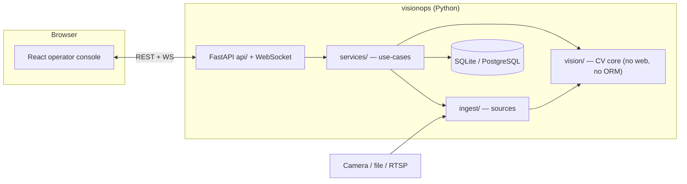

# VisionOps

**Production-grade computer-vision operations platform.**
V0.1: restricted-zone intelligence — run a camera, draw a zone, get durable events
with evidence, and watch it live — on a laptop with no GPU, no cloud and no camera.

[](https://github.com/okwedavid/VisionOPs/actions/workflows/ci.yml)

---

## What it is

VisionOps turns a video source into a running, inspectable detection pipeline:

- **Ingest** a browser webcam, a video file, a V4L2 device, or an RTSP/HTTP stream.
- **Detect** with a YOLO-family ONNX model on CPU (ONNX Runtime), frame-by-frame,
  with rate control, back-pressure and honest health reporting.
- **Track** detections across frames (constant-velocity Kalman + IoU association).
- **Reason** about geometry: polygon/line zones, dwell time, cooldown, severity.
- **Record** every zone transition as an append-only event with a snapshot.
- **Observe** live: an overlay canvas at capture FPS plus a throttled HUD.

Everything an operator does is behind one API-key gate, tenant-scoped, audited and
retention-managed. See [`docs/PRD.md`](docs/PRD.md) for the full specification.

## Capabilities (V0.1)

| Area | Included |
| --- | --- |
| Sources | browser webcam (WebSocket frame ingest), file, V4L2 device, RTSP/HTTP |
| Detection | ONNX Runtime, CPU provider, configurable input size, class filter, NMS |
| Tracking | Kalman box filter, IoU association, hit/age scoring |
| Zones | polygon + line, class filter, min-dwell, cooldown, severity |
| Events | append-only, org-scoped, filter/search/paginate, summarise, CSV/JSON export |
| Live | per-session WebSocket state stream + browser frame ingest |
| Security | API-key auth, per-key rate limiting, credential encryption (AES-256-GCM), audit trail |
| Ops | health/readiness, Prometheus metrics, retention pruning, typed settings, operator CLI |

## Architecture



`vision/` depends on nothing but NumPy/OpenCV/ONNX Runtime. `api/` never touches the
ORM directly; `db/scoped.py` is the single tenant-isolation chokepoint. The dependency
direction is documented in [`docs/ARCHITECTURE.md`](docs/ARCHITECTURE.md) and enforced
by tests.

## Tech stack

- **Backend:** Python 3.11–3.13, FastAPI, Pydantic v2, SQLAlchemy 2, Alembic,
  ONNX Runtime, OpenCV (headless), NumPy, `cryptography`.
- **Frontend:** React 19, TypeScript, Vite 6, TanStack Query, Tailwind CSS 4, Vitest.
- **Tooling:** `uv` (Python), `npm` (web), `make` (the canonical command surface — ADR-023).

## Prerequisites

- [`uv`](https://docs.astral.sh/uv/) ≥ 0.5 and Python 3.11+
- Node.js ≥ 20 and npm
- `make`
- *(Optional)* an NVIDIA/CUDA runtime for a GPU execution provider; not required.

## Quick start (no Docker)

```bash
git clone https://github.com/okwedavid/VisionOPs.git
cd VisionOPs

make install     # uv sync (backend) + npm ci (frontend)
make env         # .env from .env.example, with a random master key + bootstrap key
make model       # download yolo11n ONNX (~11 MB) into ./models
make demo        # seed an organisation/site/camera/source/zone on the fixture video
make dev         # API on :8000, Vite dev server on :5173
```

Open <http://localhost:5173>, paste the API key printed by `make env` when prompted, then
open the **Camera** page and press **Start session**.

**No camera? No model?** `make demo` wires a camera to the committed synthetic fixture
(<`samples/fixtures/zone-walkthrough.mp4`>) so the whole flow — detections, zone events,
history, live overlay — runs offline with zero hardware. The fixture is clearly labelled
synthetic: it exercises the pipeline, not detection accuracy.

## Command surface

Run `make` for the full, self-documenting list. The essentials:

| Target | Does |
| --- | --- |
| `make install` | Install backend + frontend dependencies |
| `make env` | Create `.env`, generate master key, run `visionops init` |
| `make model` | Download and verify the detection model |
| `make dev` / `make dev:fixture` | Run API + web app (optionally seed the demo first) |
| `make demo` | Seed the hardware-free fixture demo |
| `make migrate` / `make migrate-test` | Apply / round-trip migrations |
| `make lint` / `make format` / `make typecheck` | Ruff, ruff-format, mypy |
| `make test` / `make test-cov` | Backend tests / with coverage gates |
| `make test-cv` / `make test-security` / `make test-model` | Focused suites |
| `make test-frontend` / `make test-e2e` | Vitest (+coverage gate) / Playwright |
| `make test-all` | Everything runnable locally |
| `make build` | Frontend bundle + Python wheel |
| `make prune` / `make bench` | Apply retention / measure performance |

The `visionops` CLI is the same surface without `make`:
`visionops serve | init | key | migrate | model | prune | bench | demo`.

## Configuration

Copy [`.env.example`](.env.example) to `.env` (or just run `make env`) and edit.
Every variable has a working default for local development **except**
`VISIONOPS_MASTER_KEY`, which is required only when storing camera credentials.
`.env` is gitignored and holds real secrets — never commit it.

Key variables (full table in [`docs/DEPLOYMENT.md`](docs/DEPLOYMENT.md)):

| Variable | Default | Purpose |
| --- | --- | --- |
| `VISIONOPS_ENV` | `local` | `local`/`development`/`staging`/`production` |
| `VISIONOPS_DATABASE_URL` | `sqlite:///./data/visionops.db` | SQLite or `postgresql+psycopg://…` |
| `VISIONOPS_MEDIA_ROOT` | `./data/media` | Containment boundary for `file` sources |
| `VISIONOPS_MASTER_KEY` | — | AES-256-GCM key for camera credentials |
| `VISIONOPS_RATE_LIMIT_RPS` | `10` | Per-key request rate |
| `VISIONOPS_MAX_SESSIONS` | `4` | Concurrent pipeline cap |

## Testing

Everything runs on a laptop: **no camera, no GPU, no network**. The CV logic that
produces customer events is tested *exactly* with a scripted detector and an injected
clock; real-model tests are marker-gated and skipped (never faked) when weights are absent.

```bash
make test          # unit + cv + integration + api + security
make test-cov      # + coverage gates (vision core ≥ 85%, backend ≥ 75% line coverage)
make test-frontend # vitest with the ≥ 70% coverage gate
make test-e2e      # Playwright against a real backend + built SPA
```

See [`docs/TESTING.md`](docs/TESTING.md) for the strategy and marker scheme.

## Project layout

```
backend/visionops/   Python: API, services, vision engine, ingest, db, realtime
frontend/            React + TypeScript operator console (Vite)
tests/               Python suites: unit, cv, integration, api, security
frontend/e2e/        Playwright browser end-to-end tests
infra/               Dockerfiles, compose, nginx, systemd unit
scripts/             fixture generation, coverage gate, helpers
samples/             synthetic fixture video + provenance
docs/                product + engineering documentation (read first)
```

## Deployment

Production runs the API behind nginx (same-origin SPA + WebSocket), against PostgreSQL,
under systemd or Docker. See [`docs/DEPLOYMENT.md`](docs/DEPLOYMENT.md) for the runbook
and [`infra/`](infra/) for ready-made artefacts.

For a quick hosted test on Render, the committed [`render.yaml`](render.yaml) Blueprint
deploys a single Docker service (API + SPA, SQLite): see
[`docs/RENDER.md`](docs/RENDER.md).

## Security & privacy

API-key auth, per-key and per-IP rate limiting, encrypted camera credentials, path
containment for `file` sources, an append-only audit trail, and privacy-by-default
(snapshots off by default). Report vulnerabilities per [`SECURITY.md`](SECURITY.md);
the threat model is in [`docs/SECURITY_PRIVACY.md`](docs/SECURITY_PRIVACY.md).

## Roadmap

V0.1 is restricted-zone intelligence on a single node. The next phases (multi-camera
scaling, edge/control-plane split, cloud uplink, more detectors) are tracked in
[`docs/ROADMAP.md`](docs/ROADMAP.md).

## License

MIT — see [`LICENSE`](LICENSE).
