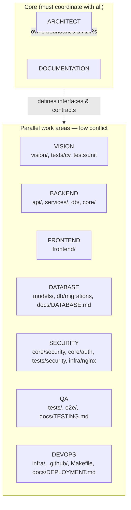
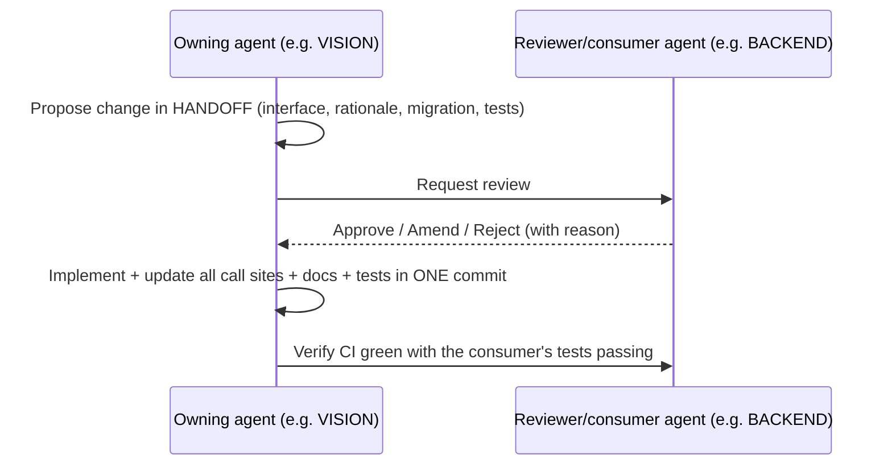

# VisionOps — Agent Workflow

> **Audience:** AI coding agents (OpenCode and equivalents) and the humans supervising them.
> **Purpose:** make parallel, autonomous work on this repository **safe and non-conflicting**, with a clear ownership map, a shared file-based communication channel, and an honest completion report.
> **Core rule: no agent modifies anything it has not first read, and no agent claims a capability it has not executed.**

---

## 1. Operating principles

1. **Read before write.** Every agent starts with: `git status` → `docs/PRD.md` (scope) → `docs/ARCHITECTURE.md` (boundaries) → the module it will touch → the existing tests for it. Skipping this is the single largest source of wasted work and accidental regressions.
2. **Own your directory.** Specialisation by path (§3). Touching another agent's area requires coordination through a handoff file (§4), not an edit.
3. **One concern per change.** No drive-by refactors in a feature commit. Refactors land separately so a bisect stays meaningful.
4. **Tests are part of the change.** A behaviour change without a test is incomplete. A bug fix without a failing-then-passing test is not merged.
5. **Never weaken a gate.** Do not delete a test, lower a coverage threshold, add `# noqa`/`@ts-ignore` to silence a real error, or mark a test `xfail` to make CI green. Fix the cause or document the reason in the PR.
6. **Fail loudly, never fake.** A failing test is information. A mocked "success" is sabotage.
7. **No secrets, ever.** No real keys, tokens, passwords, camera URLs with credentials, or `.env` files. If you find one, remove it from the working tree and report it — do not commit it.
8. **Honest reporting.** If you could not verify something, say so explicitly. "Implemented, untested" is a legitimate status; "complete" without execution is not.

---

## 2. Standard agent session

```bash
# 1. Orient
git status                      # never start dirty without understanding why
git log --oneline -10           # recent intent and conventions
cat docs/AGENT_WORKFLOW.md      # this file

# 2. Scope — confirm the change fits YOUR area (§3)
#    If it does not, stop and coordinate (§4).

# 3. Read before write
#    - the module and its neighbours
#    - its tests
#    - the relevant doc section
#    - conventions in docs/REPOSITORY_STRUCTURE.md §8

# 4. Implement (narrowly)
#    - follow existing patterns; do not introduce a new library
#    - if a dependency is genuinely needed, add an ADR first (docs/TECHNICAL_DECISIONS.md)

# 5. Validate — run these, do not assume
make lint && make typecheck && make test        # or the subset for your area
npm --prefix frontend run lint && npm --prefix frontend run typecheck   # frontend areas

# 6. Commit — logical, conventional message
git add <only your files>
git commit -m "feat(vision): add two-stage low-confidence re-association"

# 7. Report (§7)
```

**Definition of "done" for an agent:** change implemented, tests written and passing, lint and typecheck clean, docs updated if behaviour changed, commit made, report written. Anything less is reported as partial with the exact remaining step.

---

## 3. Agent roles and ownership



| Agent | May modify | Must inspect first | Validation it owns | Never does |
| --- | --- | --- | --- | --- |
| **ARCH** | `docs/ARCHITECTURE.md`, `docs/TECHNICAL_DECSIONS.md`, `docs/REPOSITORY_STRUCTURE.md`, `docs/PRD.md` | Whole repo shape, all docs, git history | Consistency of diagrams vs code; ADR coverage | Write feature code; change runtime behaviour |
| **VISION** | `backend/visionops/vision/**`, `backend/visionops/ingest/**`, `tests/cv/**`, `tests/unit/test_{geometry,preprocess,postprocess,kalman,tracker,zones,event_engine}*`, `docs/VISION_ENGINE.md`, `docs/EVENT_ENGINE.md` | `vision/contracts.py` first (the interface others depend on), existing CV tests, the model adapter | `make test-cv`; determinism of every new rule; import-graph guard (no web/ORM imports) | Touch `api/`, DB models, or frontend; change a published event type's meaning |
| **BACKEND** | `backend/visionops/api/**`, `services/**`, `core/**` (except security/auth), `realtime/**`, `schemas/**`, `docs/API.md` | `api/deps.py`, service patterns, `docs/API.md` | `make test`, `tests/api/**` | Modify `vision/` internals (only the interfaces); change the DB schema without DBA |
| **FRONTEND** | `frontend/**`, `docs/FRONTEND.md` | `frontend/src/lib/api.ts` (typed client), `types/api.ts`, an existing page for patterns | `npm run lint`, `npm run typecheck`, `npm run test` | Hand-write API types that diverge from the backend; add a chart/animation library without an ADR |
| **DATABASE** | `backend/visionops/models/**`, `db/migrations/**`, `db/scoped.py`, `docs/DATABASE.md` | `docs/DATABASE.md`, existing migrations, all query paths in `services/` | `make migrate-test` (up/down on both dialects), `tests/integration/**` | Drop or rename a column without a data migration + downgrade path; remove an index used by a query |
| **SECURITY** | `backend/visionops/core/{security,auth,ratelimit}.py`, `core/logging.py`, `infra/nginx/**`, `tests/security/**`, `docs/SECURITY_PRIVACY.md`, `SECURITY.md` | `docs/SECURITY_PRIVACY.md` threat model, `core/ids.py`, audit service | `make test-security`; redaction tests; a threat-model update | Weaken a control to make something convenient; add telemetry that leaves the host without an ADR |
| **QA** | `tests/**`, `e2e/**`, `docs/TESTING.md`, CI test jobs | `docs/TESTING.md`, existing test patterns and fixtures | The full suite; acceptance criteria verification | Reduce coverage thresholds; delete/skip a failing test; write a test that asserts on a real model's exact output (non-deterministic) |
| **DEVOPS** | `infra/**`, `.github/**`, `Makefile`, `.env.example`, `docs/DEPLOYMENT.md`, `scripts/**` | `docs/DEPLOYMENT.md`, CI workflows, `Makefile` | `docker build` config lint, workflow syntax, a clean-checkout rehearsal | Change a default that affects runtime behaviour without updating `.env.example` + docs; add a cloud dependency to a local path |
| **DOCUMENTATION** | `docs/**`, `README.md`, `CHANGELOG.md`, `CONTRIBUTING.md` | **The code** — every claim must be verified against reality | A documentation-vs-code audit pass; link check; command verification | Document a feature that does not exist; leave a `FUTURE` item described as `CURRENT` |

### Shared surfaces (coordination required)

| Surface | Why | Rule |
| --- | --- | --- |
| `vision/contracts.py` | Every agent depends on it | VISION proposes; ARCH approves before merge |
| `schemas/*.py` ↔ `frontend/types/api.ts` | API contract | BACKEND and FRONTEND change them in the same PR, generated/verified |
| `pyproject.toml` / `package.json` | Dependency policy | ADR required; SECURITY and ARCH review |
| `docs/API.md` | Contract documentation | BACKEND owns the endpoints; FRONTEND owns the client mapping |
| CI workflows | Shared gate | QA and DEVOPS coordinate; nobody disables a gate to pass |
| `Makefile` | Everyone runs it | DEVOPS owns; others request additions |

---

## 4. Communication between agents (file-based, git-native)

Agents communicate through **small, committed files**, not through conversation. This makes the reasoning auditable and survives context loss.

### 4.1 Handoff notes — `.agent/HANDOFF/<topic>.md`

```markdown
# Handoff: two-stage low-confidence re-association
From: VISION        To: VISION, QA
Status: proposed | in-progress | blocked | done
Date: 2026-01-01
Scope: vision/tracker.py, tests/unit/test_tracker.py
Interface change: no (Tracker protocol unchanged)  ← critical for other agents
Decision needed: none | <question>                    ← ARCH must answer
Validation: `make test-cv` → 41 passed
Residual risk: crowd ID switches unchanged
Commits: abc1234
```

Create one file per topic. Delete/collapse it when the work is merged into the main docs. `AGENTS.md` at the repo root indexes the live ones.

### 4.2 Blocking questions

If an agent needs a decision outside its ownership, it writes a `HANDOFF` with `Decision needed:` and continues on everything else. It does **not** guess, and does **not** proceed into the other area.

### 4.3 Contract-change protocol (interface first)



Rules: interface changes are **additive or fully specified**; a breaking change requires an ADR and a migration path; a commit that changes a contract must update the consumer in the same commit (or the repo is broken at that commit, which is worse).

---

## 5. Avoiding conflicts

| Technique | Rule |
| --- | --- |
| **Path ownership** | One agent owns a path. If a change needs another's path, it is a handoff, not an edit. |
| **Small commits** | One concern per commit, so conflicts are one-file, not repository-wide. |
| **Contract-first** | The interface (or API schema) lands in the same commit as its implementation — never "interface in one PR, implementation later" for a shared seam. |
| **Re-read before write** | If a file changed since you last read it (`git status`, `git log`), re-read before editing. |
| **No reformatting** | Never reformat or reorder files you are not changing — it destroys mergeability and reviewability. |
| **No drive-by upgrades** | Do not bump unrelated dependency versions, even to "fix a warning". |
| **Rebase-friendly** | Commit early and often; do not leave a half-finished refactor in the working tree across sessions. |
| **Branch naming** | `main` is always releasable. Work on `feat/<scope>-<short>`, `fix/<short>`, `docs/<short>`. |
| **Do not commit generated artefacts** | No `node_modules/`, `.venv/`, `data/`, model weights, `*.db`, build output, `.env`, or coverage artefacts. Check `.gitignore` first. |
| **Do not rewrite history** | No force-push to `main`, no amend of shared commits, no rebasing someone else's branch. |

---

## 6. Git usage

```bash
# Start
git switch -c feat/vision-line-zones

# Before every commit
git status                     # only intended files
git diff --stat                # what actually changed
git diff                       # read it — do not skim

# Commit (Conventional Commits)
git add <specific paths>
git commit -m "feat(zones): add direction-aware line-crossing strategy"
# Body: why, not what. Reference the HANDOFF topic and the acceptance criteria covered.

# Verify
git log --oneline -3
make test                      # the commit must be green on its own
```

**Message conventions:** `type(scope): summary` with types `feat|fix|docs|test|refactor|perf|build|ci|chore`. Scopes mirror the roles (`vision`, `api`, `web`, `db`, `security`, `infra`, `docs`). Examples:

```
feat(vision): add IoU association for low-confidence detections
fix(api): return 404 instead of 403 for cross-organisation camera ids
test(cv): assert exact event sequence for the scripted 60-frame walk
docs(deploy): document Postgres restore drill for the runbook
chore(deps): pin fastapi to 0.115 range in uv.lock
```

**Never:** `git add .` without reading the diff; `git commit -a` on a large diff; amending a pushed commit; force-pushing `main`; committing with `--no-verify` to skip hooks.

---

## 7. Completion report format

Every agent ends its run with this structure (in the conversation, and in the PR description when applicable):

```markdown
## Status: complete | partial | blocked

### What changed
- `<path>` — <one line, per file or per concern>

### Why
- <the problem being solved, and the decision taken>

### Validation actually executed
- `make lint` → pass
- `make typecheck` → pass
- `make test` → 212 passed, 1 skipped (`test_model_marker`, no weights)
- `npm --prefix frontend run build` → pass (bundle 148 kB gzip)

### Interface / contract changes
- none | <what changed, who consumes it, migration needed>

### Not done / follow-ups
- <explicit list; "nothing" only if truly nothing>

### Risks and known limits
- <what could break, what was not tested, what needs human approval>
```

**Honesty rules for this report:**
- List only commands that were run, with their real output summarised.
- "Skipped" is a valid outcome; "passed" for something not executed is not.
- If a test fails and you could not fix it, report the failure and the diagnosis. Never delete or skip the test to make the run green.
- If you deviated from your assignment, say so in `Not done` and explain why.

---

## 8. Definition of done (checklist, applies to every agent)

- [ ] Read the relevant docs and existing code before writing
- [ ] Changed only files inside my ownership area (or have a handoff for the rest)
- [ ] Added or updated tests; they fail without my change and pass with it
- [ ] `make lint`, `make typecheck`, `make test` (plus frontend equivalents) pass for my area
- [ ] No new dependency without an ADR
- [ ] No secrets, no `.env`, no generated artefacts, no model weights committed
- [ ] Docs updated if behaviour or configuration changed
- [ ] Commit message follows the convention and explains *why*
- [ ] Completion report written with commands actually executed
- [ ] Residual risks and follow-ups stated explicitly

---

## 9. Human checkpoints (agents stop and ask)

Agents must not decide these unilaterally:

| Decision | Why it needs a human |
| --- | --- |
| New runtime dependency | Dependency policy is a product decision (ADR-021) |
| Breaking API or event-schema change | External contract; needs deprecation planning |
| New database table/column | Schema is a long-term commitment; DATABASE + ARCH review |
| Anything touching authentication, crypto, or secrets | Security-critical; SECURITY + ARCH review |
| Changing a privacy-relevant default (retention, snapshot storage, detections persistence) | Legal/ethical impact |
| Adding any face/identity/biometric capability | Explicitly out of scope by ADR-018; would require a product-level decision |
| Changing the deploy target or adding a cloud dependency | Cost and portability impact |
| Modifying or disabling a CI gate | Quality gate integrity |
| Publishing, tagging or releasing | Release authority is human |
| Editing `docs/PRD.md` scope or roadmap commitments | Product commitment |

---

## 10. Agent anti-patterns (explicitly prohibited)

| Anti-pattern | Why it is prohibited |
| --- | --- |
| Deleting or skipping a failing test | Destroys the only thing that catches the regression |
| Adding `TODO`-driven stubs presented as features | Fake functionality is worse than absent functionality |
| Mocking a "successful" inference in production code | Real deployments would break; a test-only fake belongs in tests |
| Catching broad exceptions and returning success | Hides real failures; breaks the "fail loudly" principle |
| Duplicating business logic in a router or component | Two sources of truth; the copy will drift |
| Reformatting unrelated files | Destroys reviewability and mergeability |
| Bumping dependencies to silence a warning | Hides a real issue; expands the supply chain |
| Weakening validation to make a UI work | Pushes a security problem to the backend |
| Writing enormous files (500+ lines) to avoid splitting | Unmaintainable; the repo structure doc defines module boundaries |
| Committing `node_modules`, `.venv`, `data/`, model weights, `*.db` | Repository hygiene; possibly secrets |
| Claiming a capability without running it | The cardinal sin of AI-assisted engineering |
| Editing outside your area without a handoff | Causes conflicts and confusing diffs |
| Silently changing public interfaces | Breaks consumers; violates the contract-first protocol |
