# VisionOps — System Architecture

> **Audience:** a senior engineer joining the project who needs to understand how the system works end to end.
> **Scope of accuracy:** diagrams and prose describe the **implemented V0.1** unless explicitly tagged `NEXT` / `FUTURE`.
> **Companion docs:** `TECHNICAL_DECISIONS.md` (why), `REPOSITORY_STRUCTURE.md` (where), `VISION_ENGINE.md` (the CV core).

---

## 0. Architectural rules of the road

Five rules govern every design decision. Breaking one requires an ADR (`docs/TECHNICAL_DECISIONS.md`).

1. **The CV core is a library, not a service.** `backend/visionops/vision/` imports no web framework, no ORM and no network library. It is a synchronous, deterministic, injectable pipeline. This is what makes it testable, embeddable in an edge agent, and replaceable model-by-model.
2. **Events are the only durable product.** Detections, frames and tracks are ephemeral working state. Everything a customer cares about survives as a typed, structured, queryable event.
3. **Normalised geometry everywhere.** All coordinates crossing a boundary (detection, zone, event metadata, WebSocket payloads, stored rows) are floats in `[0,1]`. Resolution never leaks into the data model.
4. **Dependencies point inward.** `api → services → {db, ingest, realtime}` and `ingest → vision`. Never the reverse. No circular imports, no service locator.
5. **Failure is a state, not an exception.** Camera and model problems transition a session to `DEGRADED`/`FAILED` with a reason code that the UI renders. Crashing is reserved for genuine process corruption.

---

## 1. Overall system

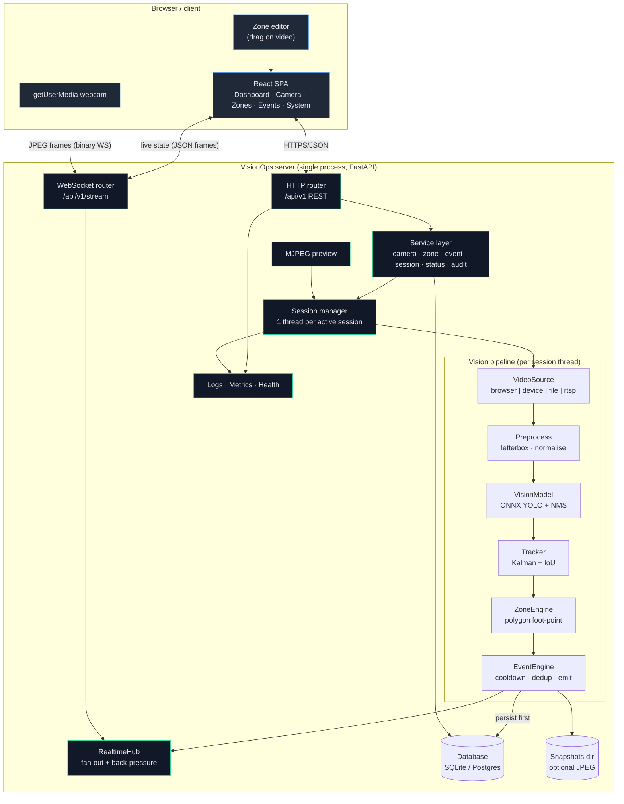

**Single process on purpose.** V0.1 runs the API, the WebSocket hub and the inference pipeline in one OS process, because the pipeline is CPU-bound and blocking while the API is I/O-bound — and separating them buys nothing until we have more than a handful of cameras. The seams for extraction (`VideoSource`, `EventSink`, `SessionManager`) already exist (§3.3 and §20 in `TECHNICAL_DECISIONS.md`), so Phase 2 splits a worker out without touching the vision code or the API contract.

### 1.1 Request lifecycle, end to end

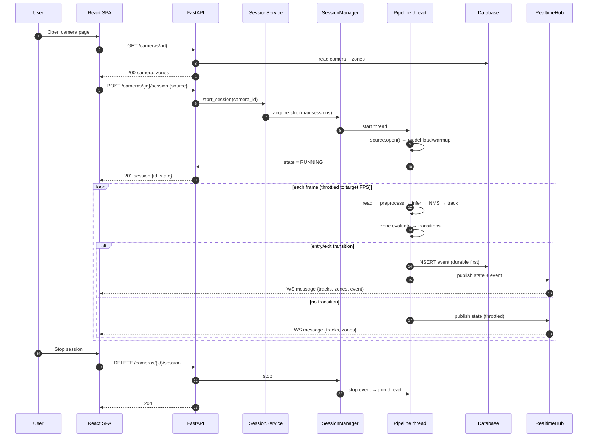

---

## 2. Camera → CV pipeline

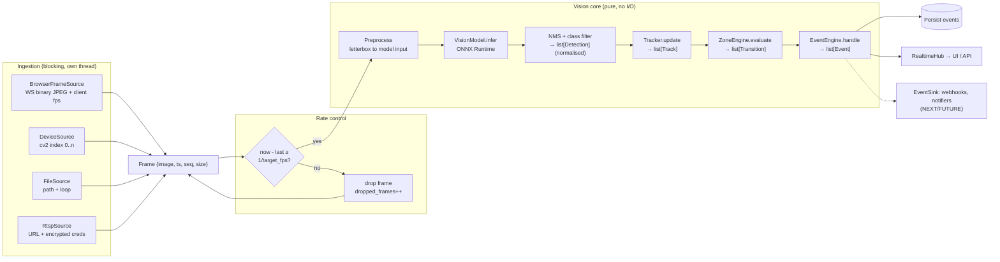

Key properties:

- **One source, one thread, one pipeline instance.** No shared mutable state between sessions except the loaded model session and read-only config.
- **Frame dropping is explicit** (`dropped_frames` counter, exposed in System Status). A slow model never creates a growing backlog.
- **Failure containment:** every stage can raise. The pipeline converts a stage failure into a session state change (`DEGRADED`) plus a metric, and keeps the loop alive so transient problems self-heal.

---

## 3. Real-time processing

### 3.1 Frame and state rates

| Stage | Rate | Why |
| --- | --- | --- |
| Capture | source native (25–30 fps typical) | Cannot be controlled |
| Inference | `VISIONOPS_TARGET_FPS` (default 5, range 1–30) | CPU budget; freshness |
| Overlay publish | `VISIONOPS_PUBLISH_FPS` (default 10) | Human perception; UI smoothness |
| Event write | only on transitions | Write amplification control |
| Metrics flush | on demand / every N seconds | Cheap |

### 3.2 Live state payload (WebSocket, one JSON object per publish)

```jsonc
{
  "type": "session.state",
  "session_id": "…",
  "camera_id": "…",
  "seq": 1042,
  "server_time": "2026-01-01T10:00:00.123Z",
  "source": { "state": "RUNNING", "fps": 4.9, "frames": 812, "dropped": 3, "reason": null },
  "ai":     { "state": "READY", "model": "yolo11n", "sha256": "…", "latency_ms_p95": 38 },
  "stats":  { "active_tracks": 3, "in_zone": 2, "processed_fps": 4.8, "frame_age_ms": 61 },
  "tracks": [ { "id": 12, "label": "person", "confidence": 0.91,
                "box": [0.31, 0.22, 0.44, 0.86], "in_zone": ["front-desk"], "age": 42 } ],
  "zones":  [ { "id": "…", "name": "front-desk", "polygon": [[0.3,0.3],[0.7,0.3],[0.7,0.9],[0.3,0.9]],
                "color": "#f97316", "severity": "warning", "occupancy": 1 } ],
  "events": [ { "id": "…", "type": "ZONE_ENTERED", "occurred_at": "…", "zone_id": "…",
                "track_id": 12, "severity": "warning", "metadata": { "dwell_seconds": null } } ]
}
```

`events` is present **only** on the publish that carries a transition, so the UI can toast precisely. A reconnecting client always re-fetches history over REST (`GET /events?since=…`), which keeps the socket ephemeral and the database authoritative.

### 3.3 Realtime fan-out and back-pressure

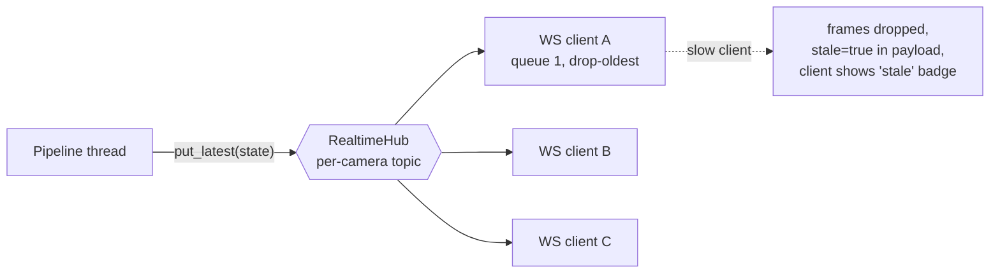

- **One topic per camera**, each with a single-slot latest-value buffer. If a client cannot keep up, it misses intermediate states (they are not durable information) rather than accumulating memory. Events are durable, so no information is lost.
- **Heartbeat + timeout:** the hub sends a ping every 20 s and drops clients that miss two rounds.
- **Extraction seam:** `EventSink` is the publisher interface. `RealtimeHub` is one implementation; `NotificationDispatcher` and `WebhookDispatcher` become others without touching the pipeline.

---

## 4. Event generation

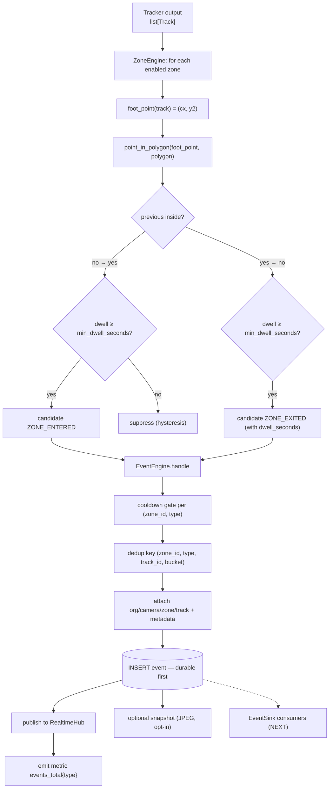

### 4.1 Why the foot point

A person's box spans head to feet. The **bottom-centre** of the box is the most reliable single point for "is this person in this area", because it corresponds to the ground contact of the body:

- Using the box centre misclassifies a person leaning over a threshold.
- Using the top-left corner (naïve IoU-based zone logic) is arbitrary.
- Using the box centre makes a *tall person's head* count as inside a zone that their feet never entered.

Full rationale, edge cases and alternatives in `docs/VISION_ENGINE.md` §Zone geometry.

### 4.2 Event lifecycle

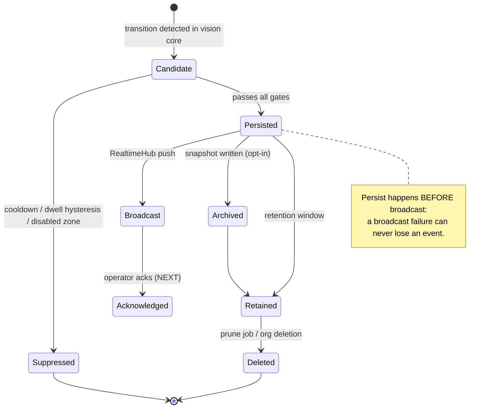

---

## 5. Database relationships

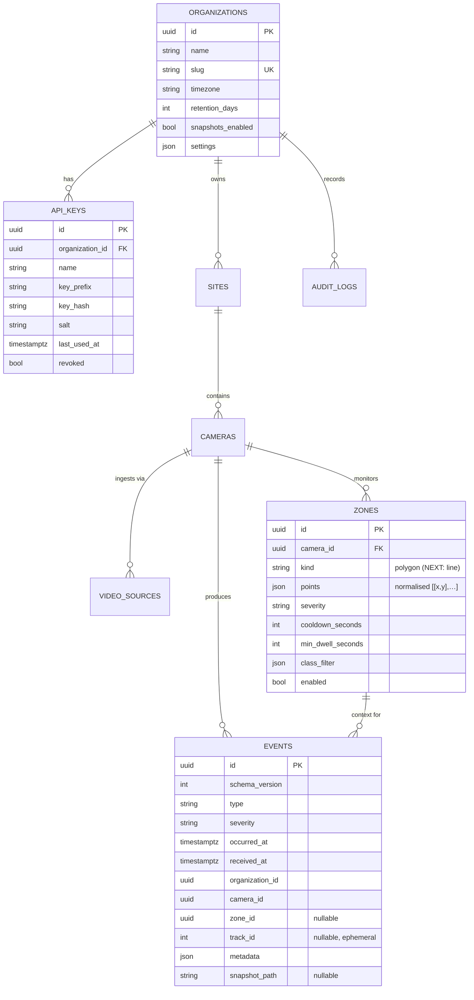

Full table documentation — every field, index, retention rule and security note — is in `docs/DATABASE.md`. Design highlights:

- **`organization_id` on every domain row.** Enforced through one scoped repository helper so it cannot be forgotten.
- **`events` is append-only** and indexed `(organization_id, occurred_at DESC)` for the default feed, plus per-camera and per-zone indexes and a type index.
- **No `detections`/`tracks` tables in V0.1** — they are high-volume, low-value, and would leak behavioural trails. They are designed (with retention) in `docs/DATABASE.md` for the phase that needs them.
- **UUID primary keys, time-ordered UUIDv7** so that index locality survives future volume, and so events created on an edge node can be deduplicated on sync (`FUTURE`).

---

## 6. Authentication

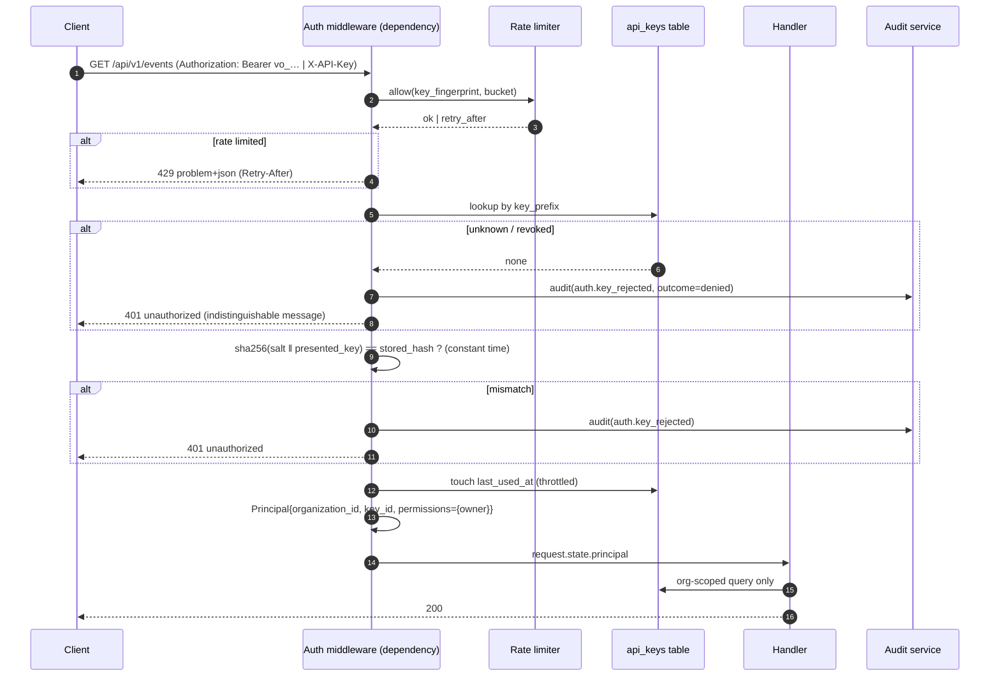

Rules that matter:

- Keys are **hashed with a per-key random salt** (SHA-256). Keys are 32 random bytes, so brute force is infeasible and a fast hash keeps lookup O(1) — unlike a password. Constant-time comparison prevents timing leakage.
- **Uniform 401.** Unknown key, revoked key and bad signature produce byte-identical responses so the endpoint cannot be used as a key oracle.
- **Exempt paths:** `/healthz`, `/readyz`, `/api/v1/docs`, `/api/v1/openapi.json`. Documented as an intentional trade-off (discoverability of the API contract without credentials).
- **Bootstrap:** on first run, if `VISIONOPS_API_KEY` is set, it is hashed into the database and never stored in plaintext; if unset, a random key is generated, printed **once** to the console and to `.env` with `0600` permissions.
- **Permission checks exist now** (`Principal.can("zone.write")`) even though V0.1 has a single owner principal, so Phase 6 adds multi-user authz without rewriting handlers.

---

## 7. Multi-tenancy

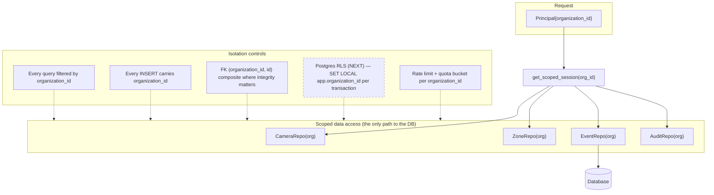

- **Structural (V0.1):** single-org *operationally*, multi-org *structurally*. Cross-org reads are impossible through the service layer; a negative test asserts it.
- **Cross-organisation references return 404, not 403** — an attacker must not be able to probe for the existence of another tenant's resources.
- **Phase 6 adds:** users, memberships, roles, Postgres RLS as defence in depth, per-org encryption key option, per-org quotas and rate limits, and an org-deletion job.

---

## 8. Cloud deployment

```mermaid
flowchart TB
  subgraph Edge["Site / edge (optional)"]
    EC["Cameras (RTSP)"] --> EG["Edge agent (Phase 7)<br/>same vision pipeline<br/>events-only uplink"]
  end

  subgraph Cloud["Cloud (Phase 10 target)"]
    LB["Load balancer / WAF<br/>TLS termination"]
    WEB["Static web app (CDN)"]
    API["API replicas (stateless) ×N"]
    WQ["Pipeline workers ×N<br/>(one camera set each)"]
    DB[("Postgres<br/>partitioned by month")]
    CACHE[("Redis<br/>fan-out + rate limits")]
    OBJ[("Object storage<br/>snapshots / clips")]
    OBS["Logs · Metrics · Traces<br/>+ alerting"]
  end

  CUST["Customers / integrators"] -->|"HTTPS + API key / OAuth2"| LB
  CUST -->|"HTTPS"| WEB
  WEB -->|"REST"| LB
  LB --> API
  API --> DB
  API --> CACHE
  API --> OBJ
  WQ --> DB
  WQ --> CACHE
  API -.->|"publish state"| CACHE
  WQ -.->|"publish state"| CACHE
  CACHE -.->|"subscribe (WS)"| API
  EG -->|"HTTPS: events batch, resumable, idempotent"| LB
  API & WQ & DB & CACHE --> OBS

  style EG stroke-dasharray: 5 5
  style Cloud fill:#0b1220,stroke:#475569
```

Migration path from V0.1: the single process already *is* this topology collapsed. Extraction order and the exact interfaces are specified in `docs/DEPLOYMENT.md` §Scaling and `docs/TECHNICAL_DECISIONS.md` ADR-002.

**Bandwidth rule:** cameras are pulled from inside the customer's network whenever possible. The platform never *requires* customers to stream raw video to our cloud, which is both a cost decision and a privacy decision.

---

## 9. Edge deployment

```mermaid
flowchart TB
  subgraph Site["Customer site — fully autonomous"]
    CAMS["IP cameras (RTSP)"]
    BOX["Edge box<br/>x86 NUC / ARM SBC / Jetson<br/>API + pipeline + local SQLite"]
    STO[("Local event store<br/>WAL SQLite")]
    UI["Local UI on LAN"]
    CAMS --> BOX --> STO
    UI <--> BOX
  end

  subgraph CloudP["Control plane (optional)"]
    CP["Control API<br/>config + health + fleet"]
    CC[("Central event store<br/>aggregated / long retention)"]
    CP <--> CC
  end

  BOX -->|"1. config push (signed, versioned)"| CP
  BOX -->|"2. events batch (UUID-idempotent, resumable cursor,<br/>default: NO video)"| CP
  CP -->|"3. heartbeat / health"| BOX
  CP -.->|"site offline is reported honestly"| DASH["Fleet dashboard"]

  style Site fill:#0b1220,stroke:#34d399
  style CloudP stroke-dasharray: 5 5
```

Edge properties that the V0.1 architecture already supports:

- The pipeline writes to a repository interface over a local file database → same code on a $90 SBC.
- Events carry client-generated UUIDs → deduplicated sync.
- Model weight is a file with a recorded SHA-256 → reproducible offline installs.
- If the control plane is unreachable, the site keeps detecting and alerting locally, and the queue drains when connectivity returns (bounded, with back-pressure and a documented drop policy).

---

## 10. Future AI agent architecture

```mermaid
flowchart TB
  Q["Analyst question<br/>'Any unauthorised entry to Bay 4 last night?'"]
  R{"Can a deterministic query<br/>express this?"}
  D["Deterministic path<br/>SQL over events/aggregates<br/>→ answer + table"]
  P["Planner (LLM)<br/>structured intent only,<br/>no raw SQL, no raw video"]
  T["Tool layer (read-only, allow-listed)"]
  T1["search_events(filters, window)"]
  T2["get_event(id)"]
  T3["aggregate(zone, camera, window, bucket)"]
  T4["describe_zone(id)"]
  T5["export_window(window, format)"]
  EV["Evidence set<br/>event IDs + aggregate rows"]
  A["Answer composer<br/>EVERY numeric claim cites an event ID or aggregate row"]
  CITE["Citation checker<br/>re-verifies each claim against the DB"]
  OUT["Cited answer / narrative report"]
  T --> T1 & T2 & T3 & T4 & T5
  T1 & T2 & T3 & T4 & T5 --> EV
  EV --> A --> CITE
  CITE -->|"all claims verified"| OUT
  CITE -->|"unverifiable claim"| FIX["Retry once, then abstain"]
  A -.->|"never"| DENY["Write / delete / raw video<br/>NOT AVAILABLE to the agent"]

  style DENY fill:#3b0d0d,stroke:#ef4444
```

Non-negotiable constraints (design now, enforce in Phase 9):

1. **Read-only.** The tool layer has no write verb. No `create`, no `update`, no `delete`, no SQL write.
2. **No raw video or images** ever reach the model — only event metadata, counts and aggregate rows. This keeps the agent inside the privacy posture of the platform.
3. **Citations are mandatory and machine-verified.** The composer is followed by a checker that re-reads each cited event from the database; unverifiable claims are removed or the answer is abstained.
4. **Deterministic first.** Simple questions never touch an LLM. The agent handles only what a query cannot express, which bounds cost and hallucination surface.
5. **Full audit.** Every agent run logs the question, tools used, event IDs touched and the final answer (`metadata`-only, no PII because none exists).

---

## 11. Alert workflow

```mermaid
flowchart LR
  E["Event (durable)"] --> G["Grouper<br/>window=5 min, key=(org,zone,type)"]
  G --> S{"Suppressed?<br/>quiet hours · already alerting · severity floor"}
  S -->|yes| X["count only"]
  S -->|no| A["Alert record<br/>status=open, severity, event_count"]
  A --> P["Policy: channels, retry, escalation"]
  P --> N1["In-app (dashboard)"]
  P --> N2["Email"]
  P --> N3["Slack / Teams"]
  P --> N4["Webhook (HMAC-signed)"]
  P --> N5["SMS"]
  N2 & N3 & N4 & N5 --> R{"Delivered?"}
  R -->|no| RT["Retry with backoff → dead-letter"]
  R -->|yes| L["Delivery log (auditable)"]
  A --> ACK["Operator acknowledges / dismisses"]
  ACK --> FB["Feedback signal → FP-rate telemetry (model regression detection)"]

  style A fill:#0b1220,stroke:#f59e0b
```

V0.1 substitutes the dashboard event feed for delivery; `AlertEngine` is introduced in Phase 4 and consumes the same `EventSink` seam the pipeline already publishes to. Dismissal/acknowledgement feedback becomes the online model-regression signal described in `docs/PRD.md` §33.

---

## 12. Public API

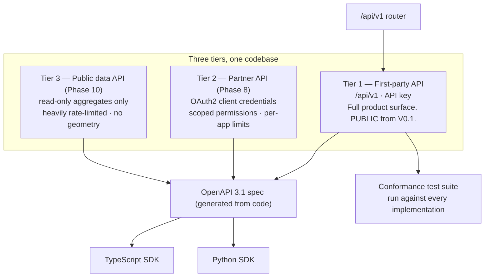

Resource model (V0.1 implemented; the rest is the documented target):

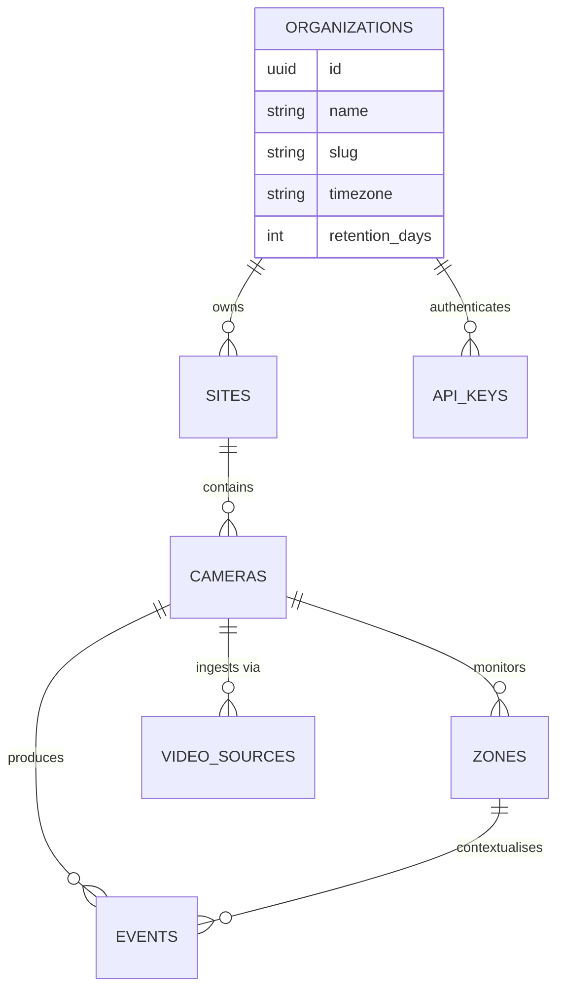

Endpoint groups (V0.1 → Phase 10):

| Group | V0.1 | Next | Future |
| --- | --- | --- | --- |
| Health/system | `/healthz`, `/readyz`, `/system/status`, `/system/metrics` | `/system/diagnostics`, `/models` | `/system/usage`, `/system/billing` |
| Organisation | `GET /organizations/self` | members, invitations, settings | plans, quota |
| Sites | CRUD | schedules, grouping | site analytics |
| Cameras | CRUD + sources | discovery (ONVIF), health probes | firmware |
| Sessions | start/stop/state, preview, stream | batch ops, schedules | remote relay |
| Zones | CRUD | line zones, bulk import, templates | smart suggestions |
| Events | list, detail, summary, export | ack, bulk actions, retention admin | full-text |
| Rules | — | CRUD + evaluation | versioned rollout |
| Alerts | — | list, ack, policies | escalation |
| Analytics | `GET /events/summary` | aggregates, ranges | forecasting |
| Webhooks | — | — | CRUD, deliveries, replay |
| Integrations | — | — | CRUD, marketplace |

Contract rules: RFC 9457 problem details; `request_id` on every response; cursor pagination; ISO-8601 UTC; additive minor changes only; major version bump for breaking changes with a ≥ 12-month sunset.

---

## 13. Data lifecycle

```mermaid
flowchart TB
  subgraph Collect["Collection — minimised at the source"]
    F["Raw frames<br/>in memory only"]
    D["Detections<br/>in memory only"]
    T["Tracks<br/>in memory only"]
  end
  F --> D --> T --> Z["Zone transitions"]
  Z --> E["Event (the durable record)"]
  E --> S{{"Snapshot?"}}
  S -->|off (default)| N1["nothing else stored"]
  S -->|on, opt-in| SN["JPEG file<br/>data/snapshots/…"]
  E --> DB[("Event row")]
  DB --> AGG["Hourly aggregates (NEXT)<br/>recomputable from events"]
  AGG --> RPT["Reports / analytics / AI agent (NEXT/FUTURE)"]
  SN & DB --> RET{{"retention_days<br/>(org default 90)"}}
  RET --> DEL["prune job deletes rows<br/>and orphaned snapshot files"]
  AGG -.->|"longer retention,<br/>no individual identity"| KEEP["Aggregates retained<br/>beyond raw event retention"]

  style DEL fill:#3b0d0d,stroke:#ef4444
  style KEEP fill:#0f2a1a,stroke:#34d399
```

Lifecycle guarantees:

- **Nothing raw is stored.** Frames and per-frame detections die with the process; only transitions become events.
- **Events are the system of record** and aggregates are a derived, rebuildable projection — so a bug in aggregation can be fixed by recomputation, and retention of raw events does not lose the long-term trend.
- **Retention is enforced by a job, not by hope** (`visionops prune --dry-run` shows what it would delete; the scheduled run is documented and tested).
- **Deletion cascades correctly:** removing a zone does not remove historical events (they keep the zone name in metadata), so history stays truthful.
- **Export at any time** (CSV/JSON) for portability and data-subject requests.

---

## Appendix A — Component responsibilities

| Component | Owns | Must never |
| --- | --- | --- |
| `api/` | HTTP shape, auth dependency, validation, status codes | Touch the DB, contain business rules |
| `services/` | Use-cases, transactions, orchestration | Know about HTTP or SQLAlchemy sessions |
| `vision/` | Frame → detections → tracks → transitions → events | Import FastAPI, SQLAlchemy, OpenCV globals, or the network |
| `ingest/` | Frame production, source health, retry/backoff | Make CV decisions |
| `realtime/` | Fan-out, WS lifecycle, back-pressure | Persist or mutate domain state |
| `db/` | Engine, session lifecycle, scoped repositories, migrations | Contain business rules |
| `models/` | ORM mapping only | Contain logic |
| `schemas/` | DTOs and validation | Contain business rules |
| `core/` | Config, logging, metrics, errors, ids, security, auth primitives | Import feature modules |
| `cli/` | Operator commands (`serve`, `init`, `key`, `prune`, `bench`, `demo`) | Be required by the API |

## Appendix B — Concurrency model

| Thing | Model | Why |
| --- | --- | --- |
| HTTP | async (uvicorn/asyncio) | I/O-bound, high concurrency |
| WS connections | async | Fan-out must not block inference |
| Pipeline sessions | one dedicated thread each, bounded by `max_sessions` | Blocking decode + CPU inference; simplest correct isolation |
| DB writes from pipeline | short-lived sync session per write, SQLite `busy_timeout` | Avoid long transactions from the pipeline thread |
| Model session | one ONNX InferenceSession, shared, guarded by a lock | ORT sessions are thread-safe; the lock also bounds concurrency |
| Metrics registry | in-process, lock-protected counters | No external dependency; exported on demand |
| Rate limiter | in-process token buckets | Sufficient for single node; Redis in Phase 6 |

**Why not a message broker?** Because no two components need independent failure domains or independent scaling at V0.1 scale, and a broker is a whole operational dependency (and a data-residency surface) for no benefit. The `EventSink` interface is where a broker would attach if the calculus ever changes — documented, not pre-built.
