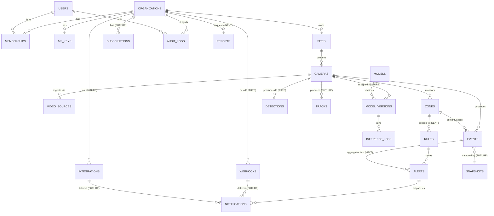

# VisionOps — Database Architecture

> **Scope:** the complete product schema is designed here. **V0.1 migrates only the tables marked `CURRENT`.** Tables marked `NEXT`/`FUTURE` are specified so the schema grows without a rewrite, but they are *not* created by migration `0001`.
> **Implementation:** SQLAlchemy 2.0 typed ORM, Alembic migrations, SQLite default / PostgreSQL compatible.

---

## 1. Design principles

| Principle | Rationale |
| --- | --- |
| **Every domain row carries `organization_id`** | Tenant isolation is structural, not a convention (ADR: §23 PRD). Enforced through one scoped repository chokepoint; Postgres RLS in Phase 6. |
| **Time-ordered UUIDv7-style primary keys** | Index locality at volume, no cross-node collisions when edge nodes later generate events, no volume leakage (ADR-024). |
| **UTC, timezone-aware, `timestamptz` everywhere** | Events are forensic records. A naive local timestamp is a defect. Display converts to the organisation's timezone. |
| **Normalised geometry (`[0,1]`) stored as JSON** | Resolution independence (ADR-019). Shape varies by entity so a rigid column type would be worse than validated JSON. |
| **Append-only for events and audit logs** | They are evidence. No `updated_at`, no `DELETE` path in the application for events except retention. |
| **JSON only for genuinely open attributes** | Typed columns for anything filtered, sorted or joined. JSON is for `metadata` that consumers read, never for core query fields. |
| **Dialect-portable** | Nothing in the V0.1 schema requires Postgres. Portable features only; Postgres-only features are clearly marked. |
| **`CHECK` constraints for enums** | The database is the last line of defence against a bad write from a future script. |
| **Retention is a column, deletion is a job** | Retention policy per organisation; a scheduled command enforces it. |

### Naming and conventions

- Tables: plural, snake_case (`organizations`, `video_sources`).
- Columns: snake_case; `*_id` for foreign keys; timestamps `*_at`.
- Booleans: `is_*` / `*_enabled`.
- Enum-like columns: `TEXT` + `CHECK (col IN (...))` — portable, self-documenting, and upgradable by altering the check.
- Soft delete only where business semantics need it (`cameras`, `zones`: so historical events keep referring to something real). Implemented as `deleted_at` (nullable timestamptz) plus an always-applied filter.

---

## 2. Entity relationship map (full product)



**V0.1 subset in solid use:** `organizations`, `api_keys`, `sites`, `cameras`, `video_sources`, `zones`, `events`, `audit_logs`.
**Everything else is designed but not created** — see the `FUTURE`/`NEXT` tags per table below.

---

## 3. Tables — `CURRENT` (created by migration `0001_initial`)

### 3.1 `organizations` — tenant root

**Purpose.** The isolation boundary. Every other domain row hangs off one organisation.

| Column | Type | Null | Notes |
| --- | --- | :-: | --- |
| `id` | `UUID` | no | PK, time-ordered UUID |
| `name` | `TEXT` | no | Display name, 1–120 chars |
| `slug` | `TEXT` | no | **Unique**, URL-safe, immutable |
| `timezone` | `TEXT` | no | IANA name, e.g. `Africa/Lagos`. Used for display and `NEXT` schedules |
| `retention_days` | `INTEGER` | no | Event retention; default `90`; `CHECK (1..3650)` |
| `snapshots_enabled` | `BOOLEAN` | no | Default `false` — privacy-by-default |
| `min_dwell_seconds` | `REAL` | no | Org default for zone dwell hysteresis, default `0.5` |
| `event_cooldown_seconds` | `REAL` | no | Org default cooldown, default `10.0` |
| `settings` | `JSON` | no | Free-form, forward-compatible (`{}`) |
| `created_at` / `updated_at` | `TIMESTAMPTZ` | no | `server_default=now()` |

**Indexes:** PK; `UNIQUE(slug)`.
**Retention:** never deleted implicitly; organisation deletion (`NEXT`) cascades after a legal-hold check.
**Security:** row is the tenant root; the only way to read it is with a principal bound to it. `slug` is not a secret but is not enumerable by API (no listing endpoint in V0.1).

### 3.2 `api_keys` — machine authentication

**Purpose.** Authenticate API clients (the UI, scripts, edge agents) and attribute audit records.

| Column | Type | Null | Notes |
| --- | --- | :-: | --- |
| `id` | `UUID` | no | PK |
| `organization_id` | `UUID` | no | FK → `organizations.id`, `ON DELETE CASCADE` |
| `name` | `TEXT` | no | Human label, e.g. `ops-laptop` |
| `key_prefix` | `TEXT` | no | First 12 chars of the public id — **indexed, not secret**, enables O(1) lookup |
| `key_hash` | `TEXT` | no | SHA-256 hex of `salt‖secret` |
| `key_salt` | `TEXT` | no | 16 random bytes, hex |
| `permissions` | `JSON` | no | Permission strings; V0.1 default `["*"]` |
| `rate_limit_rps` | `REAL` | no | Per-key override; `NULL` → org default |
| `last_used_at` | `TIMESTAMPTZ` | no | Throttled touch (at most once per 60 s) |
| `expires_at` | `TIMESTAMPTZ` | yes | Optional expiry |
| `revoked` | `BOOLEAN` | no | Default `false` |
| `created_at` | `TIMESTAMPTZ` | no | |

**Indexes:** PK; `UNIQUE(key_prefix)`; `INDEX(organization_id)`; `INDEX(key_prefix) WHERE NOT revoked` (partial — revoked keys are not on the hot path).
**Security:** the plaintext secret exists only at creation time, printed once. Comparison is constant-time. `key_prefix` is shown in the UI for identification and is intentionally insufficient to authenticate. A revoked key is never deleted, so its `revoked_at` history survives in audit.
**Retention:** keep revoked keys indefinitely (audit value), or prune after `retention_days`.

### 3.3 `sites` — physical location grouping

**Purpose.** Group cameras by location so operators can navigate and so analytics can aggregate per site.

| Column | Type | Null | Notes |
| --- | --- | :-: | --- |
| `id` | `UUID` | no | PK |
| `organization_id` | `UUID` | no | FK, cascade |
| `name` | `TEXT` | no | 1–120 |
| `timezone` | `TEXT` | yes | Overrides organisation timezone |
| `address` | `TEXT` | yes | Optional human address; **not** geocoded or transmitted anywhere |
| `description` | `TEXT` | yes | Free text |
| `created_at` / `updated_at` | `TIMESTAMPTZ` | no | |

**Indexes:** PK; `UNIQUE(organization_id, name)`; `INDEX(organization_id)`.
**Retention:** sites are not deletable when cameras reference them (FK `RESTRICT`); soft-delete in `NEXT`.
**Security:** address is customer-provided PII-lite; never logged at INFO, included in exports only if the operator asks.

### 3.4 `cameras` — logical camera

**Purpose.** The unit of monitoring. Owns zones, sources and events. Independent of any particular transport.

| Column | Type | Null | Notes |
| --- | --- | :-: | --- |
| `id` | `UUID` | no | PK |
| `organization_id` | `UUID` | no | FK, cascade |
| `site_id` | `UUID` | no | FK → `sites.id`, `ON DELETE RESTRICT` |
| `name` | `TEXT` | no | 1–120 |
| `description` | `TEXT` | yes | |
| `status` | `TEXT` | no | `online｜offline｜degraded｜disabled`, `CHECK` |
| `target_fps` | `REAL` | no | Inference FPS budget, default `5`, `CHECK (0.5..60)` |
| `model_version_id` | `UUID` | yes | FK → `model_versions.id` (`FUTURE`; V0.1 uses the global configured model) |
| `settings` | `JSON` | no | e.g. `{"input_width":640,"confidence_threshold":0.35}` overrides |
| `last_seen_at` | `TIMESTAMPTZ` | yes | Last frame successfully processed |
| `deleted_at` | `TIMESTAMPTZ` | yes | Soft delete; hidden from all default queries |
| `created_at` / `updated_at` | `TIMESTAMPTZ` | no | |

**Indexes:** PK; `UNIQUE(organization_id, name)`; `INDEX(organization_id, site_id)`; `INDEX(organization_id, status) WHERE deleted_at IS NULL`.
**Retention:** soft-deleted cameras keep historical events (FK from events is `ON DELETE SET NULL` **and** events store `camera_name` in metadata, so history survives even hard deletion).
**Security:** nothing sensitive. Camera credentials live in `video_sources`, never here.

### 3.5 `video_sources` — where frames come from

**Purpose.** One ingest configuration per camera transport, with encrypted credentials.

| Column | Type | Null | Notes |
| --- | --- | :-: | --- |
| `id` | `UUID` | no | PK |
| `organization_id` | `UUID` | no | FK, cascade |
| `camera_id` | `UUID` | no | FK → `cameras.id`, cascade |
| `kind` | `TEXT` | no | `browser｜device｜file｜rtsp`, `CHECK` |
| `name` | `TEXT` | no | e.g. `front-door-rtsp` |
| `target` | `TEXT` | no | For `device`: `"0"`; `file`: path; `rtsp`: **URL without credentials**; `browser`: client label |
| `credential_blob` | `TEXT` | yes | AES-256-GCM ciphertext, `v1:<key_id>:<b64>` — **never** plaintext |
| `is_primary` | `BOOLEAN` | no | Exactly one primary per camera (partial unique index) |
| `options` | `JSON` | no | `{"loop":true,"timeout_ms":5000,"transport":"tcp"}` etc. |
| `created_at` / `updated_at` | `TIMESTAMPTZ` | no | |

**Indexes:** PK; `INDEX(organization_id, camera_id)`; partial `UNIQUE(camera_id) WHERE is_primary`.
**Security — the most important table for secrets:**
- `target` for RTSP **must not** contain `user:pass@`; credentials live only in `credential_blob`. A validation rule rejects URLs containing `@` in the authority section.
- `credential_blob` is encrypted with AES-256-GCM using a key from `VISIONOPS_MASTER_KEY`, with the row `id` as associated data (prevents ciphertext swapping between rows). Envelope format `v1:<key_id>:<base64(iv‖ciphertext‖tag)>`.
- The decryption key never enters the database, never enters a log line, and never crosses the API.
- Reading a source through the API returns `"credentials": {"configured": true}` — **never** the secret, not even masked.
- File paths are resolved and containment-checked against an allow-listed root (`VISIONOPS_MEDIA_ROOT`, default `./data/media`) to defeat path traversal.

**Retention:** none (configuration, not data).

### 3.6 `zones` — spatial rules

**Purpose.** A named geometric area (and its policy) attached to one camera.

| Column | Type | Null | Notes |
| --- | --- | :-: | --- |
| `id` | `UUID` | no | PK |
| `organization_id` | `UUID` | no | FK, cascade |
| `camera_id` | `UUID` | no | FK → `cameras.id`, cascade |
| `name` | `TEXT` | no | 1–120, unique per camera |
| `description` | `TEXT` | yes | |
| `kind` | `TEXT` | no | `polygon` (V0.1); `line` reserved (`NEXT`) — `CHECK (kind IN ('polygon','line'))` |
| `points` | `JSON` | no | Normalised `[[x,y],…]`, ≥ 3 points, each in `[0,1]`, validated on write |
| `color` | `TEXT` | no | `#RRGGBB`, validated |
| `severity` | `TEXT` | no | `info｜warning｜critical`, `CHECK` |
| `class_filter` | `JSON` | no | e.g. `["person"]`; empty list = all classes |
| `cooldown_seconds` | `REAL` | no | Default from org; `CHECK (0..86400)` |
| `min_dwell_seconds` | `REAL` | no | Hysteresis; `CHECK (0..3600)` |
| `enabled` | `BOOLEAN` | no | Default `true` |
| `deleted_at` | `TIMESTAMPTZ` | yes | Soft delete preserves event history |
| `created_at` / `updated_at` | `TIMESTAMPTZ` | no | |

**Indexes:** PK; `UNIQUE(camera_id, name)`; `INDEX(organization_id, camera_id) WHERE deleted_at IS NULL`; `INDEX(organization_id, enabled)`.
**Validation (application + `CHECK` where possible):** polygon must be non-self-intersecting? *Not enforced at V0.1* (documented limitation: even-odd test on a self-intersecting polygon gives the mathematically expected but possibly surprising result; the UI prevents drawing it by construction). Points are clamped/rejected outside `[0,1]` with a field-level problem.
**Retention:** permanent (configuration). Deleting a zone stops future events; past events keep `zone_id` (nullable FK) **and** a `zone_name` copy in metadata so reports remain readable.
**Security:** no personal data. Zone geometry is commercially sensitive → never exposed on the public data API (Phase 10).

### 3.7 `events` — the durable record

**Purpose.** The system of record for everything that happened.

| Column | Type | Null | Notes |
| --- | --- | :-: | --- |
| `id` | `UUID` | no | PK, client-generated (edge-sync idempotency) |
| `schema_version` | `INTEGER` | no | Payload contract version, default `1` |
| `organization_id` | `UUID` | no | FK, cascade — **denormalised deliberately** so retention/export never needs a join |
| `type` | `TEXT` | no | From the event registry; `CHECK` kept in sync with the registry |
| `severity` | `TEXT` | no | `info｜warning｜critical｜error` |
| `occurred_at` | `TIMESTAMPTZ` | no | When it happened in the physical world |
| `received_at` | `TIMESTAMPTZ` | no | When the system learned of it (`server_default=now()`) |
| `camera_id` | `UUID` | yes | FK → `cameras.id`, `ON DELETE SET NULL` |
| `camera_name` | `TEXT` | no | Denormalised copy for durable reports |
| `zone_id` | `UUID` | yes | FK → `zones.id`, `ON DELETE SET NULL` |
| `zone_name` | `TEXT` | yes | Denormalised copy |
| `track_id` | `INTEGER` | yes | **Ephemeral**, session-scoped. `CHECK (track_id > 0)` |
| `session_id` | `UUID` | yes | Which processing session observed it |
| `confidence` | `REAL` | yes | Detection confidence when meaningful |
| `metadata` | `JSON` | no | Structured, typed per event type (validated) |
| `snapshot_path` | `TEXT` | yes | Relative path under the snapshot root only |
| `acknowledged_at` | `TIMESTAMPTZ` | yes | `NEXT` (operator action) |
| `acknowledged_by` | `UUID` | yes | `NEXT` |

`metadata` for the V0.1 types:

```jsonc
// ZONE_ENTERED / ZONE_EXITED
{
  "camera_name": "front-door",
  "zone_name": "restricted",
  "zone_kind": "polygon",
  "box": [0.31, 0.22, 0.44, 0.86],     // normalised, evidence geometry
  "foot_point": [0.375, 0.86],
  "point_in_zone": [0.375, 0.86],
  "dwell_seconds": null,                  // on ENTERED
  "dwell_seconds": 12.4,                  // on EXITED
  "track_age_frames": 88,
  "class": "person",
  "confidence": 0.91,
  "source_kind": "browser",
  "model": "yolo11n",
  "model_sha256": "…",
  "frame_width": 1280, "frame_height": 720,
  "pipeline_version": "0.1.0"
}
```

**Indexes (all tuned for the actual queries):**

| Index | Serves |
| --- | --- |
| PK `(id)` | point lookups, dedup |
| `(organization_id, occurred_at DESC, id DESC)` | default event feed + cursor pagination |
| `(organization_id, camera_id, occurred_at DESC)` | camera history |
| `(organization_id, zone_id, occurred_at DESC)` | zone history and analytics |
| `(organization_id, type, occurred_at DESC)` | type filters and counters |
| `(organization_id, severity, occurred_at DESC)` | dashboard "critical only" |
| `(occurred_at)` | retention scan and prune job |
| `(camera_id, occurred_at DESC)` where `acknowledged_at IS NULL` | `NEXT` ack queue |

**Retention:** per organisation `retention_days`; enforced by `visionops prune`. Events may be deleted in bulk; there is no per-event delete API (deliberate: evidence should not be casually erased; organisation-level deletion is the erasure path).
**Security:** no PII by construction. `metadata` is validated against the event-type schema before insert, so a plugin cannot smuggle arbitrary data. Snapshots are the only image data and are off by default.
**Write discipline:** one short transaction per event batch; `INSERT` only. No `UPDATE` except `acknowledged_at` (`NEXT`).

### 3.8 `audit_logs` — security trail

**Purpose.** Append-only record of security-relevant actions.

| Column | Type | Null | Notes |
| --- | --- | :-: | --- |
| `id` | `UUID` | no | PK |
| `organization_id` | `UUID` | no | FK, cascade |
| `actor_type` | `TEXT` | no | `api_key｜user｜system`, `CHECK` |
| `actor_id` | `TEXT` | no | Key id or user id (`system` for internal) |
| `action` | `TEXT` | no | Dotted verb, e.g. `zone.create`, `auth.key_rejected`, `session.start` |
| `target_type` | `TEXT` | yes | `zone｜camera｜source｜api_key｜event` |
| `target_id` | `TEXT` | yes | |
| `outcome` | `TEXT` | no | `success｜denied｜failure`, `CHECK` |
| `ip` | `TEXT` | yes | Client IP (from proxy headers, trusted-proxy aware) |
| `user_agent` | `TEXT` | yes | Truncated to 256 chars |
| `request_id` | `TEXT` | yes | Correlates with logs |
| `detail` | `JSON` | no | Sanitised diff-ish summary. **Never** secrets |
| `created_at` | `TIMESTAMPTZ` | no | |

**Indexes:** PK; `(organization_id, created_at DESC)`; `(organization_id, action, created_at DESC)`; `(organization_id, outcome, created_at DESC)`.
**Retention:** default 365 days (`VISIONOPS_AUDIT_RETENTION_DAYS`), independent of event retention.
**Security:** append-only by policy — there is no service method that updates or deletes an audit row. Redaction is enforced by a sanitiser that strips known secret keys from `detail` before write. Hash-chaining for tamper evidence is `FUTURE`.

---

## 4. Tables — `NEXT` / `FUTURE` (designed, not created in V0.1)

| Table | Purpose | Key fields | Notes |
| --- | --- | --- | --- |
| `users` | Human identities (Phase 6) | `email`, `display_name`, `password_hash`(or OIDC subject), `status`, `last_login_at` | No password column needed if OIDC-only; keep nullable for self-host |
| `memberships` | User ↔ org with role | `user_id`, `organization_id`, `role`, `invited_at`, `accepted_at` | `UNIQUE(user_id, organization_id)`; role → permissions |
| `roles` / `permissions` | Custom roles (Phase 6+, optional) | `name`, `permissions JSON` | Ship with fixed roles first; custom roles later |
| `detections` | Per-frame detections (Phase 3, opt-in) | `camera_id`, `frame_ts`, `class`, `confidence`, `box JSON`, `zone_id?` | **High volume.** Mandatory sampling (default: only frames that produced a transition, or 1-in-N), short retention (default 7 days), org flag `store_detections` default false |
| `tracks` | Track lifecycle (Phase 3, opt-in) | `camera_id`, `session_id`, `track_id`, `first_seen`, `last_seen`, `frames_seen`, `box JSON` | Same sampling/retention as detections. Never linkable across sessions |
| `rules` | Boolean rule definitions (Phase 4) | `camera_id?`, `zone_id?`, `expression JSON`, `severity`, `cooldown`, `enabled` | Predicate tree over the normalised Signal frame, not SQL |
| `alerts` | Grouped operator alerts (Phase 4) | `rule_id?`, `zone_id?`, `status`, `severity`, `first_event_at`, `last_event_at`, `event_count`, `acknowledged_*` | One alert ↔ many events |
| `notifications` | Delivery attempts (Phase 4) | `alert_id`, `channel`, `target`, `status`, `attempts`, `last_error`, `sent_at`, `idempotency_key` | At-least-once; `UNIQUE(idempotency_key)` |
| `reports` | Generated report definitions (Phase 4) | `organization_id`, `kind`, `window JSON`, `schedule`, `format`, `artifact_path`, `status` | Artefacts expire |
| `webhooks` | Outbound HTTP subscriptions (Phase 8) | `organization_id`, `url`, `secret_hash`, `events JSON`, `enabled` | Secret shown once; HMAC signing key stored encrypted |
| `integrations` | Third-party connectors (Phase 8) | `provider`, `config JSON` (encrypted), `status` | Credentials inside `config` are encrypted, never plaintext |
| `subscriptions` | SaaS plans (Phase 10) | `organization_id`, `plan`, `status`, `period_start/end`, `seats`, `quota JSON` | Billing concerns isolated here |
| `models` | Logical model (Phase 9) | `slug`, `name`, `task`, `description` | e.g. `person-detector` |
| `model_versions` | Immutable artefacts (Phase 9) | `model_id`, `version`, `uri`, `sha256`, `framework`, `input_width/height`, `classes JSON`, `metrics JSON`, `license`, `stage` | `UNIQUE(model_id, version)`; `UNIQUE(sha256)`; stage machine `candidate→shadow→active→deprecated` |
| `inference_jobs` | Evaluation runs (Phase 9) | `model_version_id`, `dataset_uri`, `metrics JSON`, `started/finished`, `status` | Reproducibility |
| `snapshots` | Snapshot metadata (Phase 3) | `event_id`, `camera_id`, `path`, `bytes`, `sha256`, `captured_at` | Files on disk; row for lifecycle/verification. V0.1 uses `events.snapshot_path` and migrates to this table when retention automation needs it |
| `aggregates_hourly` | Materialised rollups (Phase 3) | `bucket_start`, `camera_id?`, `zone_id?`, `event_type`, `count`, `occupancy_min/avg/max`, `dwell_avg` | Recomputable from `events`; PK `(bucket_start, camera_id, zone_id, event_type)` with `COALESCE` sentinels. Longer retention than raw events |

**Migration safety:** each of these is added by a forward migration that only creates new tables/columns; no destructive change is planned without a documented data migration and a downgrade path.

---

## 5. Views and helper queries

SQLite lacks some Postgres features, so analytics in V0.1 use portable SQL through SQLAlchemy Core:

```sql
-- Events per hour for a camera (V0.1: computed on demand with a bounded window)
SELECT strftime('%Y-%m-%dT%H:00:00Z', occurred_at) AS bucket,
       type, COUNT(*) AS n
FROM events
WHERE organization_id = :org AND camera_id = :camera
  AND occurred_at >= :since
GROUP BY bucket, type
ORDER BY bucket;

-- Critical events requiring attention (NEXT)
SELECT * FROM events
WHERE organization_id = :org AND acknowledged_at IS NULL AND severity IN ('critical','error')
ORDER BY occurred_at DESC LIMIT 50;
```

`aggregates_hourly` (Phase 3) replaces the first query with an index scan over a fraction of the rows, and is rebuilt with `visionops backfill-aggregates --since …`.

---

## 6. Retention and deletion matrix

| Data | Default retention | Enforced by | Configurable | Erasure path |
| --- | --- | --- | --- | --- |
| Events | 90 days | `visionops prune` (cron/systemd timer) | per org (`retention_days`) | org deletion (Phase 6) |
| Event snapshots | = event retention | same job deletes orphaned files | org opt-in + same retention | same |
| Audit logs | 365 days | same job | env | org deletion |
| Detections/tracks (`FUTURE`) | 7 days | same job | per org | same |
| Hourly aggregates | 400 days | same job | env | same |
| Camera credentials | until changed | manual | — | source deletion |
| Video | **never stored** | n/a | n/a | n/a |

Deletion is always: delete rows, then delete files, then record an audit entry. Orphans are removed by a reconciliation pass in the prune job.

---

## 7. Migrations

- Alembic, `backend/visionops/db/migrations/`, revision files named `NNNN_description.py`.
- `0001_initial` creates **only** the 8 `CURRENT` tables plus indexes and `CHECK` constraints.
- Applied automatically on API startup when `VISIONOPS_AUTO_MIGRATE=true` (default in production, can be disabled for orchestrated deploys).
- **Every migration must have a working `downgrade()`** while that major version is supported.
- Multi-dialect: migrations use `op.create_table`/`op.create_index` only, plus dialect-guarded blocks for Postgres-only features (RLS, partitioning, `JSONB`) so the SQLite path never breaks.
- CI runs migrations up and down against a fresh SQLite database on every change.

---

## 8. Connection and concurrency configuration

| Setting | Default | Notes |
| --- | --- | --- |
| `VISIONOPS_DATABASE_URL` | `sqlite:///./data/visionops.db` | `postgresql+psycopg://…` in production |
| SQLite `journal_mode` | `WAL` | Readers do not block the writer |
| SQLite `busy_timeout` | `5000` ms | Absorbs short write contention |
| SQLite `synchronous` | `NORMAL` | Safe with WAL; documented trade (a power loss may lose the last transactions, never corrupt) |
| `pool_pre_ping` | `true` | Postgres/edge restart safety |
| Session scope | per request / per write | Never held across a pipeline iteration |

The pipeline thread opens a **short-lived session per event batch** and commits immediately, so a slow consumer can never hold a write transaction.

---

## 9. Security considerations (summary)

1. **Secrets:** only `video_sources.credential_blob` (encrypted) and `api_keys.key_hash` (salted hash) hold anything sensitive. Nothing else in the schema is a credential.
2. **Multi-tenancy:** `organization_id` is `NOT NULL` on every domain table; the scoped repository is the only sanctioned query path; a test asserts cross-org reads return empty.
3. **Path safety:** `snapshot_path` is relative to the snapshot root and re-validated on read; file-source targets are containment-checked.
4. **URL safety:** RTSP/HTTP targets are scheme-allow-listed (`rtsp`, `rtsps`, `http`, `https`) and rejected if they embed credentials; `NEXT` adds egress/DNS pinning for SSRF defence.
5. **Integrity:** `CHECK` constraints on every enum-like column; foreign keys enforced (`PRAGMA foreign_keys=ON` on SQLite); metadata JSON validated per event type.
6. **No PII:** no name, email, face, licence plate or device identifier column exists anywhere. Biometrics are structurally impossible.
7. **Audit:** writes, credential changes, key operations and authorisation failures are audited.
8. **Least data:** an operator can see, from the schema alone, exactly what a deployment stores — this is a feature of the design, and it is documented in `SECURITY_PRIVACY.md`.
