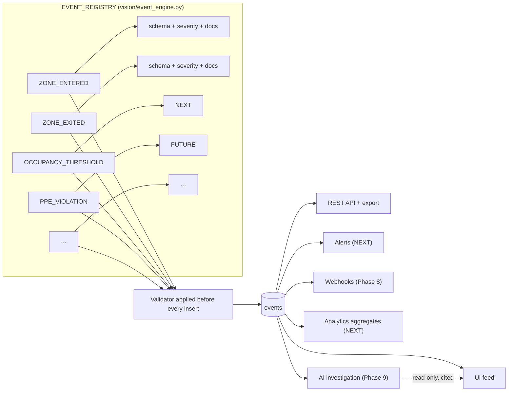
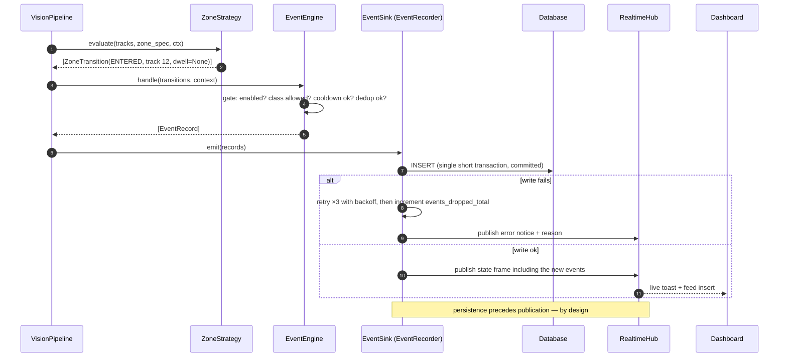
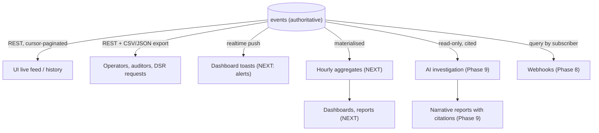
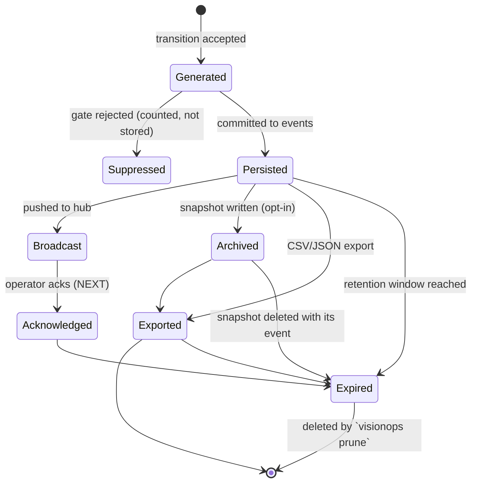

# VisionOps — Event Engine

> **Thesis:** VisionOps has exactly one durable product — the **event**. Detections, tracks and frames are working state; events are the record. Anything the platform ever does (UI, alerts, reports, API, webhooks, analytics, AI investigation) is a projection of the event stream.

---

## 1. Event anatomy

```jsonc
{
  "id": "0192c4a1-7f3b-7c9d-9a11-6f0b2e5d8a31",   // time-ordered UUIDv7, generated client-side
  "schema_version": 1,                            // payload contract version
  "type": "ZONE_ENTERED",                         // from the registry — never free text
  "severity": "warning",                          // info | warning | critical | error
  "occurred_at": "2026-01-01T10:15:42.318Z",      // physical-world time (source clock when available)
  "received_at": "2026-01-01T10:15:42.402Z",      // when the system learned
  "organization_id": "…",
  "camera_id": "…",
  "camera_name": "front-door",                    // denormalised: history stays readable
  "zone_id": "…" | null,
  "zone_name": "restricted" | null,
  "track_id": 12 | null,                          // EPHEMERAL, session-scoped
  "session_id": "…",
  "confidence": 0.91 | null,
  "metadata": { /* typed per type, §3 */ },
  "snapshot_path": "2026/01/01/<event_id>.jpg" | null
}
```

### Design rules

| Rule | Why |
| --- | --- |
| **Typed registry, no free text** | A new event type must declare its metadata schema; a plugin cannot invent an unvalidatable shape. |
| **Client-generated UUIDv7** | Makes future edge→cloud replication idempotent and makes index insertion order match time order. |
| **Denormalised `camera_name`/`zone_name`** | A report must remain readable after a camera or zone is deleted. |
| **`schema_version` on every event** | Consumers migrate; unknown fields must be ignored (contract rule). |
| **Structured `metadata`, typed per type** | Reports, alerts and the AI agent need facts, not a free-text blob. |
| **No PII, by construction** | There is no identity field to fill in. See `SECURITY_PRIVACY.md`. |
| **Persist before publish** | A broadcast failure must never lose an event. The API is the recovery path. |
| **Append-only** | No updates except operator acknowledgement (`NEXT`). Evidence should not be casually edited. |

---

## 2. Event type registry



Registry entry (illustrative):

```python
EventTypeSpec(
    name="ZONE_ENTERED",
    severity="warning",          # default; zone severity overrides
    metadata_schema=ZONE_ENTRY_METADATA,   # dataclass → validated dict
    description="A tracked object entered a configured zone.",
    since_version="0.1.0",
)
```

Validation is enforced at the **write boundary** (`EventService.record`), not in the pipeline, so every future producer (webhook receiver, agent tool, replay command) gets the same guarantee.

---

## 3. Type catalogue

### `CURRENT` — implemented and tested

| Type | Severity | Metadata | Emitted when |
| --- | --- | --- | --- |
| `ZONE_ENTERED` | zone severity (`warning` default) | `zone_name`, `zone_kind`, `box`, `foot_point`, `class`, `confidence`, `track_age_frames`, `frame_width`, `frame_height`, `source_kind`, `model`, `model_sha256`, `pipeline_version` | Confirmed entry (dwell ≥ `min_dwell_seconds`) |
| `ZONE_EXITED` | `info` | as above **+** `dwell_seconds` | Confirmed exit |
| `SOURCE_STARTED` | `info` | `source_kind`, `source_name`, `target_fps` | A session begins ingesting |
| `SOURCE_STOPPED` | `info` | `duration_seconds`, `total_frames`, `total_events` | A session ends cleanly |
| `SOURCE_FAILED` | `error` | `reason_code`, `detail`, `retries` | A source gives up after retries |
| `MODEL_LOADED` | `info` | `model`, `sha256`, `provider`, `classes_count`, `input_size`, `warmup_ms` | Model successfully warmed up |
| `MODEL_FAILED` | `error` | `reason_code`, `detail`, `model_path` | Model load or repeated inference failure |

### `NEXT` — designed, interface reserved

| Type | Metadata |
| --- | --- |
| `LINE_CROSSED` | `line_name`, `direction` (`forward`/`backward`), `foot_point_prev`, `foot_point`, `class` |
| `OCCUPANCY_THRESHOLD` | `occupancy`, `threshold`, `direction` (`above`/`below`), `zone_name`, `window_seconds` |
| `DWELL_EXCEEDED` | `dwell_seconds`, `threshold_seconds`, `zone_name`, `track_id` |
| `OBJECT_DETECTED` | `class`, `confidence`, `box`, `duration_seconds` (only for configured "notable" classes to avoid noise) |
| `OBJECT_LEFT_ZONE` | as `ZONE_EXITED` (kept separate so "left" semantics can evolve independently) |
| `RULE_MATCHED` | `rule_id`, `rule_name`, `facts` (evaluated predicate values) |
| `ALERT_RAISED` | `alert_id`, `group_window_seconds`, `event_count` |
| `CAMERA_HEALTH_CHANGED` | `from_state`, `to_state`, `reason_code` |

### `FUTURE` — reserved names (do not reuse)

`PPE_VIOLATION` (`missing_items`, `worn_items`), `VEHICLE_DETECTED` (`vehicle_type`, `plate_redacted: true` — never the plate itself), `QUEUE_THRESHOLD` (`queue_length`, `estimated_wait_seconds`), `ANOMALY_DETECTED` (`anomaly_type`, `score`, `baseline_ref`), `SAFETY_VIOLATION` (`category`, `standard_ref`), `MODEL_SWITCHED`, `EDGE_SYNC_COMPLETED`, `AGENT_QUERY_COMPLETED`.

**Rule:** a name in the reserved list is claimed only when its implementation and metadata schema exist. Pre-claiming keeps the audit trail of "what was promised" honest.

---

## 4. Generation pipeline



### Anti-storm gates (all independent)

| Gate | Scope | Solves |
| --- | --- | --- |
| **Dwell hysteresis** | per `(zone, track)` | Boundary flapping — a person standing on the line |
| **Cooldown** | per `(zone, type)` | Alert storms from many people in a busy zone |
| **Dedup key** | `(zone, type, track, 5 s bucket)` | Duplicate events from a brief tracker ID re-creation |
| **Class filter** | per zone | Irrelevant classes (e.g. a chair in a restricted zone) |
| **Clip suppression** | per track | Events from a person half-outside the frame |

Configuration defaults are deliberately conservative: `min_dwell_seconds = 0.5`, `cooldown_seconds = 10`.

---

## 5. Consumption model



Properties:

- **Pull is the source of truth; push is an optimisation.** Every consumer must be able to re-read history over REST, so no consumer depends on a socket being connected. This is what makes reconnects, browser refreshes and edge sync trivially correct.
- **Ordering:** events are ordered by `(occurred_at, id)`; the cursor encodes both, so pagination is stable while new events arrive.
- **Idempotency:** consumers dedupe on `id`.
- **Fan-out seam:** `EventSink` implementations. `RealtimeHub` is the live one; `WebhookDispatcher` (Phase 8) and `NotificationDispatcher` (Phase 4) are future ones. The pipeline does not change when they arrive.

---

## 6. Lifecycle and retention



- Retention default **90 days**, per organisation (`retention_days`), enforced by `visionops prune` (rows first, then orphaned snapshot files, then an audit entry).
- Aggregates (`NEXT`) are retained longer than the raw events they summarise, so long-term trends survive raw-event deletion. They are recomputable by `visionops backfill-aggregates`.
- Deleting a zone or camera does **not** delete its events; `zone_name`/`camera_name` remain in the row and metadata so reports stay truthful.

---

## 7. Versioning and compatibility

- `schema_version` starts at `1` and increments only for **breaking** metadata changes.
- Consumers must **ignore unknown fields** and tolerate unknown `type` values (log and skip) — this is a documented contract requirement, and it is how a `FUTURE` event type can be added without breaking an older dashboard.
- Additive metadata (new optional keys) does not bump the version.
- Removing or retyping a metadata key requires `schema_version = 2` and a documented migration for consumers; the API exposes `GET /api/v1/events/schema` (describing types, severities and metadata keys) so consumers can discover the contract programmatically.

## 8. Extension checklist for a new event type

1. Add a `EventSpec` to `EVENT_REGISTRY` (`vision/event_engine.py`) with severity, description, version and a validated metadata dataclass.
2. Emit it from a `ZoneStrategy` (`vision/zones.py`) or `EventEngine` — never from `api/`.
3. Add the `CHECK` constraint value if the DB constraint enumerates types (migration required).
4. Add tests: schema validation, suppression gates, ordering and dedup.
5. Document it in §3 with its real status (`CURRENT`/`NEXT`/`FUTURE`).
6. If the UI shows it, add the label/severity mapping in `frontend/src/lib/format.ts` and cover it in the UI test.
7. If it is user-configurable, add it to the API docs and the frontend types.
