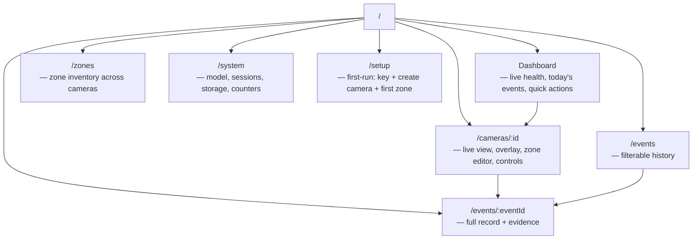
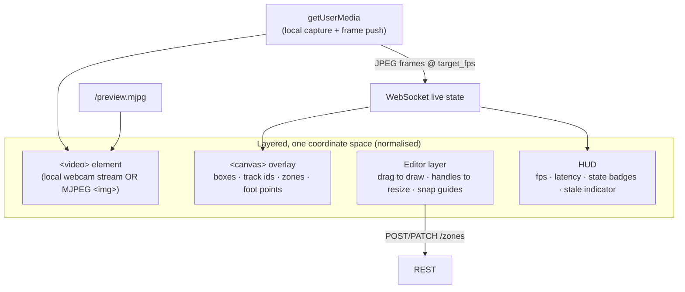
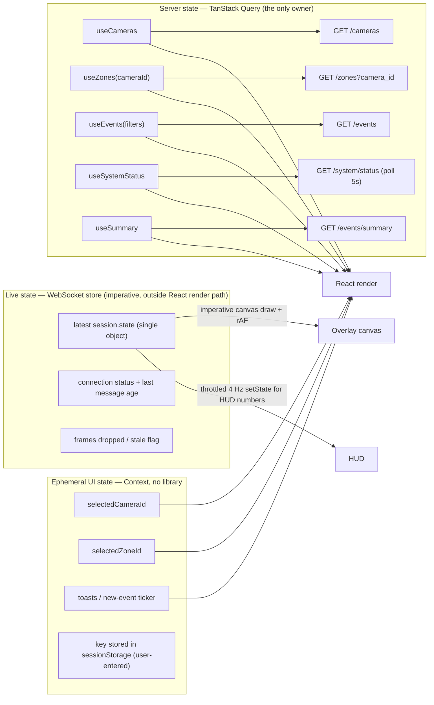

# VisionOps — Frontend Architecture

> **Goal:** an operator console that a security or operations team would trust with a live camera, on a phone in a warehouse or on a control-room wall. Not a tutorial page, not a dashboard mockup.
> **Stack:** React 19 · TypeScript (`strict`) · Vite · Tailwind CSS · React Router · TanStack Query. Four runtime dependencies, deliberately (ADR-011).

---

## 1. Screens (V0.1)



| Screen | Answers, in one glance |
| --- | --- |
| **Dashboard** | Is anything happening? Is anything broken? What are the cameras doing right now? |
| **Camera view** | What does the AI see, where are the zones, who is where, and is the stream healthy? |
| **Zones** | What is defined, where, with which severity and thresholds? |
| **Events** | What happened, when, filtered how I need it? |
| **Event detail** | The exact facts behind one event, with the evidence image if enabled. |
| **System status** | Is the AI loaded, which model, how fast, what errors, how much disk left? |
| **Setup** | First-run wizard: API key, organisation, site, camera, first zone. |

---

## 2. Live camera view — the centrepiece



**Coordinate handling (the classic source of overlay bugs).**

1. Geometry from the API is **normalised `[0,1]`** (ADR-019). No pixels cross the boundary.
2. The canvas is sized to the video's *displayed* box (`getBoundingClientRect()`), with `devicePixelRatio` scaling for sharpness.
3. Drawing converts once: `x = nx * displayWidth`, `y = ny * displayHeight`. Aspect ratio is preserved because both use the same displayed box.
4. The overlay listens to `ResizeObserver` and re-renders on layout changes, so a window resize or rotation never leaves the boxes misaligned.
5. Editor drag coordinates are inverted back to normalised on save: `nx = x / displayWidth`, clamped to `[0,1]`.

**Sources on this screen:**

| Source kind | Video element | Frames to server | Notes |
| --- | --- | --- | --- |
| `browser` | `<video>` from `getUserMedia` | Yes (JPEG over WS, paced) | Zero-latency local preview; permission failure is a first-class error state with instructions |
| `device` / `file` / `rtsp` | `` | No | Video comes from the server; overlay from the same pipeline, so they are inherently synchronised |

**Editor UX.** Drag on empty video → new rectangle; drag a zone → move; drag a corner → resize; click a zone → select and edit name, colour, severity, class filter, dwell and cooldown numerically; `Delete` removes (with confirm). Coordinates snap to 0.5 % and are shown as percentages while dragging so the numbers are meaningful. Validation errors from the API are rendered next to the field, not as a toast.

**States that must be visible (never a blank canvas):**

| State | Presentation |
| --- | --- |
| Camera permission denied | Instructions card: how to allow, plus a "use the fixture video instead" action |
| No camera / no source | Prominent empty state with a create-source path |
| Session starting | Skeleton with "starting pipeline…" and live state once the first frame lands |
| Source degraded | Amber banner with the reason code and human detail ("Camera busy — close other apps using it") + retry button |
| Model unavailable | Red banner: AI disabled, detections unavailable, events not being produced; link to setup docs |
| WebSocket stale (> 3 s) | "Live updates stale" badge; the UI shows the last known state with its age, and reconnects with backoff |
| Processing stopped | Blue banner: stream visible, inference paused, with a Start control |

**Accessibility & responsiveness.** Live regions (`aria-live="polite"`) announce new events without stealing focus; every control is keyboard reachable; the video is focusable with keyboard shortcuts (`Space` start/stop, `Z` new zone); contrast ≥ 4.5:1 on text; the layout is a single column below `md`, two columns at `md`, camera+events split at `xl`. Canvas is decorative for assistive tech — the same information is available as text (track list, zone list, event list).

---

## 3. Design language

Dark, dense, calm. Operators watch these screens for hours, so: dark background (`#0b1220`), low-saturation surfaces, one accent per state (green healthy, amber warning, red critical, blue informational), and colour never as the *only* signal (severity badges carry text as well as colour).

| Token group | Values |
| --- | --- |
| Surfaces | `bg` `#0b1220`, `surface` `#111a2b`, `surface-2` `#18243a`, `border` `#24324d` |
| Text | `primary` `#e6edf7`, `secondary` `#9fb0c9`, `muted` `#6b7c99` |
| State | `ok` `#22c55e`, `warn` `#f59e0b`, `crit` `#ef4444`, `info` `#3b82f6` |
| Severity | `info` slate, `warning` amber, `critical` red, `error` red-strong |
| Type | System UI stack; tabular numerals for counts, latencies and timestamps |
| Radius/spacing | `rounded-lg`, 4 px base grid |

Components (`components/ui/`): `Button`, `Card`, `Badge`, `StatCard`, `Table`, `Modal`, `Field`, `Select`, `Toggle`, `EmptyState`, `Banner`, `Spinner`, `RelativeTime`, `ConfidenceBar`. `StatCard` is the workhorse: label, big value, delta, state colour, sparkline slot.

---

## 4. State management



Why the live store is imperative: a 5–15 FPS state stream re-rendering a React tree would burn CPU on the operator's machine and cause visible jitter. The overlay draws from a mutable ref inside `requestAnimationFrame`; only small HUD numbers enter React state at a throttled rate.

**Query conventions.** Stale times: live endpoints 2 s (polled), configuration 30 s, history `Infinity` until invalidated. Mutations invalidate precisely (`zones` list, `system/status`, `events`) and optimistically update the zone editor with rollback on error. Errors surface as a `Banner` plus a toast, never silently.

**WebSocket resilience.** Exponential backoff (1 s → 30 s) with jitter; on reconnect, a REST re-sync of missed events (`?from=lastSeenEventTime`); a heartbeat watchdog marks the connection stale after 3 s of silence; tab visibility changes pause the HUD polling but keep the socket.

---

## 5. Data flow for a new event (what the user sees)

```mermaid
sequenceDiagram
  autonumber
  participant WS as WebSocket
  participant Store as live store
  participant Q as TanStack Query
  participant U as UI
  WS->>Store: session.state (events[] present)
  Store->>Store: append to ticker (dedupe by id, cap 50)
  Store->>Q: invalidateQueries(['events'])
  Q->>Q: refetch page 1 (cursor pagination keeps it stable)
  U->>U: toast (type + zone + camera + time), feed row animates in
  Note over U: live state stays authoritative for the overlay;<br/>the list stays authoritative for history
```

The overlay is driven by the socket; the *list* is driven by REST. That split means a dropped socket degrades the picture, never the history.

---

## 6. Error handling in the UI

| Error | Presentation |
| --- | --- |
| `401` | Full-screen "API key required" screen with a field and a link to `visionops key add`. Cached key kept in `sessionStorage` only. |
| `429` | Toast with the `Retry-After` value; the query retries automatically after it |
| `404` on a camera | Redirect to `/cameras` with a toast — never a blank page |
| `503 capacity_exceeded` | Inline error on the Start button: "4 sessions already running (max 4). Stop one to start this." |
| Network offline | Global offline banner; cached data shown with an "as of HH:MM" stamp |
| WebSocket down | Stale badge + automatic reconnect; overlay keeps the last frame with an age stamp |
| Unknown error | Generic message + `request_id` displayed so support can find it in the logs |

A global `ErrorBoundary` catches render errors with a readable panel and a reload action. No stack traces are shown to users.

---

## 7. Performance budget

| Metric | Target |
| --- | --- |
| Initial JS (gzip, production build) | < 200 KB |
| Largest Contentful Paint (LAN) | < 1.5 s |
| Interaction to Next Paint | < 100 ms |
| Overlay draw cost | < 2 ms per frame at 30 boxes |
| Re-render on a live state frame | 0 (imperative path) |
| Bundle budget enforced in CI | yes (`vite build` reports; the CI job fails above the budget) |

Techniques: route-level `React.lazy` for `System` and `Zones`; no charting library in V0.1 (CSS/sparkline components only); canvas drawing with a single `setTransform`; throttled HUD updates; `content-visibility` on long event lists.

---

## 8. Security in the client

- The API key is entered by the operator, kept in `sessionStorage` (cleared when the tab closes) and sent in the `X-API-Key` header. It is **never** compiled into the bundle, never in a URL, never in `localStorage` (persisting a long-lived secret in a browser is a bad default).
- No `dangerouslySetInnerHTML` anywhere — API strings are rendered as text (XSS-safe by construction).
- CSP forbids inline scripts in the production build; the dev server is exempted by vite config only.
- External links use `rel="noreferrer noopener"`.
- The production build ships **no source maps**.

---

## 9. Accessibility

- Semantic landmarks (`header`/`nav`/`main`), skip link, visible focus rings.
- Live regions for events and state changes; the canvas has a text alternative listing active tracks and zone occupancy.
- All controls labelled; icon-only buttons carry `aria-label`.
- Colour is never the only signal; severity badges include text.
- Keyboard: full camera control without a mouse; the zone editor is operable by arrow keys after selecting a zone (V0.1: numeric fields provide the keyboard path; drag refinement is mouse-only and documented as such).

---

## 10. Frontend testing

| Layer | What | How |
| --- | --- | --- |
| Unit | `format.ts`, severity mapping, filter serialisation, geometry helpers, WS reducer | Vitest |
| Component | `StatCard`, `Badge`, `EmptyState`, event row, filter bar, zone form validation | Vitest + Testing Library |
| Hook | `useEvents` cursor handling, `useLiveSession` reconnect logic (with a fake socket) | Vitest |
| Contract | Type-level check that `types/api.ts` matches the OpenAPI schemas | generated types + `tsc` |
| E2E | Setup → start session → define zone → observe event → filter → detail → degraded-camera path | Playwright, with a **fake camera device** and a **scripted/deterministic source** |

E2E uses Chromium's `--use-fake-device-for-media-capture`, so the whole webcam path is exercised in CI without hardware. See `docs/TESTING.md`.
