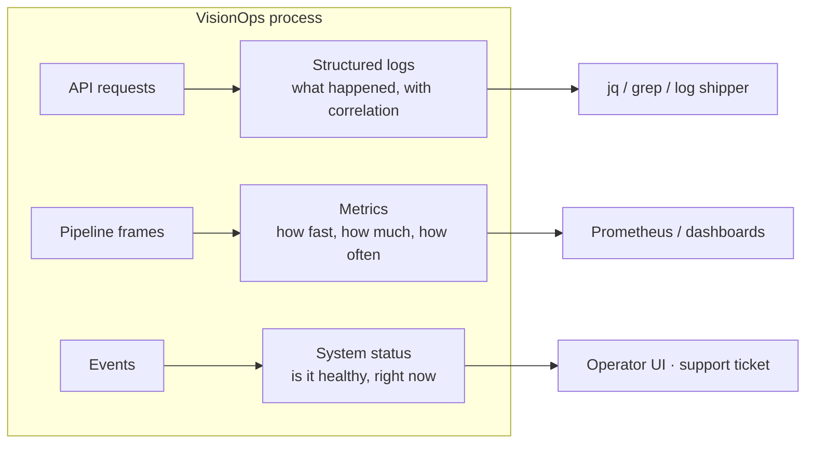
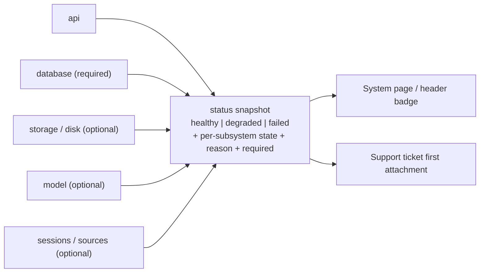

# VisionOps — Observability

> **Goal:** every failure is diagnosable from the outside, without a debugger and without guessing. If something is wrong, one of these three things says so clearly: **logs**, **metrics**, or **status**.

---

## 1. The three pillars



Design rules:

1. **Low cardinality.** Labels are bounded (`type`, `severity`, `kind`, `reason_code`, `endpoint`, `status`) — never a camera name, id, URL or track id in a metric label.
2. **Correlation ids everywhere.** `request_id` on HTTP, `session_id` on a pipeline. Both appear in every log line of that operation.
3. **No secrets, no PII, ever.** Redaction at the formatter, plus an allow-list policy for structured fields.
4. **Zero dependencies.** Our own JSON formatter and Prometheus exporter (ADR-016). No telemetry leaves the process unless the operator configures a shipper.

---

## 2. Structured logging

### 2.1 Format

One JSON object per line in production; a compact human-readable line in development.

```json
{
  "ts": "2026-01-01T10:15:42.318Z",
  "level": "INFO",
  "logger": "visionops.vision.pipeline",
  "message": "session started",
  "request_id": null,
  "session_id": "0192c4c5-…",
  "camera_id": "0192c4b0-…",
  "camera_name": "front-door",
  "source_kind": "browser",
  "model": "yolo11n",
  "model_sha256": "…",
  "target_fps": 5.0,
  "provider": "CPUExecutionProvider"
}
```

### 2.2 Levels and what belongs at each

| Level | Content | Examples |
| --- | --- | --- |
| `DEBUG` | Per-frame detail (**off in production**) | frame seq, inference ms, track count, drop reason |
| `INFO` | Lifecycle and configuration | startup, model loaded (with warmup ms and checksum), session started/stopped, migrations applied, config summary at boot |
| `WARNING` | Degradation that is handled | source retrying, inference recovered, event write retried, rate limit hit, slow frame, disk pressure |
| `ERROR` | Failure with a cause | source failed after retries, model inference failed repeatedly, event write dropped, unhandled exception |
| `CRITICAL` | Process unusable | DB unreachable at startup, unrecoverable config error (then we exit with a clear message) |

### 2.3 What is never logged

API keys, camera credentials, RTSP URLs containing credentials, snapshot content, frame bytes, raw detection dumps at INFO level, customer names/addresses, or any value that would let a reader reconstruct who was where.

### 2.4 Redaction

- A field-name denylist is applied to all structured fields and message parameters: `password`, `secret`, `token`, `api_key`, `authorization`, `credential`, `pass`, `key`.
- Denylisted fields are replaced with `"***"` and a counter `log_redactions_total` increments.
- Test `tests/unit/test_logging.py` and `tests/security/test_logging_redaction.py` assert that a log capture containing a secret contains no trace of it.

### 2.5 Rotation and shipping

- Native run: `RotatingFileHandler`, 10 MB × 5, path from `VISIONOPS_LOG_FILE`.
- Containers: stdout/stderr, rotated by the platform (`docker logs`, `journalctl`).
- Shipping: the format is one JSON object per line, so any shipper (Vector, Fluent Bit, Loki, CloudWatch) works with a regex/expression parser. No proprietary format.

---

## 3. Metrics

Exposed at `GET /api/v1/system/metrics` in Prometheus text format. Registry lives in-process; `NEXT` adds optional Redis-backed counters for multi-process.

### 3.1 Catalogue

**Pipeline / vision**

| Metric | Type | Labels | Meaning |
| --- | --- | --- | --- |
| `visionops_pipeline_frames_total` | counter | `session` | Frames processed |
| `visionops_pipeline_frames_dropped_total` | counter | `session`, `reason` | Frames dropped (`rate_limit`, `stale`, `invalid`) |
| `visionops_pipeline_fps` | gauge | `session` | Current effective FPS |
| `visionops_pipeline_frame_age_ms` | gauge | `session` | Age of the newest frame — **staleness detector** |
| `visionops_inference_latency_seconds` | histogram | `provider` | Model inference time (buckets 5 ms → 5 s) |
| `visionops_preprocess_latency_seconds` | histogram | — | Letterbox + pack |
| `visionops_active_tracks` | gauge | `session` | Tracks currently reported |
| `visionops_tracks_created_total` | counter | — | New tracks (rising ⇒ detector/tracker instability) |
| `visionops_tracks_lost_total` | counter | — | Track removals |
| `visionops_detections_total` | counter | `label` | Raw detections by class (bounded labels) |
| `visionops_inference_errors_total` | counter | — | Inference exceptions |
| `visionops_model_state` | gauge | `state` | 1 for the active state (`ready`/`loading`/`failed`/`disabled`) |

**Events**

| Metric | Type | Labels |
| --- | --- | --- |
| `visionops_events_total` | counter | `type`, `severity` |
| `visionops_events_suppressed_total` | counter | `type`, `reason` (`cooldown`, `dedup`, `dwell`, `clip`, `class_filter`, `disabled`) |
| `visionops_events_dropped_total` | counter | `reason` (`db_error`) |
| `visionops_event_write_latency_seconds` | histogram | — |
| `visionops_zone_transitions_total` | counter | `zone_kind`, `direction` |

**Sources**

| Metric | Type | Labels |
| --- | --- | --- |
| `visionops_source_state` | gauge | `kind`, `state` |
| `visionops_source_frames_total` | counter | `kind` |
| `visionops_source_errors_total` | counter | `kind`, `reason_code` |
| `visionops_source_retries_total` | counter | `kind` |
| `visionops_session_uptime_seconds` | gauge | `session` |
| `visionops_sessions_active` | gauge | — |

**API**

| Metric | Type | Labels |
| --- | --- | --- |
| `visionops_http_requests_total` | counter | `method`, `path` (templated, e.g. `/api/v1/zones/{id}`), `status` |
| `visionops_http_request_duration_seconds` | histogram | `method`, `path` |
| `visionops_ws_connections` | gauge | — |
| `visionops_ws_messages_sent_total` | counter | `type` |
| `visionops_ws_messages_dropped_total` | counter | `reason` (`slow_client`, `closed`) |
| `visionops_rate_limited_total` | counter | `endpoint` |
| `visionops_auth_failures_total` | counter | `reason` |

**Process / runtime**

| Metric | Type | Notes |
| --- | --- | --- |
| `visionops_process_resident_memory_bytes` | gauge | RSS |
| `visionops_process_cpu_seconds_total` | counter | Process CPU time |
| `visionops_process_uptime_seconds` | gauge | |
| `visionops_event_rows_total` | gauge | Row count (from DB, on demand) |
| `visionops_log_redactions_total` | counter | |

### 3.2 Interpreting the key signals

| Symptom | Look at | Likely cause |
| --- | --- | --- |
| Events stop, stream alive | `frame_age_ms` rising | Source stalled |
| `DEGRADED`, no events | `inference_errors_total` | Model/runtime failure |
| Duplicate or missing events | `tracks_created_total` spiking | Detector instability → thresholds too low / bad lighting |
| Latency climbing | `inference_latency_seconds` p95 | Thermal throttling, CPU contention with other sessions |
| Event volume collapse | `events_suppressed_total{reason="cooldown"}` | Cooldown too aggressive for a busy zone |
| Alert storm gone "because it is fixed" | `events_dropped_total{reason="db_error"}` | Disk/db problem — **never assume a fix** |
| Memory growth | `resident_memory_bytes` | Leak or unbounded queue — soak test territory |

### 3.3 Alerting starter rules (for operators who want them)

```yaml
- alert: VisionOpsSessionDegraded
  expr: visionops_source_state{state="degraded"} == 1 or visionops_source_state{state="failed"} == 1
  for: 2m

- alert: VisionOpsInferenceSlow
  expr: histogram_quantile(0.95, rate(visionops_inference_latency_seconds_bucket[5m])) > 0.5
  for: 10m

- alert: VisionOpsModelFailed
  expr: visionops_model_state{state="failed"} == 1

- alert: VisionOpsEventsDropped
  expr: increase(visionops_events_dropped_total[15m]) > 0

- alert: VisionOpsStaleFrames
  expr: visionops_pipeline_frame_age_ms > 10000
  for: 1m
```

---

## 4. System status (the operator-facing aggregate)

`GET /api/v1/system/status` merges five subsystems into one verdict. Health is computed by `services/system_service.py`: each probe returns `(state, reason_code, detail)`, `ok` and `healthy` share the lowest severity rank, and the aggregate applies the required/optional rule below.



Verdict rules (`status` is `healthy | degraded | failed`; `/readyz` reports the same rule as `ready | degraded | unavailable`):

| Verdict | When |
| --- | --- |
| `healthy` | Every subsystem is `ok` (or intentionally disabled) |
| `degraded` | Any **optional** subsystem is `degraded` or `failed` — e.g. a source `DEGRADED`, an inference error, high frame age, low disk (< 500 MB free), or a single camera whose session `failed`. A per-camera failure degrades the platform report, it never makes it `failed`/offline. |
| `failed` | A **required** subsystem failed — the `database` is unreachable. `/readyz` answers `503`/`unavailable` in this case. |

Each subsystem carries `{state, reason_code, detail, required}` where `reason_code` is a **stable machine string** (`CAMERA_BUSY`, `RTSP_TIMEOUT`, `MODEL_MISSING`, `MODEL_CORRUPT`, `SOURCE_STALLED`, `DISK_LOW`, `DB_UNREACHABLE`, `HEALTH_TIMEOUT`, `PROBE_ERROR`) and `detail` is an actionable human sentence, scrubbed of connection strings or credentials. Reason codes are part of the public contract — clients may switch on them.

`implemented` — the header badge (`HealthBadge`) and the System page both read the same `useHealthStatus()` hook so they cannot disagree. The hook polls `GET /api/v1/readyz` every 12 s (paused in a background tab), derives one of four states for the badge — `checking`, `healthy`, `degraded`, `offline` — keeps the last good answer marked *stale* if a refresh fails, and never treats an authentication failure as the backend being offline. Dependencies are probed with bounded timeouts (the database probe uses its own engine with a 1 s lock wait and a 2 s thread bound, and the whole sweep observes a wall-clock budget) so a health request cannot hang behind a stuck dependency.

---

## 5. Diagnosability recipes

| Symptom | 60-second procedure |
| --- | --- |
| "No events are being generated" | 1. `/system/status` → is `ai.state` `ready`? 2. Is a session `RUNNING` with `frame_age_ms` small? 3. `active_tracks > 0`? If yes → check zones: enabled, `class_filter`, geometry actually over the camera's area of interest. 4. `events_suppressed_total{reason}` non-zero → thresholds/cooldown, not a bug. |
| "Events are wrong" | 1. Pull the event's `metadata.box`/`foot_point`; 2. compare with the zone polygon; 3. check `clip: true` (a partly-visible person); 4. check `model_sha256` — a different model version changes results; 5. reproduce with `uv run pytest tests/cv/test_pipeline_deterministic.py` for logic, or a marker test for the model. |
| "It is slow" | 1. `inference_latency_seconds` p50/p95; 2. number of active sessions vs `max`; 3. `resident_memory_bytes`; 4. host CPU contention (`top`); 5. lower `target_fps` or `input_width`. |
| "The camera will not start" | 1. `source_state` + `reason_code`; 2. `CAMERA_BUSY` → close other apps; 3. `RTSP_TIMEOUT` → increase `options.timeout_ms`, try `transport: tcp`; 4. `SOURCE_AUTH` → re-enter credentials; 5. reproduce with `ffplay <target>` on the same host. |
| "Everything died after restart" | 1. `journalctl -u visionops` / container logs; 2. startup config summary and migration log; 3. `MODEL_FAILED` → weights missing/corrupt at the configured path; 4. `DB_UNREACHABLE` → path/permissions. |
| "The dashboard shows stale data" | 1. WS state (`stale` flag + `server_time` age); 2. REST still works? → socket-only issue; 3. proxy WebSocket upgrade headers; 4. client reconnects automatically; history remains correct regardless. |

---

## 6. Alerts and paging (`NEXT`)

The metrics and status endpoints are the inputs for an operator's own alerting today. VisionOps itself will **not** phone home. A Phase 6 `AlertEngine` sends notifications for *domain* events (zone entries), not for platform health — platform health is the operator's monitoring system's job, and we give them the signals to do it well. An optional Sentry/OTel sink is a configuration choice, never a requirement.

---

## 7. Implementation notes

- `core/logging.py` owns the formatter, the redaction filter and the `contextvar` for `request_id`/`session_id`.
- `observability/metrics.py` is a lock-protected registry of counters/gauges/histograms with a Prometheus text exporter and bounded label cardinality (unknown labels are collapsed to `other`).
- `services/system_service.py` builds the status snapshot from injected probes (`database`, `storage`, `model`, `sessions`), each returning a `Check(state, reason_code, detail, required)`; the aggregate is `aggregate_verdict()`. Probes are cheap, never raise (a raising probe is reported as `PROBE_ERROR`), and a slow probe is bounded by `timeout_seconds`.
- Metrics are read from a pipeline's own counters (each session owns its histograms) and registered/unregistered with the global registry on start/stop, so a stopped session's series disappear instead of going stale.
- Tests assert metric names, label sets and cardinality bounds, so a future refactor cannot silently break dashboards.
