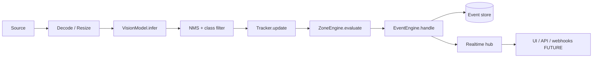

# VisionOps — Product Requirements Document

> **Status:** Living document · **Version:** 0.1.0 · **Owner:** VisionOps core team
> **Scope of this document:** the complete product from the V0.1 implementation through a mature, publicly usable platform.
> **How to read it:** every section is tagged `CURRENT` (implemented now), `NEXT` (immediately after V0.1), or `FUTURE` (architecturally accommodated, deliberately not built yet).

---

## Table of contents

1. [Executive summary](#1-executive-summary) · 2. [Product vision](#2-product-vision) · 3. [Problem statement](#3-problem-statement) · 4. [Target users](#4-target-users) · 5. [Target industries](#5-target-industries) · 6. [Core use cases](#6-core-use-cases) · 7. [V0.1 exact scope](#7-v01-exact-scope) · 8. [V0.1 non-goals](#8-v01-explicit-non-goals) · 9. [Roadmap](#9-full-future-roadmap) · 10. [Functional requirements](#10-functional-requirements) · 11. [Non-functional requirements](#11-non-functional-requirements) · 12–21 [Vision & data](#12-computer-vision-architecture) · 22. [Reporting](#22-reporting-architecture) · 23. [Multi-tenancy](#23-multi-tenant-architecture) · 24. [Hierarchy](#24-organization-site-camera-hierarchy) · 25. [AuthN](#25-authentication-and-authorization) · 26. [Roles](#26-user-roles-and-permissions) · 27. [Database](#27-database-architecture) · 28. [API](#28-api-architecture) · 29. [Frontend](#29-frontend-architecture) · 30. [Backend](#30-backend-architecture) · 31. [AI agents](#31-ai-agent-architecture) · 32. [Model management](#32-model-management-architecture) · 33. [Model evaluation](#33-model-evaluation-strategy) · 34. [Datasets](#34-dataset-strategy) · 35–37. [Observability, logging, errors](#35-observability) · 38. [Security](#38-security-architecture) · 39. [Privacy-by-design](#39-privacy-by-design-architecture) · 40–42. [Retention, video, event storage](#40-data-retention-strategy) · 43. [Audit logging](#43-audit-logging) · 44–48. [Deployment](#44-deployment-architecture) · 49. [Testing](#49-testing-strategy) · 50–54. [Performance, scale, reliability, DR, cost](#50-performance-requirements) · 55–56. [Versioning](#55-api-versioning) · 57. [Plugins](#57-plugin-module-architecture) · 58. [Integrations](#58-future-integrations) · 59. [Public API](#59-public-api-strategy) · 60. [SaaS](#60-saas-architecture) · 61. [Public launch](#61-public-launch-requirements) · 62–65. [Checklists](#62-production-readiness-checklist) · 66–71. [Opportunities, risks, mitigations, DoD](#66-future-opportunities)

---

## 1. Executive summary

VisionOps turns cameras that already exist into operational intelligence. Most organisations own cameras. Very few can answer questions about them: *was anyone in the loading bay after 22:00? How many people are on the floor right now? Did the required PPE zone stay clear?*

VisionOps is a self-hostable computer-vision platform that ingests existing video (webcam, IP/RTSP, file), runs efficient CPU-first object detection and tracking, applies operator-defined spatial rules (zones, lines, thresholds), and turns violations into a durable, queryable, exportable **event stream** — surfaced in a dashboard, an API, webhooks, reports and (later) an AI investigation assistant.

**The V0.1 production slice** is *restricted-zone intelligence*: connect a camera, see live video, detect and track people, draw a restricted zone, and get an enter/exit event with a timestamp, a zone, a track, and a snapshot — with full event history.

The architecture is deliberately **layered and interface-driven**. Detection is a swappable `VisionModel`; tracking is a swappable `Tracker`; zone reasoning is a swappable `ZoneEngine`; events are a generic typed stream. Swapping YOLO for RT-DETR, a cloud API, or an edge NPU changes one adapter, not the application. That is the difference between a tutorial and a platform.

**Guiding principle: production-quality foundations, minimal first feature set.** We would rather ship 8 things that are real, tested and extensible than 40 things that are stubbed.

## 2. Product vision

> Cameras are the most-deployed sensor in the world and the least-used data source. VisionOps makes them answerable.

Three horizons:

| Horizon | Product | Customer |
| --- | --- | --- |
| **Now — Self-hosted intelligence** | Run the whole platform on your own hardware (laptop, NUC, edge box). Zone monitoring, counts, events, API. | Operators with existing cameras and no safe analytics today. |
| **Next — Fleet operations** | Many cameras, many sites, rules, alerts, reports, integrations, teams. | SMEs and mid-market operations teams. |
| **Future — Ambient operational safety (SaaS + edge)** | Managed cloud, edge inference, industry modules (PPE, vehicles, queues, occupancy), AI-assisted investigation. | Enterprises, institutions, municipalities, and the public. |

Non-negotiable design values:

1. **Runs anywhere, cheaply.** A 4-core laptop, a €200 NUC, a Jetson, or a cloud VM. CPU-first inference is the default path; GPU is an accelerator, never a requirement.
2. **Privacy-preserving by construction.** No biometric identity, no facial recognition, no face storage. Analytics are over *objects, anonymous ephemeral track IDs, zones, counts and timestamps*.
3. **Own your data.** Open formats, open schema, exportable events, self-hostable, no mandatory cloud.
4. **Honest engineering.** No fake integrations, no mock data presented as real, no dead configuration. Every documented capability is either implemented and tested, or explicitly marked FUTURE with its integration point defined.

## 3. Problem statement

**Today, extracting operational value from an existing CCTV estate is a four-way bad trade:**

| Option | Problem |
| --- | --- |
| Cloud AI-as-a-service (e.g. managed video analytics) | Recurring per-camera/per-minute cost that scales badly; video leaves the premises; regulatory friction; vendor lock-in; often unusable on intermittent links. |
| Commodity NVR/VMS | Strong recording and playback, weak *semantics*. It cannot tell you "restricted zone entered" as a queryable, aggregate, alertable fact. |
| Custom CV project per site | 6–18 months, brittle, non-transferable, no multi-site operations, no product surface. |
| Nothing (most sites) | Blind to unauthorised access, safety violations, occupancy and queue behaviour. |

**The specific gap:** a *small, affordable, self-hosted, general-purpose* layer that turns "cameras exist" into "operational facts exist" — with an API and an event model that survive the jump from one camera to a thousand.

**Why it is hard, honestly:**

- Real deployments are messy: RTSP quirks, dropped frames, night scenes, motion blur, occlusion, 8 fps cameras pretending to be 25 fps.
- Models are not the bottleneck; **scene adaptation, thresholds, spatial reasoning and operational trust** are.
- Operators do not want a research demo; they want alerts they can act on at 03:00 without false alarms every 4 minutes.
- Privacy law (NDPA Nigeria, GDPR EU/UK, POPIA South Africa, CCPA and equivalents) makes naive people-counting deployments legally hazardous.

**Our answer:** a small set of composable, testable primitives — *sources → detection → tracking → spatial rules → events* — with opinionated defaults, per-deployment thresholds, and an auditable data model.

## 4. Target users

**Primary (design for these first):**

- **Operations supervisor / site manager** — needs to know *now* whether something is wrong, and a history to answer questions later. Values the dashboard above all.
- **Safety officer** — needs zone violations, dwell time and PPE events with defensible evidence (timestamps, snapshots, zone definitions).
- **Small-business owner** (warehouse, shop, clinic, school) — wants the count, not the platform. Zero-ops install, works on a mini PC.
- **Security/control-room operator** — needs live situational awareness and an event feed that can be shared.

**Secondary:**

- **Integrator / MSP** — builds deployments for clients; needs multi-site, API keys, stable contracts, reproducible configuration.
- **Developer / platform engineer** — builds on the API and webhooks; needs typed contracts, versioning and docs.
- **Auditor / compliance officer** — needs exports, retention control and audit trails.
- **Data/AI engineer** — wants to swap models, evaluate them on their own footage, and reuse the pipeline.

**Anti-users (we must not design for them):** users wanting facial recognition, biometric identity, or individual staff productivity scoring. We will not build these; see §39.

## 5. Target industries

Ordered by fit with the V0.1 slice and by market accessibility:

1. **Warehouses & logistics** — restricted/keep-clear zones, dock safety, forklift-adjacent pedestrian separation (Phase 5).
2. **Construction sites** — exclusion zones, PPE (Phase 5), working-hour occupancy.
3. **Manufacturing / factories** — machine-guard zones, cell-count monitoring, shift analytics.
4. **Retail** — entrance/exit counts, queue length (Phase 5), shop-floor occupancy, dwell by zone.
5. **Schools & universities** — after-hours access control of restricted areas, campus occupancy.
6. **Hospitals & clinics** — restricted clinical areas, corridor flow, waiting-room occupancy. (Highest privacy sensitivity — privacy-by-design is mandatory here.)
7. **Public institutions & government** — perimeter and restricted-area monitoring with a public-interest accountability trail.
8. **Municipalities** — public-space occupancy and event safety at low cost across many sites.
9. **Transport / parking / fuel** — vehicle detection, restricted-lane crossing.
10. **Residential / SME premises** — single-camera, low-cost, self-hosted, no subscription.

**Geographic strategy:** the platform must be installable and operable in low-bandwidth, cost-sensitive environments (Nigeria, Kenya, Ghana, South Africa, Southeast Asia, South America) *and* in regulated markets (EU/UK, North America). This drives the "edge-capable, cloud-optional, bandwidth-tolerant" architecture (§47) and self-hosting as a first-class deployment mode.

## 6. Core use cases

### V0.1 use cases (implemented)

| ID | Use case | Acceptance |
| --- | --- | --- |
| UC-01 | Watch a live camera with people detection and tracking overlays | Live detections appear within 2 s of starting the session, with track IDs and confidence |
| UC-02 | Draw a rectangular restricted zone over the video | Zone persists, renders on the overlay, is versioned and re-loadable after restart |
| UC-03 | Receive an alert when a person enters the restricted zone | A `ZONE_ENTERED` event is created, persisted and streamed to the UI within 1 s |
| UC-04 | Receive an alert when a person leaves the zone | A `ZONE_EXITED` event is created with the dwell duration |
| UC-05 | Review event history with filters | Event list is paginated, filterable by type/zone/camera/time, and shows detail with metadata |
| UC-06 | Know the system is healthy | System status page shows source, model, tracker and pipeline state, FPS, latency, and the active error, if any |
| UC-07 | Recover from a camera failure | Source failure is surfaced as `DEGRADED`/`FAILED` with reason; retry/backoff; no crash, no silent stall |

### NEXT use cases (Phases 2–4)

| ID | Use case |
| --- | --- |
| UC-08 | Run 8–32 cameras concurrently with per-camera isolation and fair resource sharing |
| UC-09 | Count people inside a zone (occupancy) and alert on threshold crossings |
| UC-10 | Define a virtual line and detect direction-aware crossing |
| UC-11 | Combine conditions into rules (zone + class + time window + dwell) |
| UC-12 | Dispatch alerts to email/Slack/webhook with grouping, dedup and escalation |
| UC-13 | Answer analytics questions (hourly counts, peak occupancy, per-zone totals) |
| UC-14 | Generate a scheduled report (PDF/CSV) |

### FUTURE use cases

| ID | Use case |
| --- | --- |
| UC-15 | Detect PPE violations (helmet, hi-vis, mask) in construction/manufacturing |
| UC-16 | Detect vehicles, licence-plate-**redacted** presence, and vehicle/pedestrian conflict |
| UC-17 | Estimate queue length and wait times |
| UC-18 | Classify anomalies (loitering, fall detection, crowd density, tailgating) |
| UC-19 | Multi-tenant SaaS with organisations, seats, quotas and billing |
| UC-20 | AI-assisted investigation: "show me every unauthorised entry to Bay 4 last night" answered over the event stream with citations |
| UC-21 | Edge inference on-site with cloud sync of events only (bandwidth-constrained sites) |

## 7. V0.1 exact scope

**In scope — the complete, implemented, tested slice.**

1. **Ingestion** (4 source kinds, unified interface):
   - `browser` — webcam via `getUserMedia`, frames pushed from the browser over a WebSocket (works with zero camera libraries on the server).
   - `device` — a local V4L2/index camera via OpenCV (`DEVICE:0`).
   - `file` — a local video file; loops optionally (deterministic fixture video included for hardware-free runs).
   - `rtsp` — an RTSP/HTTP stream URL via FFmpeg/OpenCV (credentials supported, stored encrypted).
2. **Vision**: ONNX Runtime CPU inference of a YOLO-family detector, configurable confidence/IoU thresholds and target class filter (`person` by default), letterboxed preprocessing, NMS implemented in-house.
3. **Tracking**: self-contained multi-object tracker (Kalman motion model + IoU association + linear re-association of lost tracks), producing stable ephemeral track IDs with configurable `max_age`.
4. **Zones**: polygon zones (a rectangle is a 4-point polygon) with a name, colour, severity, cooldown and dwell threshold. Entry/exit determined from the **foot point** (bottom-centre of the box) — documented rationale in §12.
5. **Events**: typed, structured, persisted events with JSON metadata, dedup/cooldown, and a live WebSocket feed. Types: `ZONE_ENTERED`, `ZONE_EXITED`, plus system-lifecycle types.
6. **Persistence**: SQLite by default (zero-install), PostgreSQL-compatible via configuration; Alembic migrations; org scoping on all data rows; audit log.
7. **API**: `/api/v1` REST for health, status, cameras, zones, events (+ analytics summary), WebSocket for live pipeline state, MJPEG preview for server-side sources, API-key authentication.
8. **Web UI**: dashboard, live camera view with drawing/zone editor, event list + detail, system status. Responsive. Dark, operator-grade UI.
9. **Ops**: structured JSON logs, in-process metrics with Prometheus text exposition, health/readiness endpoints, `.env.example`, Makefile, Dockerfiles, systemd unit, GitHub Actions CI.
10. **Tests**: unit (geometry/tracker/event logic), integration (API + DB), CV-deterministic (scripted detector + synthetic fixture), optional real-model tests, frontend unit, E2E with a fake camera device.

**Definition of V0.1 "done":** see §71 and `docs/TESTING.md` acceptance criteria — all must pass before the version is called complete.

## 8. V0.1 explicit non-goals

These are *deliberately absent*. Each has a documented integration point (§57) but no speculative code.

| Non-goal | Why not now | Where it plugs in |
| --- | --- | --- |
| Facial recognition / biometric identity / person re-identification | Legal, ethical and privacy risk; out of scope permanently | — (will not be built) |
| Multi-user accounts, JWT login, RBAC | A single local operator does not need it; it is Phase 6 work | `AuthProvider` interface (`backend/visionops/core/auth.py`) |
| Multiple organisations in one deployment | Schema already supports it; enforcement/UI is Phase 6 | `org_id` on all rows; scoping helpers |
| Rule engine with boolean composition | Zones already carry a minimal policy; general rules are Phase 4 | `zone.policy` JSON schema + `Rule` model in `docs/DATABASE.md` |
| Email/SMS/Slack delivery | Requires secrets + provider accounts; Phase 4 | `Notifier` protocol |
| Webhooks | Phase 8; the event bus is already the right seam | `EventSink` protocol |
| Object detection for non-person classes in the UI | Detector is class-agnostic; UI focuses on people | Class filter is config-only |
| Line crossing, loitering, occlusion handling | Phase 4 | `ZoneEngine` strategy registry |
| Per-frame detection/track persistence | Write amplification, no operational value yet | `detections`/`tracks` tables designed in `docs/DATABASE.md` |
| Video recording / clip storage | Storage cost + privacy surface; snapshots only, opt-in | `Event.snapshot_path` |
| GPU/TensorRT/ONNX Runtime GPU provider tuning | CPU path must be excellent first; provider is config | `VISIONOPS_ORT_PROVIDER` |
| Docker Compose *required* for local dev | Docker is not always available; native dev path is first-class | `infra/` |
| Billing, quotas, metering | SaaS phase | — |

## 9. Full future roadmap

The authoritative roadmap is `docs/ROADMAP.md`. Summary:

| Phase | Theme | Outcome |
| --- | --- | --- |
| 0 | Architecture | This documentation set + ADR log |
| 1 | **V0.1 restricted-zone intelligence** | Zone enter/exit events from one camera, end to end |
| 2 | Multiple cameras | 8–32 concurrent sessions, isolation, fair scheduling, multi-camera UI |
| 3 | Persistent events + analytics | Event history at scale, hourly/zone aggregates, retention jobs |
| 4 | Rules + alerts | Line crossing, occupancy thresholds, dwell, boolean rules, notifications |
| 5 | Safety / PPE modules | PPE, vehicles, queues, conflict detection, industry packs |
| 6 | Multi-tenant organisations | Users, RBAC, orgs, quotas, Postgres RLS, audit-grade isolation |
| 7 | Edge inference | Edge agent, offline-first event sync, NPU/TensorRT providers |
| 8 | Public API + integrations | Public API programme, SDKs, webhooks, OAuth apps |
| 9 | AI investigation/reporting | Retrieval + tool-using agent over the event corpus, cited reports |
| 10 | Production SaaS | Multi-region, autoscaling, billing, SLOs, on-call |
| 11+ | Industry solutions | Vertical packs, partner ecosystem, marketplace |

## 10. Functional requirements

### 10.1 Ingestion (`CURRENT`)

- **FR-ING-01** The system shall support source kinds `browser`, `device`, `file`, `rtsp` behind one `VideoSource` interface.
- **FR-ING-02** The system shall start, stop and restart a session idempotently; a second start on a running session shall return the existing session.
- **FR-ING-03** The system shall report per-source state: `STOPPED | STARTING | RUNNING | DEGRADED | FAILED` with a machine-readable reason code and human-readable detail.
- **FR-ING-04** The system shall apply configurable target FPS sampling and skip frames rather than queueing them (freshness over completeness for live streams).
- **FR-ING-05** The system shall surface source failures (device busy, EOF, RTSP timeout, decode error) without crashing the process, and shall retry with exponential backoff up to a configurable limit before marking `FAILED`.
- **FR-ING-06** For file sources the system shall honour `loop` and report playback position/progress.

### 10.2 Detection (`CURRENT`)

- **FR-DET-01** The system shall run a YOLO-family ONNX model through ONNX Runtime with a configurable execution provider (default `CPUExecutionProvider`).
- **FR-DET-02** The system shall expose configurable `confidence_threshold` and `nms_iou_threshold`.
- **FR-DET-03** The system shall support a class allow-list; V0.1 defaults to `person`.
- **FR-DET-04** Detections shall be emitted in **normalised** coordinates `[0,1]` so that overlay rendering and storage are resolution-independent.
- **FR-DET-05** The system shall load the model once per process and reuse the session; it shall warm up before serving.
- **FR-DET-06** Inference failure shall degrade the session to `DEGRADED` with `MODEL_ERROR` and shall not crash the process; the operator shall see the error in System Status.

### 10.3 Tracking (`CURRENT`)

- **FR-TRK-01** The system shall assign stable, ephemeral (session-scoped) track IDs across frames.
- **FR-TRK-02** The system shall support configurable `max_age` (frames a lost track is retained for re-association).
- **FR-TRK-03** Tracks shall carry state (`ACTIVE | LOST | REMOVED`), first/last-seen timestamps, velocity and a bounded history.
- **FR-TRK-04** The system shall re-associate a re-appearing track to its prior ID where geometry permits, to prevent duplicate enter/exit events.

### 10.4 Zones and spatial reasoning (`CURRENT`, partial `NEXT`)

- **FR-ZON-01** Zones shall be polygons of ≥3 normalised points; rectangles are a 4-point polygon with a dedicated UI helper.
- **FR-ZON-02** Entry/exit shall be decided on the **foot point** (bottom-centre) of a track box by even-odd point-in-polygon.
- **FR-ZON-03** Each zone shall carry: name, colour, severity (`info | warning | critical`), cooldown seconds, minimum dwell seconds, enabled flag, and per-zone class filter.
- **FR-ZON-04** Crossing a zone boundary shall produce exactly one `ZONE_ENTERED` and one `ZONE_EXITED` per in/out transition, hysteresis-protected by `min_dwell_seconds` and `cooldown_seconds`.
- **FR-ZON-05** *(NEXT)* Zones shall support a type discriminator (`polygon | line`) and an optional direction vector.

### 10.5 Events (`CURRENT`)

- **FR-EVT-01** Events shall have a stable type enum, a UUID, timestamps (`occurred_at`, `received_at`), severity, and structured JSON `metadata`.
- **FR-EVT-02** Events shall reference `organization_id`, `camera_id`, `zone_id` (nullable) and `track_id` (nullable, ephemeral).
- **FR-EVT-03** Events shall be persisted before being broadcast; broadcast failure shall never lose the event.
- **FR-EVT-04** Events shall be listable with pagination and filters: type, severity, zone, camera, `from`, `to`, `text`.
- **FR-EVT-05** Event snapshots (JPEG) shall be opt-in, stored outside the database, and referenced by path.
- **FR-EVT-06** The event schema shall be versioned so consumers can migrate.

### 10.6 API and UI (`CURRENT`)

- **FR-API-01** All `/api/v1` endpoints shall require an API key (`Authorization: Bearer` or `X-API-Key`) except `/healthz` and `/readyz`.
- **FR-API-02** Errors shall be RFC 9457 problem details with a stable machine code.
- **FR-UI-01** The UI shall provide Dashboard, Camera view, Zone editor, Events, Event detail and System status.
- **FR-UI-02** The camera view shall draw video, detections, tracks, zone(s) and live state in one synchronised overlay that handles resolution/aspect changes.
- **FR-UI-03** Zone creation/editing shall be direct manipulation (drag on the video) *and* numeric entry, with validation.
- **FR-UI-04** The UI shall show camera state, AI state, event state, confidences, timestamps, zone state and health — no silent failure.

### 10.7 Multi-tenancy, RBAC, audit (`NEXT`)

- **FR-TEN-01** Every domain row shall carry `organization_id`; all queries shall be org-scoped through a single helper.
- **FR-TEN-02** *(Phase 6)* Row-level security in PostgreSQL as defence in depth.
- **FR-AUD-01** *(CURRENT)* Security-relevant mutations (create/update/delete zone, camera, source start/stop, key operations) shall write an audit record: actor, action, target, outcome, IP, timestamp, diff.
- **FR-RBAC-01** *(Phase 6)* Roles: `owner | admin | operator | analyst | viewer`, with permission checks at the API boundary.

### 10.8 Integrations, AI (`FUTURE`)

- **FR-WEB-01** *(Phase 8)* Signed, retried, at-least-once webhooks with delivery log and dead-letter.
- **FR-AGT-01** *(Phase 9)* An investigation agent that may only *read* the event corpus and cite event IDs; it may never write, and it may never receive raw video.

## 11. Non-functional requirements

| ID | Requirement | Target |
| --- | --- | --- |
| NFR-PERF-01 | End-to-end pipeline latency (frame read → event published) | p50 < 400 ms, p95 < 1200 ms on 4 vCPU at 640×360 input |
| NFR-PERF-02 | Sustained throughput | ≥ 12 processed FPS single session on 4 vCPU (yolo11n @ 640, CPU) |
| NFR-PERF-03 | API read latency | p95 < 150 ms for paginated lists of 50 |
| NFR-PERF-04 | Memory | < 1.5 GB RSS for one session + API on 4 vCPU |
| NFR-PERF-05 | Cold start | API ready < 10 s; first detection < 5 s after session start |
| NFR-REL-01 | Availability | No crash on any source/model failure; supervised restart via systemd/Docker |
| NFR-REL-02 | Durability | Events survive process restart (SQLite WAL / Postgres) |
| NFR-SEC-01 | Secrets | Never in git; encrypted at rest for camera credentials; documented in `.env.example` with dummy values |
| NFR-SEC-02 | Transport | HTTPS/TLS terminated at reverse proxy in production; docs include a hardened nginx example |
| NFR-PRIV-01 | No biometrics | No face detection, no embedding, no identity. Enforced by review + absence of models |
| NFR-PRIV-02 | Data minimisation | Store events + metadata + optional snapshot. No raw video by default. Retention configurable |
| NFR-OBS-01 | Diagnosability | Every failure path produces a structured log line, a state transition, and a user-visible reason |
| NFR-OBS-02 | Metrics | FPS, inference latency, tracker count, event rate, API latency, source uptime — exported in Prometheus text format |
| NFR-UX-01 | Responsive UI | Usable at 360 px (phone) to 2560 px (control-room wall) |
| NFR-COMP-01 | Modest hardware | Runs on 4 vCPU / 8 GB / no GPU; optional GPU path |
| NFR-INT-01 | Bandwidth | Edge mode must work with events-only uplink (§47) |
| NFR-MAINT-01 | Onboarding | Fresh developer → running system in < 30 min on a laptop with no Docker |
| NFR-PORT-01 | Portability | Linux/macOS/Windows dev; Linux prod images; ARM64 supported |

## 12. Computer-vision architecture

Detail: `docs/VISION_ENGINE.md`. Summary of the current pipeline and its seams.



Key architectural properties (`CURRENT`):

1. **Normalised coordinates everywhere.** Detections and zones are `[0,1]`. Rendering, storage and analytics never care about resolution. This is the single most important decision for future-proofing multi-camera/multi-resolution fleets.
2. **Four narrow interfaces** — `VisionModel`, `Tracker`, `ZoneEngine`, `EventEngine` — all pure-ish and framework-free (no FastAPI, no SQLAlchemy, no OpenCV-global state). They are unit-testable with fakes and are the documented plugin points.
3. **Frame skipping, never queueing.** A slow model degrades effective FPS rather than building latency. Staleness is visible (`frame_age_ms`) rather than hidden.
4. **The detector is a `Protocol`, not a class.** Swapping YOLO-ONNX for RT-DETR, TensorRT, an NPU delegate, or a cloud API means writing one adapter.

Known weaknesses and mitigations (honest): occlusion and crowded overlap (`docs/VISION_ENGINE.md` §Occlusion), motion blur, low light, small objects at distance (mitigated by configurable input size and ROI), false positives (per-class thresholds, zone class filters, cooldowns).

## 13. AI/ML architecture

- **Inference only in production.** VisionOps does not train production models in production. It *consumes* models.
- **Model abstraction:** `VisionModel` protocol (`load`, `warmup`, `infer(frame) -> list[Detection]`, `info -> ModelInfo`, `close`). `OnnxYoloModel` is the only shipped implementation (`CURRENT`). Future adapters: `RTDetrOnnxModel`, `TensorRtModel`, `NpuModel`, `RemoteModelClient`.
- **Feature/label space:** COCO class names loaded from the model's own metadata (embedded in the ONNX file or sidecar), not hard-coded. This makes non-COCO fine-tunes (`person`, `forklift`, `hi_visor`, `helmet`) work without code changes.
- **Deterministic pre/post-processing:** letterbox resize with fixed `pad`, `/255` normalisation, NMS in NumPy. No hidden randomness, no framework magic.
- **Model lifecycle** (`CURRENT`): version pinned by config + SHA-256 recorded at load; auto-download of the default model on first run (opt-out); a *lazy* loader so a missing model degrades the API (health OK) while reporting AI as unavailable — the UI then says so explicitly.
- **Model registry, training, evaluation, datasets** are `FUTURE` (Phases 9–11) and designed in `docs/DATABASE.md` (`models`, `model_versions`, `inference_jobs`) with the interface seams defined here.

## 14. Video ingestion architecture

`VideoSource` is a `Protocol`:

```python
class VideoSource(Protocol):
    def open(self) -> None: ...
    def read(self) -> Frame | None: ...   # None == end of stream
    def close(self) -> None: ...
    @property
    def info(self) -> SourceInfo: ...     # fps, width, height, frame_count, position
    @property
    def health(self) -> SourceHealth: ... # state, reason_code, detail, uptime, frames, retries
```

Implementations (`CURRENT`): `BrowserFrameSource` (WebSocket binary JPEG frames with client-side capture metadata), `DeviceSource` (OpenCV index), `FileSource` (OpenCV path + optional loop), `RtspSource` (OpenCV/FFmpeg URL with credentials from encrypted storage, OpenCV `CAP_PROP_OPEN_TIMEOUT_MSEC`/`READ_TIMEOUT_MSEC` tuning).

Design rules:

- **Blocking I/O only in a worker thread.** Each session owns one dedicated thread; the async API never blocks on decode.
- **Back-pressure by drop.** New frames supersede unread frames; the pipeline reports `dropped_frames` when capture outpaces inference.
- **Source health is a first-class object**, not a log line. UI reads it.
- **No video leaves the host in V0.1** except frames from the user's own browser to their own backend (same-origin/LAN). This is a documented privacy property, not an accident.

## 15. Camera architecture

`CURRENT`: a `Camera` is a logical entity (name, site, timezone, resolution policy, status) that owns one or more `VideoSource`s. A camera can be `online`, `offline`, `degraded`. Credentials belong to the source, encrypted at rest with an app master key (§38). Camera status is derived from its active session's `SourceHealth` plus last-frame age.

`NEXT`: camera groups, ONVIF discovery, RTSP health probing on a schedule, per-camera inference profiles (input size, thresholds, class filters) and schedules.

`FUTURE`: hardware transcoding, sub-stream/dual-stream (low-res for detection, high-res for evidence), per-camera model assignment, camera health SLAs, firmware management.

## 16. Edge-processing architecture

`FUTURE` (Phase 7) with the seam designed now:

- The **vision engine is already a library with no web dependencies**, and the only external things it touches are the DB (through a repository interface) and the realtime hub. That is exactly the shape an edge agent needs.
- The **edge agent** will run the same pipeline on an edge box and write events to a local SQLite store, then replicate to a site/cloud server over an authenticated, resumable, idempotent (UUID-deduplicated) sync channel.
- **Bandwidth policy:** edge uploads events + optional snapshots; raw video never leaves unless explicitly configured (§47).
- **Provider abstraction** (`CPUExecutionProvider` today) is where TensorRT / OpenVINO / NPU delegates attach.

## 17. Cloud-processing architecture

`FUTURE` (Phase 8–10) with V0.1 constraints in mind:

- Cloud processing is *the same pipeline*, scaled horizontally. The stateless API tier is separated from stateful pipeline workers by the `EventSink`/`VideoSource` boundaries.
- Streams arrive via pull (gateway pulls RTSP) or push (edge agent pushes frames/relays). WebRTC ingest for low-latency remote cameras is a later option; V0.1's browser path is the prototype of this.
- Object storage for snapshots/clips; Postgres for events; Redis (or Postgres LISTEN/NOTIFY) for the realtime fan-out — chosen at Phase 6/10 depending on cost profile.

## 18. Event architecture

Full detail: `docs/EVENT_ENGINE.md`. Summary:

- Events are the **only durable product of the platform**. Detections and tracks are ephemeral working state.
- Event = `{ id (uuid), schema_version, type, severity, occurred_at, received_at, organization_id, camera_id, zone_id?, track_id?, metrics: {...}, metadata: {...}, snapshot_path? }`.
- A typed registry maps event type → validation schema + default severity + documentation, so unknown types can never be silently invented by a plugin.
- Cooldowns and dedup keys are computed by the `EventEngine` per (zone, type) so a person pacing on a boundary cannot produce an alert storm.
- Events are persisted **before** broadcast; broadcast is best-effort and re-readable from the API.

`CURRENT` types: `ZONE_ENTERED`, `ZONE_EXITED`, `SOURCE_STARTED`, `SOURCE_STOPPED`, `SOURCE_FAILED`, `MODEL_LOADED`, `MODEL_FAILED`.
`NEXT`: `LINE_CROSSED`, `OCCUPANCY_THRESHOLD`, `DWELL_EXCEEDED`, `OBJECT_DETECTED`, `OBJECT_LEFT_ZONE`, `RULE_MATCHED`, `ALERT_RAISED`.
`FUTURE`: `PPE_VIOLATION`, `VEHICLE_DETECTED`, `QUEUE_THRESHOLD`, `ANOMALY_DETECTED`, `SAFETY_VIOLATION`.

## 19. Rules engine architecture

`FUTURE` (Phase 4), designed now:

```
Detections + Tracks + Zones + Context(time, camera, org)
        → RuleEvaluator (predicate tree over a normalised Signal frame)
        → RuleMatch { rule_id, severity, facts }
        → EventEngine → Event → AlertEngine → Notification channels
```

The normalised **Signal frame** (`{camera, ts, tracks[], zone_states[], metrics{}}`) is what makes rules expressible: a rule never touches pixels or raw detections. V0.1's implicit rule is "`class ∈ zone.filter ∧ foot_point ∈ zone.polygon ∧ dwell ≥ min_dwell`", which is the seed of the same model.

## 20. Alert architecture

`FUTURE` (Phase 4). `AlertEngine` sits between events and notifications:

- Grouping window (e.g. 5 min, per zone) → one alert with an event count.
- Severity routing and quiet hours per organisation.
- Escalation policy with timeout.
- Channels: in-app, email, Slack/Teams webhook, generic webhook, SMS (Twilio), push. All behind `Notifier` protocol.
- Delivery is at-least-once with idempotency keys and a delivery log.

V0.1 substitutes the dashboard event feed for delivery; the seam is `EventSink` (`RealtimeHub` today, `NotificationDispatcher` later).

## 21. Analytics architecture

`NEXT` (Phase 3):

- **Immutable event log** → **materialised hourly aggregates** (`zone_id × camera_id × hour × event_type × count`, plus occupancy min/avg/max) → **query API**.
- Aggregates are recomputable from the event log (single source of truth) and rebuildable by a backfill command.
- Ad-hoc questions without a warehouse: SQL views in `docs/DATABASE.md`.
- `FUTURE`: anomaly baselines per zone, dwell distributions, comparative dashboards, BI export (Parquet), and the AI agent reading aggregates rather than raw events where possible.

## 22. Reporting architecture

`NEXT` (Phase 3–4) / `FUTURE` polish: scheduled and on-demand reports (PDF, CSV, JSON) built from aggregates, delivered by the `Notifier`. Report definitions stored per organisation with templates. `FUTURE`: AI-written narratives (Phase 9) that cite event IDs so a human can verify every claim.

## 23. Multi-tenant architecture

`CURRENT` (structural) / `NEXT` (functional, Phase 6):

- Every domain table carries `organization_id` with an index; all reads/writes go through org-scoped repositories (`backend/visionops/db/scoped.py`). Scoping is centralised so it cannot be forgotten per-query.
- V0.1 deployment is **single-tenant operationally** (one org bootstrapped from config), but the data model and code paths are multi-tenant.
- Phase 6 adds: users, sessions, RBAC, invitations, Postgres RLS, per-org encryption keys (optional), quota enforcement and per-org rate limits.

## 24. Organization / site / camera hierarchy

```
Organization ─┬─ Site ─┬─ Camera ─┬─ VideoSource
              │        │          └─ (credentials)
              │        └─ Zone* (attached to camera, scoped by site)
              └─ ApiKey, Membership(FUTURE), Subscription(FUTURE), Integration(FUTURE)
Camera ─ Events ─┬─ Zone (nullable)
                 └─ track_id (ephemeral)
```

Zones attach to a **camera** (because geometry is meaningless across cameras) while being administered at **site** level. `docs/DATABASE.md` defines every table.

## 25. Authentication and authorization

`CURRENT`:

- **API key** (`Authorization: Bearer vo_...` or `X-API-Key: vo_...`), stored hashed (SHA-256 with a per-key random salt; keys are high-entropy so a fast hash is appropriate and lookup is O(1)), compared in constant time, scoped to one organisation.
- Bootstrap key is created from an environment variable on first run (or via CLI) and only ever printed once.
- All `/api/v1` routes require auth except `/healthz`, `/readyz` and the OpenAPI docs (docs are publicly readable but contain no secrets).
- Errors never distinguish "unknown key" from "revoked key" in the response body (timing/枚举 defence) — both return `401 unauthorized`.
- Rate limiting per key (`CURRENT`, in-process token bucket) with configurable limits.

`NEXT` (Phase 6): OIDC/OAuth2 for humans, scoped service accounts, key rotation with overlap, device-code flows for edge agents, and audit of every auth event.

## 26. User roles and permissions

`FUTURE` (Phase 6). Planned model, designed now so APIs are written against permission strings rather than role names:

| Permission | owner | admin | operator | analyst | viewer |
| --- | :-: | :-: | :-: | :-: | :-: |
| `org.manage`, `billing.manage` | ✓ | | | | |
| `members.manage`, `apikeys.manage` | ✓ | ✓ | | | |
| `camera.read` / `camera.write` | ✓ | ✓ | ✓ | ✓ | ✓(read) |
| `zone.read` / `zone.write` | ✓ | ✓ | ✓ | ✓ | ✓(read) |
| `session.start` / `session.stop` | ✓ | ✓ | ✓ | | |
| `event.read` / `event.export` | ✓ | ✓ | ✓ | ✓ | ✓(read) |
| `model.manage`, `rule.write`, `integration.manage` | ✓ | ✓ | | | |
| `audit.read` | ✓ | ✓ | | | |

`CURRENT` note: V0.1 has exactly one principal type — the bootstrap API key, implicitly `owner`. The API layer is nonetheless written to check permission strings, so Phase 6 adds authorisation, not a rewrite.

## 27. Database architecture

Full design: `docs/DATABASE.md`. `CURRENT` schema (8 tables, Alembic-migrated):

`organizations`, `api_keys`, `sites`, `cameras`, `video_sources`, `zones`, `events`, `audit_logs`.

`FUTURE` tables (designed, not migrated): `users`, `memberships`, `roles`, `permissions`, `detections`, `tracks`, `rules`, `alerts`, `notifications`, `reports`, `models`, `model_versions`, `inference_jobs`, `webhooks`, `integrations`, `subscriptions`, `snapshots`, `aggregates_hourly`.

Cross-cutting: UUIDv7-style time-ordered IDs (UUIDv4 today for portability), `created_at`/`updated_at` triggers, soft-delete only where business semantics require it (zones/cameras), `CHECK` constraints for enum-like fields, JSON columns for extensible metadata, and org-scoped composite indexes for every query path.

## 28. API architecture

Full contract: `docs/API.md`.

- **Base:** `/api/v1`, JSON, RFC 9457 error bodies, `request_id` echoed on every response and every log line.
- **Transport:** REST for state, WebSocket for live state (`/api/v1/stream/...`), MJPEG for server-side preview.
- **V0.1 resources:** `healthz`, `readyz`, `system/status`, `system/metrics`, `organizations`(read self), `sites`, `cameras`, `cameras/{id}/sources`, `cameras/{id}/session` (start/stop/state), `cameras/{id}/preview.mjpg`, `zones`, `events`, `events/{id}`, `events/summary`, `models/current`, `stream/sessions/{id}`.
- **Conventions:** cursor pagination, ISO-8601 UTC timestamps, idempotency keys on mutating endpoints (`FUTURE`), request/response size limits, strict input validation with field-level problems.
- **Docs:** OpenAPI generated from the code (never hand-written) and served at `/api/v1/docs`.

## 29. Frontend architecture

Detail: `docs/FRONTEND.md`. React 19 + TypeScript + Vite + Tailwind; React Router for navigation; TanStack Query for server state (caching, polling, invalidation); plain Context for ephemeral UI state.

Structure mirrors the API: `pages/` (Dashboard, Camera, Events, EventDetail, System, Zones), `features/` (zone editor, live overlay, event feed), `lib/api` (typed client + error normalisation), `components/ui` (primitives).

Key behaviours: live overlay drawn on a canvas over the video element using normalised coordinates; zone editor with drag handles + numeric fields; WebSocket store with reconnect/backoff and staleness indicator; responsive layout; accessible contrast and keyboard operation; explicit "no camera / no model / stale data" states — never a blank canvas.

## 30. Backend architecture

```
FastAPI app
├── api/            HTTP + WebSocket routers (thin: validate → call service → map result)
├── services/       use-cases (camera, zone, event, session, system status, audit)
├── vision/         CV core — ZERO web/db imports (model, tracker, geometry, zones, events, pipeline)
├── ingest/         VideoSource implementations + session lifecycle
├── realtime/       WebSocket hub, fan-out, back-pressure
├── db/             engine, session, scoped repositories, migrations
├── models/         SQLAlchemy ORM
├── schemas/        Pydantic DTOs (API contracts)
├── core/           config, logging, metrics, errors, security, ids, auth
└── observability/  metrics registry, health aggregation
```

Rules: routers never touch the DB directly; services never touch HTTP; `vision/` never touches FastAPI, SQLAlchemy or the network. Sessions run in dedicated threads with a bounded worker pool. Dependency injection is explicit through small `Container` factories (no service locator magic).

## 31. AI agent architecture

`FUTURE` (Phase 9), designed now:

```
User question
   → Query planner (structured intent, no raw SQL from the model)
   → Tools: search_events(filters), get_event(id), aggregate(zone,camera,window),
            describe_zone(id), export_window(window)
   → Evidence set (event IDs + aggregate rows)
   → Answer with mandatory citations to event IDs
   → Optional narrative report
```

Hard constraints: read-only tool access; no raw video into the model; no PII (there is none in the schema); every numeric claim must be traceable to an aggregate or event ID; the agent cannot create, modify or delete data; prompt/response logging with redaction; a deterministic (non-agent) answer path for simple questions, and the agent used only when a deterministic query cannot express the question. Cost control: retrieval over pre-aggregated data, cache by (question-shape, window).

## 32. Model management architecture

`FUTURE` (Phases 9–11). `models` (logical model, e.g. "person-detector") and `model_versions` (immutable artefact: URI, SHA-256, framework, input size, class map, metrics, licence, stage: `candidate|shadow|active|deprecated`). A camera references an active `model_version`. Activation is atomic and audited; shadow inference allows A/B evaluation without user-visible change. `CURRENT` stands in as: one configured model path + recorded SHA-256 in status output.

## 33. Model evaluation strategy

`FUTURE`, but the harness shape is defined now so metrics are collected from day one:

- **Offline:** precision/recall/mAP50 on a per-site held-out labelled set; false-positives-per-hour in "no-violation" footage is the metric operators actually feel.
- **Shadow:** run a candidate alongside the active model on live traffic; compare event streams without alerting.
- **Online:** from events — detection counts per zone-hour, alert volume, operator acknowledgement/dismissal rates (a rising dismissal rate is a model regression signal).
- **Gating:** a candidate must not increase false-positive rate beyond a configured budget on the shadow set before promotion.

## 34. Dataset strategy

`FUTURE`, with an important starting commitment: **no personal data leaves the operator's control.** Labelled data is customer-owned and stays in the deployment; VisionOps ships *tooling* (annotation export, evaluation harness, per-site calibration reports), not a central face/people dataset. For our own development we use: synthetic fixtures (deterministic, committed), permissively licensed public footage (CC0/CC-BY, referenced with licence and source in `samples/SOURCES.md`), and self-recorded consenting test footage. Any future shared dataset requires documented consent and licence provenance per clip.

## 35. Observability

Detail: `docs/OBSERVABILITY.md`. Three pillars:

1. **Structured logs** — JSON, one line per event, with `ts`, `level`, `logger`, `message`, `request_id`, `session_id`, `camera_id`, and structured fields. Human-readable console rendering for local dev.
2. **Metrics** — in-process registry: gauges (source state, model state, active sessions, tracker count, last frame age) and counters/histograms (inference latency, pipeline latency, events by type, dropped frames, API latency, HTTP status). Exposed as Prometheus text at `/api/v1/system/metrics` with no extra dependency.
3. **System status** — the human-facing aggregation the UI renders, combining source health, model health, pipeline health and storage health, each with a state and a reason code.

## 36. Logging

- Levels: `DEBUG` (per-frame diagnostics, off in production), `INFO` (lifecycle, config), `WARNING` (degradation), `ERROR` (failure with cause), `CRITICAL` (process unusable).
- **Never** log: API keys, camera credentials, full RTSP URLs with credentials, snapshot content, raw frame bytes.
- Correlation: `request_id` (HTTP), `session_id` (pipeline). Configurable `LOG_LEVEL`, `LOG_FORMAT=json|console`.
- Rotation: container stdout in production; `logging.handlers.RotatingFileHandler` when run natively.

## 37. Error handling

- **Domain errors** (`NotFound`, `Conflict`, `Validation`, `Unauthorized`, `RateLimited`, `SourceError`, `ModelError`) mapped centrally to HTTP codes and RFC 9457 bodies with a stable `code`.
- **Pipeline errors are states, not exceptions**: a failing source or model transitions the session to `DEGRADED`/`FAILED` with a reason code; the loop keeps running and can recover.
- **Never swallow**: unknown exceptions are logged with a stack trace and converted to `500 internal_error` without leaking internals.
- **Client-facing messages** are actionable ("camera /dev/video0 is busy — stop other apps using it") because operator errors are the most common failure.

## 38. Security architecture

Full treatment: `docs/SECURITY_PRIVACY.md`. `CURRENT` controls:

| Control | Implementation |
| --- | --- |
| Transport | Same-origin by default; production behind TLS reverse proxy (documented nginx/hardened config) |
| Authentication | API keys, hashed at rest, constant-time compare, per-org scoping, rotation support |
| Authorization | Permission checks at the API boundary; single owner principal in V0.1 |
| Tenant isolation | `organization_id` on every row + centralised scoped repositories; Postgres RLS in Phase 6 |
| Credential storage | AES-256-GCM envelope encryption with a master key from the environment; no plaintext secrets in DB |
| Secret management | Environment variables; `.env.example` with dummy values only; `.env` gitignored; CI uses repository secrets |
| Input validation | Pydantic strict schemas, clamped geometry, allow-listed source kinds, URL scheme validation |
| Abuse prevention | Per-key token-bucket rate limiting, body size limits, session-count caps, WS message caps |
| Audit | Append-only audit log for security-relevant actions |
| Dependencies | Pinned lockfiles, `pip-audit`/`npm audit` in CI, minimal dependency count as a security control |
| Headers | Security headers (CSP, `X-Content-Type-Options`, `Referrer-Policy`, `frame-ancestors`) at the proxy/app |

Threat model summary and mitigations are in `docs/SECURITY_PRIVACY.md` §Threat model (spoofed API key, SSRF via source URL, path traversal via file source, credential leakage, DoS by session storm, malicious media, cross-tenant read, log exfiltration).

## 39. Privacy-by-design architecture

**Design rules (binding on all future work):**

1. **No biometrics. Ever.** No face detection, no face recognition, no person re-identification, no embeddings. Identity is not a VisionOps concept. The schema has no person identity fields, so it cannot be inferred.
2. **Ephemeral track IDs.** `track_id` is a random, session-scoped integer with no cross-session meaning. Two tracks in different sessions are unrelated. This is enforced by construction: no global track registry, no track persistence in V0.1.
3. **Data minimisation.** The durable product is (time, camera, zone, count, class, coarse geometry). Coarse geometry of a body is stored only inside event metadata for evidence, never as a per-frame trail.
4. **No raw video by default.** Snapshots are opt-in, short-lived and retention-controlled. There is no recording feature.
5. **Purpose limitation and transparency:** the README and System Status page tell operators exactly what is recorded and where it is stored.
6. **Rights tooling:** configurable retention with automatic deletion, full event export (CSV/JSON), and org-level deletion endpoints (`NEXT`) to satisfy access/erasure requests.
7. **De-identification helpers:** snapshot regions can be configured to be blurred before storage (`FUTURE`), useful for public-sector deployments.

## 40. Data retention strategy

- `CURRENT`: `events.retention_days` (per org, default 90) with a nightly retention job (`visionops prune`) that deletes expired events and orphaned snapshots. `audit_logs` has a longer default (365). Configurable, documented, dry-run supported.
- `NEXT`: per-camera/per-zone overrides, legal hold, aggregate retention independent of raw events, and disk-pressure safety valves (delete oldest first).
- `FUTURE`: hot/warm/cold tiers, archive to object storage, jurisdiction-specific policies.

## 41. Video storage strategy

- `CURRENT`: **no video storage.** MJPEG preview is streamed live and never written. Snapshots (optional JPEG, annotated) are written to `data/snapshots/<camera>/<date>/<event_id>.jpg` with retention coupling.
- `NEXT`: optional short "clip on event" (pre/post buffer in memory, e.g. 3 s + 3 s, written to disk or S3) behind an explicit per-org opt-in and a size quota.
- `FUTURE`: S3-compatible object storage, retention classes, encryption at rest, tiered lifecycle.

## 42. Event storage strategy

- Events are the durable record: append-mostly, immutable after creation (except `acknowledged_at` in `NEXT`).
- SQLite (WAL mode, `busy_timeout`) for single-node; Postgres with partitioning by month when volume justifies it (`NEXT`).
- Index strategy: `(organization_id, occurred_at DESC)` for the default feed, `(camera_id, occurred_at DESC)`, `(zone_id, occurred_at DESC)`, `(type, occurred_at DESC)`, partial index on `acknowledged_at IS NULL` when that column exists.
- Cursor pagination on `(occurred_at, id)` — stable under concurrent writes.

## 43. Audit logging

- `CURRENT`: `audit_logs` — `id, organization_id, actor_type, actor_id, action, target_type, target_id, outcome, ip, user_agent, detail(JSON), created_at`. Written by the audit service for security-relevant actions, and never written by end users directly.
- Properties: append-only (no update path in the API), includes before/after hashes for configuration changes, records both successes and failures (a failed authz attempt is a signal), and is queryable via the API (`NEXT`: export).
- `FUTURE`: hash-chaining for tamper-evidence, SIEM shipping, and per-actor anomaly detection.

## 44. Deployment architecture

Detail: `docs/DEPLOYMENT.md`. Five environments/forms: LOCAL (native dev, hot reload), DEVELOPMENT (shared), STAGING (production-shaped), PRODUCTION (reversed proxy + systemd/containers + backups), EDGE (site-local, event-only uplink).

`CURRENT` artefacts: `infra/docker/Dockerfile.api`, `infra/docker/Dockerfile.web`, `infra/docker-compose.yml`, `infra/nginx/visionops.conf`, `infra/systemd/visionops.service`, `.env.example`, `Makefile` targets for every operation, and a documented backup/restore procedure for the SQLite database and snapshots directory.

Rule: no deployment step requires cloud services. AWS/GCP/Azure are documented options, never requirements.

## 45. Local development architecture

- **Backend:** `uv` + `uv sync`, `uvicorn --reload` on `:8000`, SQLite file at `./data/visionops.db`, hot reload, in-memory rate limiter, auto-provisioned dev API key in `.env`.
- **Frontend:** Vite dev server on `:5173` with `/api` and `/ws` proxied to the backend (so the app is same-origin in dev and no CORS configuration is required in production).
- **One command:** `make dev` runs both; `make dev:fixture` pre-creates a camera wired to the committed synthetic fixture video so the app is demonstrable with **zero** camera hardware.
- **Tests must not need hardware:** see `docs/TESTING.md`.

## 46. Cloud deployment architecture

`FUTURE` (Phase 10) target shape, documented now to avoid rework:

- **Region:** choose where data residency and latency demand (Nigeria has no widely available region today → West Africa (EU-South/AF-South) or US-East with explicit latency acceptance; document honestly).
- **Components:** containerised API (stateless), pipeline workers (stateful, one camera set each), Postgres (managed), Redis, object storage, managed ingress/TLS, secrets manager, object-store lifecycle for retention, CDN for the web app.
- **SLOs:** 99.9% API availability, event write durability ≥ 99.99%, p95 event-to-dashboard < 3 s.
- **Cost control:** CPU-first models, autoscaling on queue depth not CPU, per-org quotas, aggregation so we never ship raw frames to the cloud, and a documented "self-host instead" escape hatch for customers.

## 47. Edge deployment architecture

`FUTURE` (Phase 7) target shape:

- Edge box (x86 NUC / ARM SBC / Jetson) runs the API + pipeline locally; the site has no cloud dependency for core alerts.
- Uplink is events-only by default (`NEXT`/`FUTURE`), designed for 3G/satellite links. Sync is idempotent by event UUID with resumable cursor.
- Health is reported as a heartbeat; the control plane shows "site offline" honestly.
- Config is pushed from the control plane, signed; the edge keeps running if the control plane is unreachable.

## 48. CI/CD

`CURRENT`: GitHub Actions.

- **Backend job:** `uv sync` → `ruff check` → `ruff format --check` → `mypy` → `pytest` (with coverage gate) → build wheel.
- **Frontend job:** `npm ci` → `eslint` → `tsc --noEmit` → `vitest run` → `vite build`.
- **E2E job:** Playwright with Chromium's fake camera device, running the real stack (API + built frontend).
- **Security job:** `pip-audit`, `npm audit --omit=dev`, secret scan (gitleaks-style pattern check).
- **Model job (opt-in):** real-model smoke tests when a model is available in CI cache; otherwise skipped and reported as skipped (never faked).
- Releases: versioned container images, Git tags, migration on deploy with documented rollback (`alembic downgrade`).

## 49. Testing strategy

Full plan: `docs/TESTING.md`. Layers: unit → integration → API → CV-deterministic → frontend unit → E2E → security → regression. Principles: deterministic CV tests via a scripted detector (`FakeDetector`) and committed synthetic fixture video; real-model tests gated behind a marker and skipped (not faked) without a model; every test runnable on a laptop with no camera, no GPU and no network.

Coverage gates: vision core ≥ 85% line coverage, backend ≥ 75%, frontend ≥ 70% for logic-bearing modules.

## 50. Performance requirements

Targets in §11. Measurement methodology (no claims without numbers): a benchmark script (`scripts/bench.py`) measures inference latency, pipeline FPS and memory on the current machine and records the host's CPU model; results go in `docs/benchmarks.md`. V0.1 numbers must be measured before the release claim is made.

## 51. Scalability strategy

| Dimension | V0.1 | Path to scale |
| --- | --- | --- |
| Cameras per node | 1 (configurable cap, default 4) | Phase 2: 8–32 with frame skipping and per-camera FPS budgets |
| Nodes | 1 | Horizontally: worker pool + shared DB + fan-out bus |
| Events/sec | < 1 typical | Postgres + partitioning; batched inserts at high rates |
| API QPS | < 20 | Stateless replicas + cache + pagination |
| Video bandwidth | LAN/browser | Edge event-only uplink; WebRTC relay where needed |

Levers, in order of preference: reduce inference input size → increase frame skipping → lower priority cameras → move to GPU/edge node → add nodes. Never: unbounded queues.

## 52. Reliability requirements

- Session-level fault isolation: one camera failing must never affect another.
- Process-level supervision: systemd `Restart=on-failure` or Docker `restart: unless-stopped`.
- State recovery: events are durable; sessions are intentionally ephemeral and auto-restartable.
- Graceful shutdown: sessions stopped, WS closed with a code, DB committed, no partial writes.
- Degradation ladder: full → reduced FPS → detections only (no snapshots) → source failed (health reports it) → auto-retry.

## 53. Disaster recovery considerations

- **V0.1:** SQLite file + snapshots directory are the state. Documented backup (`sqlite3 .backup` or file copy with WAL checkpoint) and restore procedure; nightly backup script; restore drill in the runbook. RPO 24 h, RTO 1 h (documented honestly for a single-node deployment).
- **NEXT:** Postgres PITR, object-store versioning, cross-site replication.
- **FUTURE:** multi-region failover, event-stream replication with conflict-free UUID semantics (which is why events carry client-generated UUIDs — this is a deliberate forward-compatible choice).

## 54. Cost-control strategy

- **CPU-first** (no GPU requirement); smallest viable model by default (`yolo11n`) with documented accuracy trade-offs.
- **No video egress**; no per-minute cloud billing.
- **Aggregation before storage** so analytics never scans a billion rows.
- **Bounded resource use**: session caps, FPS budgets, retention deletion, snapshot opt-in.
- **Self-hosting as a product feature**, not a fallback — it is the cheapest possible operating cost for a customer.
- Measured cost model in `docs/DEPLOYMENT.md` §Cost (self-host vs. SaaS break-even), revisited at Phase 10.

## 55. API versioning

- URL-prefix major version: `/api/v1`. Minor additive changes only (new optional fields, new endpoints, new event types with `schema_version`).
- Breaking changes require `/api/v2`; `/api/v1` served until a published sunset date (≥ 12 months).
- `Deprecation` and `Sunset` headers on deprecated endpoints; changelog in `docs/API.md` and `CHANGELOG.md`.
- Event payloads carry `schema_version`; consumers must ignore unknown fields (documented contract).

## 56. Backward compatibility

- Database: migrations only, never destructive without an explicit data migration; downgrade paths for the current major version; `events` and audit tables are append-only.
- Config: new env vars must have defaults; renamed vars supported for at least one release with a deprecation warning.
- Python API: internal modules are not a public contract; the `vision` package interfaces are the contract and are versioned (`VISIONOPS_VISION_API = "1"`).
- Web: no breaking change without a major bump; API client regenerated from OpenAPI.

## 57. Plugin/module architecture

Capability modules are **strategies resolved from registries**, not `if/else` chains, and never require forking:

```python
# vision/registry.py
VisionModelRegistry   # "onnx-yolo" → OnnxYoloModel       (CURRENT)
TrackerRegistry       # "kalman-iou" → KalmanIouTracker   (CURRENT)
ZoneStrategyRegistry  # "polygon"    → PolygonZoneStrategy (CURRENT); "line" NEXT
EventTypeRegistry     # type → validator/severity/docs    (CURRENT)
NotifierRegistry      # email/slack/webhook              (NEXT)
RuleOperatorRegistry  # gt/lt/in/contains/time_window    (NEXT)
```

Rules for contributors: register in one place; keep modules dependency-free at the boundary; write the strategy's own tests; no hidden globals; no network access inside `vision/`; document the extension in `docs/VISION_ENGINE.md` (extending section) before shipping.

## 58. Future integrations

`FUTURE`, prioritized by demand: Slack, Microsoft Teams, WhatsApp Business API, email/SMTP, SMS (Twilio), generic webhooks, Prometheus/Grafana, Grafana Loki, S3-compatible storage, Home Assistant, MQTT, ONVIF camera discovery, LDAP/SAML/OIDC, Zapier/Make/n8n, ServiceNow/Jira incident creation, UK/EU e-invoicing and ERP read APIs for retailers, and municipal open-data portals (publish event counts, never raw video).

Each integration implements a `Protocol` and is optional; the core never imports them.

## 59. Public API strategy

Three tiers, one codebase:

1. **First-party API** (`/api/v1`): the UI's own contract, stable and fully documented. Public from V0.1.
2. **Partner API** (Phase 8): OAuth2 client-credentials apps, scoped permissions, per-app rate limits, published changelog, deprecation policy, sandbox org.
3. **Public/open API** (Phase 10): anonymous-token access to *published, aggregate* data only (e.g. municipal occupancy counts), read-only, heavily rate-limited, no camera or zone geometry exposure. This is how "the general public" is served without exposing customer operations.

Governance: OpenAPI as the source of truth, SDKs generated (TypeScript + Python) from it, conformance test suite run against every implementation, and a public status page and incident process before the "public" label is used.

## 60. SaaS architecture

`FUTURE` (Phase 10): multi-tenant by organisation with per-org encryption keys, tenant-scoped everything (DB RLS, cache namespacing, log redaction), quota and metering, subscription plans, self-serve onboarding, data residency by region, org-level export/delete for portability, and a shared-nothing-enforcement stance (noisy-neighbour isolation by per-tenant worker pools or dedicated nodes for large tenants).

Explicit product stance: **self-host stays free and first-class.** SaaS competes on managed operations, integrations and AI assistance — not on making self-hosting impossible.

## 61. Public launch requirements

Before announcing VisionOps publicly:

- [ ] All tests, lint, typecheck, builds green in CI from a clean clone.
- [ ] A **fresh-machine runbook verified by someone who did not write it** (documented time-to-running).
- [ ] Security review of the default configuration; no open default credentials; a documented hardening guide.
- [ ] Privacy notice, data-processing description, model licences checked, and a `SECURITY.md` with a real disclosure channel and response SLA.
- [ ] Licence files for the project *and* every bundled model/sample asset, with provenance recorded.
- [ ] Public issue tracker, roadmap, contributing guide, code of conduct, and a security policy.
- [ ] Honest capability statement: nothing labelled "supported" that is not tested; everything else marked experimental with its integration point.
- [ ] A published architecture overview and API reference generated from code.
- [ ] Benchmark numbers on reference hardware, published with methodology.
- [ ] Demo path that works on a laptop with **no camera** (the fixture path) — because every reviewer lacks hardware.

## 62. Production-readiness checklist

- [ ] Config validated at startup; invalid config fails fast with a clear message.
- [ ] Database migrations applied and reversible; backups verified.
- [ ] Logs structured, redacted, rotated; no secrets.
- [ ] Metrics and health endpoints exposed; alerting documented.
- [ ] Graceful shutdown and restart verified (kill -TERM during a session).
- [ ] Resource limits set (session cap, FPS budget, body limits).
- [ ] Rate limiting active; body size limits active.
- [ ] HTTPS termination documented and headers configured.
- [ ] Dependency audit clean; lockfiles committed.
- [ ] Retention job scheduled and verified (dry run + real run).
- [ ] Snapshot storage excluded from backups-as-truth? No — included and documented.
- [ ] System Status UI truthfully reflects every degraded state (tested with fault injection).
- [ ] Runbook for the five failure modes we actually hit (camera busy, model missing, disk full, DB locked, clock skew).

## 63. Security checklist

- [ ] No secrets in git history (verified with a secret scan).
- [ ] API keys hashed at rest, constant-time compared, rotatable, revocable, individually named.
- [ ] Camera credentials encrypted at rest (AES-256-GCM), master key external, rotation documented.
- [ ] Least privilege: single owner principal now; permission checks everywhere; RLS later.
- [ ] Tenant isolation verified by a negative test (cross-org read returns 404, not data).
- [ ] Input validation on every write path; polygon geometry clamped and validated; source URL scheme allow-listed (blocks `file://` and `gopher://`).
- [ ] SSRF controls on remote source URLs (`NEXT`: egress policy + DNS pinning).
- [ ] Path traversal impossible for file sources and snapshot paths (resolved-path containment test).
- [ ] Rate limits on REST and WS; max sessions enforced; max WS message size enforced.
- [ ] Security headers set; CORS locked to configured origins (empty by default).
- [ ] No biometric models or face handling anywhere in the repo (grep-verifiable).
- [ ] Audit log records auth failures and configuration changes.
- [ ] Dependency and container scanning in CI.
- [ ] `SECURITY.md` published with disclosure instructions.

## 64. Privacy checklist

- [ ] Data inventory documented (what is stored, where, how long).
- [ ] No PII in the schema; track IDs ephemeral and non-linkable across sessions.
- [ ] No facial recognition, no face detection, no embeddings (grep-verifiable).
- [ ] Retention configurable with automatic deletion; default documented.
- [ ] Export implemented (CSV/JSON) and organisation deletion available (`NEXT`).
- [ ] Snapshots opt-in, retention-coupled, and blurred-on-request capability documented (`FUTURE`).
- [ ] Consent/notice text provided for deployments (README + System Status page).
- [ ] Legal-hold and per-camera overrides documented (`NEXT`).
- [ ] Cross-border transfer considerations documented for cloud mode.
- [ ] Model and sample licences verified for redistribution.

## 65. QA checklist

- [ ] Acceptance tests for every UC in §6 pass.
- [ ] Hardware-free path verified (fixture video, fake camera device).
- [ ] Fault injection: camera busy, camera unplugged mid-run, model missing, model corrupt, DB locked, disk full, clock skew, network drop for WS clients.
- [ ] Cross-browser UI check (Chromium + Firefox) and responsive checks (360/768/1440 px).
- [ ] Accessibility pass (keyboard navigation, focus, contrast, aria labels on live regions).
- [ ] Long-run soak (≥ 2 h) with no memory growth and no event duplication.
- [ ] Event integrity: no duplicate `ZONE_ENTERED` for a single entry; no missing exit on track removal.
- [ ] Regression suite runs on every change; failures block merge.
- [ ] Timezone/DST correctness of event timestamps and filters (UTC storage, local display).

## 66. Future opportunities

1. **Vertical packs** — construction, warehouse, retail, school: opinionated default zones, classes and thresholds per industry (highest-leverage product move; no new architecture needed).
2. **Camera-first onboarding** — "point at this camera, we will suggest zones and thresholds" using co-occurrence statistics, not magic.
3. **Coverage analytics** — which cameras/areas actually produce useful events; retire the dead ones (cost saving for customers).
4. **Anomaly baseline service** — learn normal dwell/count distributions per zone, alert on deviation.
5. **Evidence bundles** — per-event clip with audio removed, hash-chained for legal defensibility.
6. **Marketplace** — community modules and integrations with a compatibility matrix.
7. **Open event schema** — publish the event model as a versioned public spec so integrators can build against it without us.
8. **Sovereign/private deployments** — on-prem appliance image, air-gapped support (Nigeria/Africa government and industrial buyers).
9. **Mobile/PWA** — supervisors getting push alerts and reviewing events from a phone.
10. **Accessibility of the AI** — on-device small models for edge; a "no-internet mode" that still alerts.

## 67. Technical risks

| ID | Risk | Likelihood | Impact | Mitigation |
| --- | --- | --- | --- | --- |
| TR-01 | CPU inference too slow for real use on cheap hardware | Medium | High | Frame skipping, input-size profiles, `yolo11n` default, benchmark script, honest published numbers |
| TR-02 | Tracker ID switches in crowded scenes → duplicate/missing events | High | High | Foot-point logic, hysteresis, cooldown, event dedup keys, acceptance tests for crowded fixtures, documented limits |
| TR-03 | ONNX Runtime ABI/CPU-feature issues on ARM/old CPUs | Medium | Medium | Headless-only deps, execution-provider config, startup self-test, clear error with remediation |
| TR-04 | RTSP/camera variability (URLs, auth, codecs) | High | Medium | Pluggable source, per-source health, backoff, docs with real examples |
| TR-05 | SQLite write contention under bursty events | Low | Medium | WAL, `busy_timeout`, batched inserts, Postgres path documented |
| TR-06 | WebSocket fan-out leaks/memory growth | Medium | High | Bounded queues per client, drop-oldest policy, heartbeat/timeout, metrics, soak test |
| TR-07 | Dependency weight of OpenCV (~60 MB) complicates installs | Medium | Low | Documented, pinned, `opencv-python-headless` only |
| TR-08 | Two languages (TS + Python) raise coordination cost | Medium | Medium | Contract-first (OpenAPI + WS schema), generated/typed clients, single Makefile |
| TR-09 | Browser MJPEG/WebSocket behaviour differences | Low | Medium | Minimal WS/MJPEG usage, Playwright E2E, documented browser support |
| TR-10 | Model download at first run fails offline | Medium | Medium | Offline mode + documented manual placement, degraded AI state is explicit |

## 68. Product risks

| ID | Risk | Likelihood | Impact | Mitigation |
| --- | --- | --- | --- | --- |
| PR-01 | False alarms destroy trust and get the product uninstalled | High | High | Per-zone thresholds/cooldowns, dedup, "quiet mode", dismissal-rate telemetry, honest defaults |
| PR-02 | Buyers expect facial recognition and reject the product | High | Medium | Clear positioning as operational (not identity) analytics; comparison page; roadmap honesty |
| PR-03 | Privacy/regulatory incident | Low | Very high | No biometrics by construction, retention, audit, DSR tooling, legal review before public launch |
| PR-04 | Competitors (NVR vendors, cloud CV vendors) bundle this | High | Medium | Open schema, self-host, integrations, deployment neutrality |
| PR-05 | Pilot-to-paid conversion stalls (feature gaps) | Medium | High | Vertical packs, honest roadmap, integrator channel |
| PR-06 | Long sales cycle with industrial/institutional buyers | High | Medium | Land with one camera + one zone, expand by site |
| PR-07 | Maintenance burden of many device/browser combos | Medium | Medium | Explicitly supported matrix, CI matrix, documented minimums |

## 69. AI/ML risks

| ID | Risk | Likelihood | Impact | Mitigation |
| --- | --- | --- | --- | --- |
| MR-01 | Accuracy claims overstated | High | High | Publish methodology, hardware, and negative results; per-site calibration report |
| MR-02 | Distribution shift (new site, night, rain, new camera) | High | High | Shadow evaluation, per-camera thresholds, active learning loop (FUTURE), fast model swap |
| MR-03 | Bias in detection (skin tone, PPE, demographics) | Medium | High | Test across varied footage, document limitations, avoid demographic inference, report per-class FP rates |
| MR-04 | Model/licence restrictions block redistribution | Medium | Medium | Only ship permissively licensed weights; record SHA-256 and licence in status |
| MR-05 | Edge model drift/version skew | Medium | Medium | Immutable model versions + recorded SHA-256 per session |
| MR-06 | AI agent fabricates findings | Medium | High | Mandatory citations, read-only tools, deterministic answers first, audit of agent runs |
| MR-07 | Anyone can claim "AI surveillance" | Medium | High | Privacy-by-design, no biometrics, transparency, governance docs |

## 70. Mitigation strategies

Cross-cutting principles, applied to all three risk tables:

1. **Fail loud, degrade gracefully, never fake.** Every degradation is a visible state (`docs/OBSERVABILITY.md`).
2. **Deterministic test coverage of logic, honest measurement of models.** Logic is unit-tested; model accuracy is measured and published, never assumed.
3. **Interfaces at every seam** so that a risk is answered by replacing one adapter, not rewriting a system (§57).
4. **Small, pinned dependency surface**; every dependency is a decision record with a removal plan.
5. **Privacy as an architectural property**, not a policy document.
6. **Honest documentation** — including this risk register — over optimistic claims.

## 71. Definition of done per phase

Every phase ends with all of: documented architecture update, implemented code, automated tests for new logic, updated OpenAPI/WS contracts, migration if the schema changed (forward + backward), updated docs and CHANGELOG, observability for the new subsystem, a security/privacy review of the delta, a runbook entry, and CI green.

| Phase | DoD highlights |
| --- | --- |
| **0 — Architecture** | All 15 documents exist, are internally consistent, and an unrelated senior engineer can onboard from them |
| **1 — V0.1** | UCs 01–07 pass; full test matrix green; hardware-free demo verified; no secrets; measured performance numbers published; honest capability statement |
| **2 — Multiple cameras** | ≥ 8 concurrent sessions on reference hardware with per-camera isolation tests; UI multi-grid; per-camera FPS budgets |
| **3 — Events + analytics** | Retention job verified; aggregates rebuildable; 1 M-event dataset performance test; export validated |
| **4 — Rules + alerts** | Rule engine unit-tested (≥ 90% coverage on the evaluator); at-least-once delivery proven with an injected-failure test |
| **5 — Safety/PPE** | Per-class evaluation report; no regression in people-detection metrics; operator-tunable thresholds |
| **6 — Multi-tenant** | Cross-tenant negative tests; RLS enforced; RBAC matrix tests; invitation flow E2E |
| **7 — Edge** | 7-day offline soak; resumable sync proven; bandwidth budget documented; signed config rollout |
| **8 — Public API** | Conformance suite green; SDKs generated; deprecation policy exercised once in a staging rehearsal |
| **9 — AI investigation** | Citation accuracy ≥ 99% on an evaluation set; read-only enforcement proven; cost per answer tracked |
| **10 — SaaS** | SLOs met for 30 days; billing correctness tests; DR drill completed; security audit passed |
| **11+** | Vertical pack published with evaluation report and support matrix |

---

## Appendix A — Document map

| Document | Answers |
| --- | --- |
| `docs/ARCHITECTURE.md` | How the system fits together (diagrams) |
| `docs/TECHNICAL_DECISIONS.md` | Why each technology was chosen |
| `docs/REPOSITORY_STRUCTURE.md` | Where code lives and why |
| `docs/DATABASE.md` | Every entity, index, retention |
| `docs/VISION_ENGINE.md` | Detection, tracking, zones, failure modes |
| `docs/EVENT_ENGINE.md` | Event model, lifecycle, consumers |
| `docs/SECURITY_PRIVACY.md` | Threats, controls, privacy |
| `docs/API.md` | Endpoints, schemas, errors, versioning |
| `docs/FRONTEND.md` | UX, screens, state, components |
| `docs/TESTING.md` | Test strategy and acceptance criteria |
| `docs/OBSERVABILITY.md` | Logs, metrics, status |
| `docs/DEPLOYMENT.md` | Environments, env vars, operations |
| `docs/ROADMAP.md` | Phases, sequencing, exit criteria |
| `docs/AGENT_WORKFLOW.md` | How AI agents work on this repo |

## Appendix B — Current capability ledger (honesty statement)

`CURRENT` (implemented and tested at the time of writing):

| Capability | Status |
| --- | --- |
| Webcam (browser), device, file and RTSP ingestion | Implemented, tested |
| YOLO-family ONNX detection on CPU with in-house NMS | Implemented, tested (real-model test is marker-gated and skipped without weights) |
| Kalman+IoU multi-object tracking with ephemeral IDs | Implemented, unit-tested |
| Polygon zones, foot-point enter/exit, dwell + cooldown | Implemented, unit-tested |
| Structured, persisted, streamed events | Implemented, integration-tested |
| REST + WebSocket + MJPEG API with API-key auth, rate limits, audit | Implemented, tested |
| Dashboard, camera view, zone editor, events, event detail, system status | Implemented, E2E-tested |
| Structured logs, metrics, health/readiness, fault injection | Implemented, tested |
| SQLite default / Postgres compatible, Alembic migrations | Implemented, tested |
| Retention prune command, CSV/JSON export | Implemented, tested |

`NEXT` (Phase 2–4, architecture ready, integration points documented, code not present): multiple concurrent cameras, occupancy and line zones, rule engine, notifications, hourly aggregates, users/RBAC, Postgres RLS.

`FUTURE` (Phase 5+, designed in docs, no speculative code): PPE/vehicle/queue modules, edge agent, webhooks/integrations, AI investigation, SaaS billing, plugin marketplace.

Nothing in this repository is presented as working unless it is listed in `CURRENT`.
