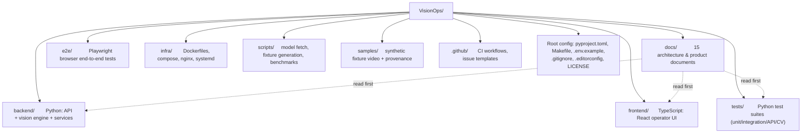
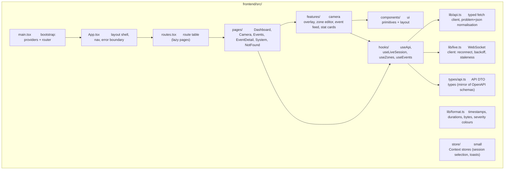
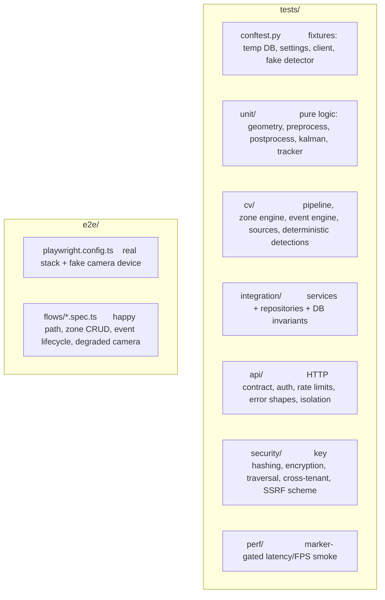

# VisionOps — Repository Structure

> **Principle:** the repository must stay navigable by a newcomer and safe to modify in parallel, while remaining small enough that one person can hold it in their head. Depth is earned by separation of concerns, not by directory count.

---

## 1. Top level



**Why two top-level code directories (`backend/`, `frontend/`)?** They are different languages with different toolchains, different test runners and different dependency lifecycles. Nesting them under a `packages/` monorepo layout implies a workspace manager (npm/pnpm/turbo) that would have to orchestrate Python too — that is ceremony, not clarity. A `Makefile` at the root is the join, and it is the documented single entrypoint (ADR-023).

**Why is `tests/` at the root rather than inside `backend/`?** Because tests must see the whole product: API surface, database, vision logic and ingestion. Colocating them with the source they test is a Go/Spring convention; for a project with two runtimes and a cross-cutting test strategy, a dedicated suite tree keyed by *test kind* is easier to navigate and easier to run selectively (`make test-cv`).

---

## 2. Backend layout

```mermaid
flowchart TB
  subgraph visionops["backend/visionops/"]
    MAIN["main.py            app factory + lifespan"]
    CLI["cli.py              operator CLI: serve/init/key/prune/bench/demo"]
    CFG["config.py           typed settings (pydantic-settings)"]
    API["api/                routers: system, orgs, sites, cameras, zones, events"]
    SVC["services/           use-cases + orchestration"]
    VIS["vision/             CV core — no web, no ORM, no network"]
    ING["ingest/             VideoSource implementations"]
    RT["realtime/            WebSocket hub"]
    DB["db/                  engine, session, scoped repos, migrations/"]
    MODELS["models/           SQLAlchemy ORM entities"]
    SCH["schemas/            Pydantic DTOs"]
    CORE["core/              config, logging, metrics, errors, ids, security, auth, ratelimit"]
    OBSV["observability/     metrics registry, health aggregation"]
  end
  MAIN --> API
  API --> SVC
  API --> CORE
  SVC --> VIS & ING & RT & DB & MODELS & SCH & OBSV
  ING --> VIS
  DB --> MODELS
  CLI --> SVC & DB & CORE

  style VIS fill:#0f2a1a,stroke:#34d399
```



### 2.1 Dependency direction (enforced by review and by tests)

```mermaid
flowchart LR
  api --> services
  api --> core
  services --> db & ingest & realtime & models & schemas & observability
  services --> vision
  ingest --> vision
  db --> models
  vision --> core/ids
  style vision fill:#0f2a1a,stroke:#34d399
```



Hard rules:

1. `vision/` imports **no** FastAPI, SQLAlchemy, or network library. A unit test asserts this (import-graph check).
2. `api/` never touches the ORM session directly.
3. `services/` never imports `fastapi`.
4. `core/` never imports a feature module.
5. `ingest/` makes no CV decisions.

### 2.2 Module responsibilities

| Package | Responsibility | Key files |
| --- | --- | --- |
| `main.py` | Application factory, lifespan (migrations, model preload, hub shutdown), static SPA serving, router registration | `create_app()` |
| `cli.py` | Operator commands | `init`, `serve`, `key`, `prune`, `bench`, `demo`, `seed` |
| `config.py` | Every environment variable, typed and validated; one `Settings` object | `Settings`, `get_settings()` |
| `core/config.py` | Env loading, `.env` support | — |
| `core/logging.py` | JSON formatter, console renderer, redaction filter, request-id contextvar | `configure_logging()`, `log_context()` |
| `core/errors.py` | Domain error hierarchy → HTTP mapping | `AppError`, `NotFound`, `Conflict`, … |
| `core/ids.py` | Time-ordered UUID generation | `new_id()` |
| `core/security.py` | Key hashing, constant-time compare, AES-256-GCM envelope encryption | `hash_secret()`, `encrypt()`/`decrypt()` |
| `core/auth.py` | `Principal`, `AuthProvider` protocol, FastAPI dependency, permission checks | `require_permission()` |
| `core/ratelimit.py` | In-process token bucket keyed by API key fingerprint | `RateLimiter` |
| `api/deps.py` | DB session, principal, pagination, container wiring | `get_db()`, `get_principal()` |
| `api/routers/*.py` | HTTP contract only | `system`, `cameras`, `zones`, `events`, `sites`, `orgs` |
| `api/ws.py` | WebSocket endpoints: live state + browser frame ingest | `stream_router`, `ingest_router` |
| `api/problems.py` | RFC 9457 problem+json builders | `problem()` |
| `schemas/*.py` | Pydantic request/response models, one module per resource | `camera.py`, `zone.py`, `event.py`, … |
| `models/*.py` | ORM entities | `organization.py`, `camera.py`, `zone.py`, `event.py`, … |
| `db/base.py` | Declarative base, naming conventions | — |
| `db/engine.py` | Engine/sessionmaker, SQLite WAL + busy timeout, dialect setup | `build_engine()` |
| `db/session.py` | Session context managers | `session_scope()` |
| `db/scoped.py` | **The** org-scoped repository helpers — the tenant-isolation chokepoint | `scoped_query()` |
| `db/migrations/` | Alembic environment + versions | `0001_initial.py` |
| `services/camera_service.py` | Camera + source CRUD, credentials | `CameraService` |
| `services/zone_service.py` | Zone CRUD, geometry validation | `ZoneService` |
| `services/session_service.py` | Session lifecycle, slot acquisition, session registry | `SessionService`, `SessionHandle` |
| `services/event_service.py` | Event writes, queries, summary aggregation, export | `EventService` |
| `services/system_service.py` | Aggregate health/status/metrics | `SystemService` |
| `services/audit_service.py` | Append-only audit writes | `AuditService` |
| `vision/contracts.py` | **The** interfaces and value types: `Frame`, `Detection`, `Track`, `Transition`, `ModelInfo`, `SourceHealth`; `VisionModel`, `Tracker`, `ZoneStrategy`, `EventSink` protocols | — |
| `vision/geometry.py` | Normalised-geometry maths: IoU, boxes, point-in-polygon, line intersection | pure functions |
| `vision/preprocess.py` | Letterbox resize, normalisation, tensor packing | `letterbox()`, `pack_batch()` |
| `vision/postprocess.py` | Model output → boxes → score threshold → class filter → NMS | `decode_yolo()` |
| `vision/onnx_model.py` | `OnnxYoloModel`: ORT session, provider selection, warmup, class map | `OnnxYoloModel` |
| `vision/kalman.py` | Constant-velocity Kalman filter (NumPy) | `KalmanBoxFilter` |
| `vision/tracker.py` | `KalmanIouTracker` implementing `Tracker` | `KalmanIouTracker` |
| `vision/zones.py` | `PolygonZoneStrategy` implementing `ZoneStrategy`; foot-point rule | `foot_point()`, `PolygonZoneStrategy` |
| `vision/event_engine.py` | Cooldown, dedup, dwell hysteresis, event construction | `EventEngine` |
| `vision/registry.py` | Name → implementation registries for models, trackers, zone strategies | `build_model()` … |
| `vision/pipeline.py` | The per-session orchestrator: read → sample → infer → track → zone → events → publish | `VisionPipeline` |
| `ingest/base.py` | `VideoSource` protocol + `FrameProducer` helpers | — |
| `ingest/device.py` | OpenCV device index source | `DeviceSource` |
| `ingest/file.py` | File source with loop + progress | `FileSource` |
| `ingest/rtsp.py` | RTSP/HTTP source with credential URL assembly and timeouts | `RtspSource` |
| `ingest/browser.py` | Browser-frame source driven by the WS ingest endpoint | `BrowserFrameSource` |
| `ingest/factory.py` | Build a source from configuration | `build_source()` |
| `realtime/hub.py` | Topic-based fan-out, per-client drop-oldest buffer, heartbeat | `RealtimeHub` |
| `realtime/protocol.py` | WS message builders (state, event, error) | `state_message()` |
| `observability/metrics.py` | Counter/Gauge/Histogram registry + Prometheus text exporter | `MetricsRegistry` |
| `observability/health.py` | Health aggregation across source/model/pipeline/storage | `HealthSnapshot` |
| `cli/*` | (kept inside `cli.py` until it exceeds ~400 lines) | — |

### 2.3 Where each "seam" lives

The five interfaces that make the platform extensible, and exactly where a new implementation goes:

| Seam | Interface file | Registry | V0.1 implementations |
| --- | --- | --- | --- |
| Detection model | `vision/contracts.py::VisionModel` | `vision/registry.py::MODELS` | `OnnxYoloModel` |
| Tracking | `vision/contracts.py::Tracker` | `MODELS`/trackers registry | `KalmanIouTracker` |
| Zone reasoning | `vision/contracts.py::ZoneStrategy` | `ZONE_STRATEGIES` | `PolygonZoneStrategy` |
| Event consumption | `vision/contracts.py::EventSink` | injected into pipeline | `EventRecorder` (DB + hub) |
| Frame production | `ingest/base.py::VideoSource` | `ingest/factory.py` | `Browser`, `Device`, `File`, `Rtsp` |

---

## 3. Frontend layout



| Directory | Contents | Rules |
| --- | --- | --- |
| `src/pages/` | One file per route; each is a thin composition of features | Pages never call `fetch` directly |
| `src/features/` | Cohesive product behaviours: `live-overlay/`, `zone-editor/`, `event-feed/`, `stat-card/`, `health-panel/` | Features may import `components/` and `lib/`, never other features' internals |
| `src/components/` | Reusable presentational primitives (`Button`, `Card`, `Badge`, `Table`, `Modal`, `Field`, `EmptyState`, `Spinner`) | Zero business logic, zero network calls |
| `src/hooks/` | Data/state hooks (`useApi`, `useLiveSession`, `useZones`, `useEvents`) | All server state funnels through TanStack Query |
| `src/lib/` | `api.ts` (typed client), `live.ts` (WS), `format.ts` | Pure utilities, unit-tested |
| `src/types/` | DTO types mirroring the backend schemas | Generated/verified against OpenAPI; never hand-diverged |
| `src/store/` | Minimal Context for cross-page ephemeral state | Not a Redux-style store |

Naming and conventions:

- Components `PascalCase.tsx`; hooks `useX.ts`; utilities `camelCase.ts`; CSS only through Tailwind utilities plus a small `index.css` for tokens.
- One component per file unless trivially small and inseparable.
- No barrel files (`index.ts` re-exports) — they create import cycles and slow type-checking. Imports are explicit paths.
- Feature-flagged or `FUTURE` UI must not exist as dead code; if a control is disabled, it shows a tooltip explaining why.

---

## 4. Test layout



Naming convention `<subject>_<scenario>.py`, mirroring the module under test (`tests/unit/test_tracker_two_stage.py` ↔ `backend/visionops/vision/tracker.py`). Marker taxonomy (`model`, `e2e`, `slow`) lets CI shard cheaply and lets contributors reproduce failures narrowly:

```bash
make test                       # everything fast
make test-cv                    # only CV logic
uv run pytest -m "not model and not e2e" -q
uv run pytest tests/api/test_events.py::test_event_isolation_between_orgs -q
```

---

## 5. Infrastructure, scripts, samples

| Path | Purpose | Notes |
| --- | --- | --- |
| `infra/docker/Dockerfile.api` | Production-ish API image (multi-stage, non-root, healthcheck) | Installs uv, runs `uv sync --frozen` |
| `infra/docker/Dockerfile.web` | Build + serve the SPA with nginx | Multi-stage: `npm ci && vite build` → nginx |
| `infra/docker-compose.yml` | Local full stack (API + web) | Not required for development |
| `infra/nginx/visionops.conf` | Production reverse proxy: TLS, security headers, `/api` and `/ws` proxying, body limits | Documented hardening defaults |
| `infra/systemd/visionops.service` | Native service unit with `Restart=on-failure`, hardening flags, env file | The recommended small-deployment unit |
| `scripts/fetch_model.py` | Download + verify ONNX model into the cache; offline-friendly | `--url`, `--sha256`, `--dest` |
| `scripts/make_fixture.py` | Generate the deterministic synthetic fixture video | Regenerable; committed output is what tests use |
| `scripts/bench.py` | Measure inference latency, pipeline FPS, RSS on this host | Writes to `docs/benchmarks.md` |
| `samples/fixtures/zone-walkthrough.mp4` | Synthetic (drawn, no humans) 320×240 clip of a figure crossing a marked area | **Clearly labelled synthetic**; used for plumbing/E2E, never accuracy claims |
| `samples/SOURCES.md` | Provenance and licence of every sample asset | Required before any third-party asset is committed |
| `data/` (gitignored) | Runtime state: SQLite DB, snapshots, model cache, logs | Never committed |

---

## 6. Dependency hygiene

- `pyproject.toml` declares every runtime dependency with a pinned range; `uv.lock` pins exact versions and is **committed**.
- `frontend/package-lock.json` is **committed**; CI uses `npm ci`.
- `.gitignore` excludes `.venv/`, `node_modules/`, `data/`, `*.db`, `.env`, model caches, coverage and test artefacts, editor directories, and OS junk. Verified with `git status --porcelain` in CI.
- No submodule vendoring of third-party code. If a license forbids easy consumption, the dependency is used via PyPI/npm instead of vendored.
- `git ls-files | xargs secret-scan` runs in CI (pattern-based) so a leaked key cannot reach `main`.

---

## 7. Contribution surface map

"Who do I ask / what may I touch?" — the same map as `docs/AGENT_WORKFLOW.md`, expressed as directories:

| Change type | Primary location | Usually also touches |
| --- | --- | --- |
| New detection model | `vision/onnx_model.py` or a new `vision/*_model.py` + `vision/registry.py` | `tests/cv/`, `docs/VISION_ENGINE.md`, `config.py` |
| Better tracking | `vision/tracker.py`, `vision/kalman.py` | `tests/unit/`, `docs/VISION_ENGINE.md` |
| New zone kind | `vision/zones.py` + `vision/registry.py` | `schemas/zone.py`, `frontend/features/zone-editor`, `docs/VISION_ENGINE.md` |
| New event type | `vision/event_engine.py` registry + `EVENT_REGISTRY` | `docs/EVENT_ENGINE.md`, `frontend/types`, `services/event_service.py` |
| New REST endpoint | `api/routers/*`, `schemas/*` | `docs/API.md`, frontend `lib/api.ts` |
| Database change | `models/*`, new Alembic revision | `docs/DATABASE.md`, `tests/integration/` |
| UI screen | `frontend/src/pages/*`, `features/*` | `frontend/src/routes.tsx` |
| Deployment | `infra/*`, `Makefile`, `docs/DEPLOYMENT.md` | `.env.example`, CI |
| Cross-cutting | first propose an ADR | `docs/TECHNICAL_DECISIONS.md` |

---

## 8. Conventions

**Python.** `ruff` (line length 100, isort, bugbear, bandit, simplify) + `mypy` with `disallow_untyped_defs`. Fully annotated public functions; `from __future__ import annotations` only where it buys something. Dataclasses (frozen where value-like) for domain value objects — Pydantic for API DTOs, dataclasses inside `vision/` so the CV core has zero framework coupling. Type hints use PEP 604 unions. Money/time: UTC everywhere internally (`datetime.now(tz=UTC)`), ISO-8601 in JSON, timezone-aware datetimes only.

**TypeScript.** `strict: true`, no `any` without an eslint-disable comment explaining why, `unknown` at boundaries, discriminated unions for API state, `import type` for type-only imports. No default exports except for page components.

**Git.** Conventional-ish commits: `type(scope): summary`, types `feat|fix|docs|test|refactor|perf|build|ci|chore`. One logical change per commit; no mixed refactor+feature. Branches: `main` (always releasable), `feat/<short>`, `fix/<short>`, `docs/<short>`. Every PR states: what changed, why, how it was tested, and what could break.

**Documentation.** Every architectural decision gets an ADR; every user-visible capability gets a README or docs section; every claim about performance or accuracy carries its methodology. If a document and the code disagree, the code is wrong until proven otherwise — or the document was never updated, which is a bug either way.
