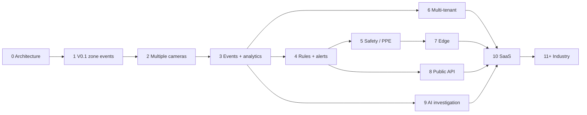

# VisionOps — Roadmap

> **Rule of the roadmap:** each phase must ship something a real operator would pay for, and must leave the architecture *more* extensible than it found it. No phase may require rewriting a previous phase. Phases marked `NEXT` are the next committed work; everything after is deliberately undesigned in code.
> **Status legend:** ✅ done · 🟡 in progress · ⬜ planned · 🔒 blocked/decided-against

---

## Phase 0 — Architecture 🟡

**Goal:** the decisions and documentation that make the rest cheap.

**Deliverables**
- ✅ Master PRD (`docs/PRD.md`) with CURRENT/NEXT/FUTURE separation
- ✅ System architecture with diagrams (`docs/ARCHITECTURE.md`)
- ✅ ADR log (`docs/TECHNICAL_DECISIONS.md`)
- ✅ Repository structure, database, vision engine, event engine, security/privacy, API, frontend, testing, observability, deployment, agent workflow
- ✅ CI, tooling, contribution surface

**Exit criteria:** an unrelated senior engineer can onboard from the docs alone; every stack choice has a recorded alternative, a downside and a revisit trigger.

**Deliberately not done here:** code. Documentation without a working slice is a plan, not a product.

---

## Phase 1 — V0.1 Restricted-Zone Intelligence ✅ *(complete)*

**User story:** *I connect a camera, draw a restricted zone, and get a timestamped event when someone enters or leaves it — with history I can trust.*

**Scope (shipped)**
- Ingestion: `browser` (getUserMedia over WebSocket), `device`, `file`, `rtsp`; healthy/degraded/failed states with reason codes and backoff
- Detection: ONNX Runtime CPU, YOLO-family, letterbox + in-house NMS, configurable thresholds/class filter, SHA-256 recorded
- Tracking: self-contained Kalman + two-stage IoU association, ephemeral IDs, `max_age` re-association
- Zones: polygon (rectangle = 4 points), foot-point containment, dwell hysteresis, cooldown, class filter, clip suppression
- Events: `ZONE_ENTERED`/`ZONE_EXITED` + source/model lifecycle events; typed registry; persisted before broadcast; REST + WebSocket
- API: `/api/v1` REST, MJPEG preview, live-state WebSocket, API-key auth, rate limits, RFC 9457 errors, audit log
- Data: SQLite default / Postgres compatible, Alembic migration, org scoping, retention prune, CSV/JSON export
- UI: Setup wizard, Dashboard, Camera view (live overlay + drag zone editor), Zones, Events, Event detail, System status; responsive
- Ops: JSON logs with redaction, Prometheus metrics, `/healthz` `/readyz` `/system/status`, Dockerfiles, nginx, systemd, Makefile, GitHub Actions

**Exit criteria:** all 22 acceptance criteria in `docs/TESTING.md` §5 pass; lint/typecheck/tests/builds green; a hardware-free demo verified; performance measured and published; documentation matches behaviour.

**Known limits carried into Phase 2 (documented, not hidden):** one session per camera at a time; tracker ID switches in dense crowds; no line zones/occupancy; no rules; single operator.

---

## Phase 2 — Multiple cameras ⬜ *(NEXT)*

**User story:** *I run eight cameras across a site from one box, and a fault on one never affects the others.*

**Scope**
- Session manager with a real scheduler: per-camera FPS budgets, priority ordering, fair CPU sharing, global frame budget
- `max_sessions` raised with graceful degradation instead of failure; per-session resource accounting
- Extract the pipeline into a separate worker **process** (ADR-002) behind the existing `VideoSource`/`EventSink` seams
- UI: camera grid with live thumbnails, per-camera status, camera picker, layout persistence
- Per-camera inference profiles (input size, thresholds, class filter, zone set)
- Scheduled operating hours (`NEXT` from the zone direction vector: day/night profiles)
- Camera health probing on a schedule (connect/disconnect detection without an active session)

**Exit criteria:** ≥ 8 concurrent sessions on reference hardware with measurable per-session isolation; a forced crash in one session leaves the others running; scheduler unit tests ≥ 90 %; grid UI usable at 1440 px.

**Risks:** CPU oversubscription making every session worse than one; the worker extraction touching the vision core. Mitigation: per-session budget accounting and the interface boundary already proven in V0.1.

---

## Phase 3 — Persistent events + analytics ⬜

**User story:** *I can ask "how many people entered Bay 4 last week, by hour?" without exporting CSVs and guessing.*

**Scope**
- `aggregates_hourly` materialisation + `visionops backfill-aggregates` (recomputable from events)
- `detections`/`tracks` tables **behind an org opt-in** with sampling and short retention (documented privacy trade)
- Analytics endpoints: occupancy over time, dwell distribution, hourly heatmap, per-zone totals
- Retention: per-camera overrides, legal hold, disk-pressure safety valve, aggregate-vs-raw retention split
- Snapshot table + automatic cleanup; `acknowledge` workflow
- Export: CSV/JSON (exists), PDF report, scheduled reports with delivery via the `Notifier`
- Performance test against a seeded 1 M-event dataset

**Exit criteria:** 1 M-event dataset p95 list latency < 300 ms with cursor pagination; aggregates byte-identical to a recomputation; retention job verified with orphan cleanup; every new endpoint has a test.

**Privacy gate:** detections/track storage stays **off by default** and requires an explicit org-level decision, documented in the privacy notice.

---

## Phase 4 — Rules + alerts ⬜

**User story:** *I can say "alert me when anyone is in the electrical room for more than 2 minutes between 22:00 and 06:00" and get it on my phone.*

**Scope**
- `rules` table + predicate-tree evaluator over the normalised **Signal frame** (no SQL from rules)
- Line zones with direction, distance belts, occupancy thresholds, dwell thresholds
- `alerts` + `notifications` + `AlertEngine` (grouping window, quiet hours, severity routing, escalation)
- `Notifier` implementations: in-app, email (SMTP), Slack/Teams, generic webhook (HMAC-signed), SMS
- At-least-once delivery with idempotency keys, retry/backoff, dead-letter, delivery log
- Rule simulation: replay a historical window and show what *would* have fired (a genuinely valuable product feature for tuning)

**Exit criteria:** evaluator unit tests ≥ 90 % including a property-based pass over generated signal frames; delivery proven with an injected-failure test; no duplicate alert for one episode; quiet hours verified with a frozen clock.

**Anti-goal:** no visual rule builder in V1 of this phase (expression + form only). A builder is a trap of complexity.

---

## Phase 5 — Safety / PPE modules ⬜

**User story:** *On our construction site, a missing hard hat in the exclusion zone alerts the supervisor immediately.*

**Scope**
- Model registry + versioning: `models`, `model_versions` (immutable artefacts, SHA-256, stage machine `candidate→shadow→active→deprecated`)
- Shadow inference + A/B evaluation harness; per-site calibration report (false positives per hour is the headline metric)
- PPE class support (`helmet`, `hi_visor`, `mask`, `harness`) and `PPE_VIOLATION` with `missing_items`/`worn_items`
- `VEHICLE_DETECTED` with **plate redaction by policy** (never the plate itself)
- `QUEUE_THRESHOLD` with estimated wait time
- `SAFETY_VIOLATION` with configurable standard references (no compliance claim we cannot evidence)
- ROI-of-interest inference to cut CPU cost for wide scenes
- Vertical packs: construction, warehouse, retail, school — opinionated default zones, classes, thresholds

**Exit criteria:** per-class evaluation report generated from a customer-provided labelled set; no regression in people-detection metrics; a vertical pack configurable entirely from the UI without code.

**Hard gate:** every accuracy claim is published with methodology, hardware and negative results. No "AI-powered" adjectives without a number.

---

## Phase 6 — Multi-tenant organisations ⬜

**User story:** *I run VisionOps for five clients from one deployment, and no one can see anything that isn't theirs.*

**Scope**
- `users`, `memberships`, roles/permissions, OIDC + local accounts, invitations, sessions, MFA
- `AuthProvider` implementations (`OidcProvider`) with `Principal.user_id`; RBAC enforced at the API boundary
- Postgres RLS as defence in depth with `SET LOCAL app.organization_id`
- Per-org quotas, rate limits, encryption keys (optional), storage caps
- Redis-backed rate limiting and realtime fan-out (multi-process)
- Organisation deletion (GDPR/DSR erasure) as a first-class, audited job
- API key scopes/rotation UI; audit log UI with export

**Exit criteria:** cross-tenant negative tests across every endpoint including nested resources; RLS proven to block direct SQL access that bypasses the app; invitation E2E; a 5-org load test.

**Note:** V0.1 is structurally multi-tenant already; this phase makes it *operationally* multi-tenant. That sequencing is deliberate — schema first, enforcement second.

---

## Phase 7 — Edge inference ⬜

**User story:** *Our site has an unreliable link. It still alerts locally and syncs when the link returns.*

**Scope**
- `visionops-edge` agent: same pipeline, local SQLite, event batching, resumable cursor, UUID-idempotent upload
- Signed, versioned config push; the edge runs independently when the control plane is unreachable
- Bandwidth budget: events-only uplink by default, documented per-site measurements
- TensorRT / OpenVINO / NPU execution providers; model pinning by SHA-256 for reproducibility
- Fleet view: per-site health, last heartbeat, queue depth, dropped events
- Store-and-forward for snapshots when bandwidth allows

**Exit criteria:** 7-day offline soak with bounded memory and no event loss on reconnect; sync idempotency proven by replaying a batch; measured uplink KB/hour/camera; a config rollback drill.

**Risk:** two places to run the pipeline (host and edge) means two places for bugs. Mitigation: literally the same code, exercised by the same tests; the edge adds transport, not logic.

---

## Phase 8 — Public API + integrations ⬜

**User story:** *Our BMS needs to react to a restricted-zone event in under a second, through a documented, supported API.*

**Scope**
- Partner API: OAuth2 client credentials, scoped permissions, per-app rate limits, sandbox organisation
- Webhooks: signed (HMAC), retried, at-least-once, delivery log, replay, dead-letter
- Integrations: Slack, Teams, WhatsApp, email, SMS, MQTT, Home Assistant, Prometheus/Grafana, S3-compatible storage
- Generated SDKs (TypeScript, Python) from the OpenAPI document, plus a conformance test suite
- Public changelog, deprecation policy, status page, incident process
- Public data API (read-only aggregates, anonymous, heavily rate-limited, no geometry)

**Exit criteria:** conformance suite green against the server and both SDKs; deprecation process rehearsed in staging; webhook delivery proven with an injected 5xx and a replay; a third-party integration built by someone outside the team using only the docs.

---

## Phase 9 — AI investigation & reporting 🔒 *(designed, deliberately deferred)*

**User story:** *I ask "show me every unauthorised entry to Bay 4 last night" and get an answer where every claim links to a stored event.*

**Scope**
- Read-only tool layer over events/aggregates (`search_events`, `get_event`, `aggregate`, `describe_zone`, `export_window`)
- Deterministic query path first; LLM only for what SQL cannot express
- Mandatory machine-verified citations; abstention when a claim cannot be verified
- Narrative report generation over verified evidence
- Per-question cost tracking, caching, and a hard spend cap
- Model registry maturation: evaluation, shadow traffic, promotion gates, rollback

**Hard constraints (from `docs/ARCHITECTURE.md` §10):** read-only tools; no raw video or images to the model; full audit of every run; deterministic answers preferred. This phase must not weaken the privacy posture — it may only read what already exists.

**Why deferred:** an AI layer over an unproven event model would make both harder to evaluate. Get rules, alerts and analytics right first; add intelligence where it is measurably better than a query.

---

## Phase 10 — Production SaaS ⬜

**Scope:** multi-region, autoscaling, per-tenant isolation (dedicated nodes for large tenants), billing/subscriptions/quotas, self-serve onboarding, data residency, SLOs with on-call, 30-day SLO evidence, external security audit, DR drill.

**Stance:** self-hosting remains free and first-class. SaaS sells managed operations, integrations and intelligence — not captivity.

---

## Phase 11+ — Industry solutions & ecosystem 🔒

- Vertical pack marketplace with a compatibility matrix
- Open event schema specification (public, versioned) so integrators are not locked to us
- Sovereign/air-gapped appliance builds for government and industrial buyers
- Mobile/PWA with push alerts for supervisors
- Anomaly baselines per zone (learn normal dwell/count distributions, alert on deviation)
- Evidence bundles with hash-chained provenance for legal defensibility
- Coverage analytics ("which of my cameras actually produce useful events?" — a cost-saving product in itself)
- Partner/MSP programme with reproducible deployment bundles

---

## Cross-cutting commitments (every phase)

| Commitment | Test |
| --- | --- |
| Lint, typecheck, unit, integration, API, security and frontend tests green | CI gate |
| Acceptance criteria updated and met for the phase | `docs/TESTING.md` |
| Docs updated in the same PR as behaviour | Review rule |
| ADR added for any new technology or pattern | Review rule |
| No new PII, no biometrics, retention respected | `docs/SECURITY_PRIVACY.md` checklist |
| Migrations have a working `downgrade()` | CI migration test |
| Performance measured and published with methodology | `scripts/bench.py` + `docs/benchmarks.md` |
| Runbook entry for the new subsystem's failure modes | `docs/DEPLOYMENT.md` |
| Honest capability statement — nothing labelled "supported" that is untested | Release checklist |

---

## Sequencing rationale

Two deliberate deviations from the original ordering, with reasons:

1. **Multi-tenancy (6) comes after analytics (3), not before.** Data volume and query shapes change the schema; migrating a live multi-tenant system is far more expensive than migrating a single-tenant one. The *schema* is multi-tenant from day one, so this is enforcement and UX, not rework.
2. **AI investigation (9) comes after rules/alerts (4).** Rules make the event semantics precise; an assistant over imprecise semantics produces confident nonsense. The event model must be trustworthy before we let a model summarise it.

**The one thing that would reorder everything:** a paying customer who needs multi-tenancy or edge deployment immediately. Then Phase 6/7 jumps ahead of Phase 3/4 — the architecture supports it, and the roadmap is a tool, not a religion.
