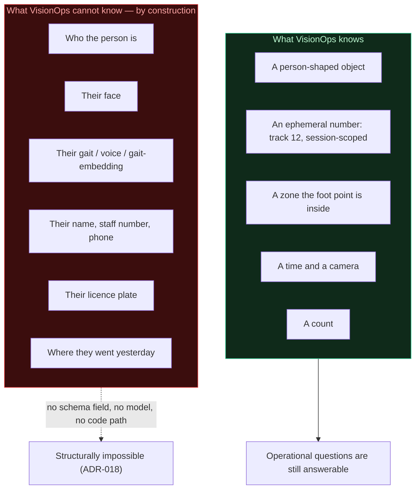
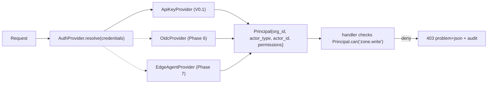

# VisionOps — Security & Privacy

> **Position in one line:** VisionOps analyses *objects in zones*, never *identities*. That single constraint removes most of the risk that makes video analytics legally and ethically hazardous — and it is enforced by the data model, not by policy.

---

## 1. Privacy posture (the design, not the promise)



**Enforcement, not aspiration:**

1. No table, column or API field can hold a name, an image of a face, an embedding or a device identifier. There is nowhere to put it.
2. No bundled or referenced model performs face detection, face recognition or re-identification. Grep-verifiable in CI.
3. `track_id` is an in-memory counter scoped to one session. There is no global track registry and no track persistence in V0.1, so track identity cannot be joined across sessions, cameras or time.
4. Frames are never written to disk unless an operator explicitly enables snapshots (off by default), and even then they are operational images with no identity semantics attached.

**Data inventory (complete):**

| Data | Stored? | Where | Retention | Contains PII |
| --- | :-: | --- | --- | :-: |
| Video frames | Only if snapshots enabled | `data/snapshots/` | = event retention (default 90 d) | No identity, but **images of people** |
| Per-frame detections | No (V0.1) | in memory | — | No |
| Tracks | No (V0.1) | in memory | — | No |
| Events | Yes | database | 90 d, configurable | No |
| Zone geometry | Yes | database | permanent | No (but commercially sensitive) |
| Camera credentials | Yes, encrypted | database | until changed | **Yes — secret** |
| Audit log | Yes | database | 365 d | Actor key id, IP address |
| Model weights | On disk | `models/` | n/a | No |

### Lawful-use guidance (shipped with the product)

Operators must be told, in the README and in the UI, that people-counting and zone monitoring in workplaces and public spaces can engage data-protection law even without biometric data, depending on jurisdiction (GDPR Art. 6/9 reasoning, Nigeria's NDPA, Kenya's DPA, South Africa's POPIA, Brazil's LGPD). VisionOps provides the technical controls — notice text, retention, export, deletion, audit — but the **lawful basis, notice to individuals, signage and purpose limitation are the operator's responsibility**. The README says this plainly. That is the honest position: we cannot make someone's deployment lawful, but we can make unlawful data collection structurally impossible.

---

## 2. Threat model

| # | Threat | Severity | Control | Test |
| --- | --- | --- | --- | --- |
| T-01 | Stolen/guessed API key → full data access | High | 256-bit random keys, SHA-256+salt at rest, constant-time compare, per-org scoping, rate limit, expiry, revocation, audit | `tests/api/test_auth.py`, `tests/security/test_secrets.py` |
| T-02 | Cross-tenant data access (IDOR) | Critical | `organization_id` on every row; single scoped-repository chokepoint; cross-org lookups return `404`, not `403` | `tests/api/test_isolation.py` |
| T-03 | SSRF via RTSP/HTTP source URL | High | Scheme allow-list (`rtsp/rtsps/http/https`), credentials in URL rejected, no `file://`, response never fetched by the API | `tests/security/test_source_url.py` |
| T-04 | Path traversal via file source or snapshot path | High | Canonical-path containment against an allow-listed media root; snapshot paths stored relative and re-validated | `tests/security/test_paths.py` |
| T-05 | Camera credentials leaked from DB or logs | Critical | AES-256-GCM envelope encryption; AAD binds ciphertext to its row; never logged; never returned by the API | `tests/security/test_secrets.py` |
| T-06 | DoS by session storm (open 500 cameras) | High | `max_sessions` cap with `503`; per-key rate limit; `target_fps` floor; WS message size caps; body size limits | `tests/api/test_limits.py` |
| T-07 | Malicious media file (decoder exploit) | Medium | `opencv-python-headless` patched version; model file validated before load; container user is non-root; read-only media root | dependency scanning in CI |
| T-08 | Log exfiltration of secrets/PII | High | Structured logging with an allow-listed-field redactor; credential and key fields never logged; log files rotated | `tests/security/test_logging.py` |
| T-09 | XSS via event metadata / zone name | Medium | React escapes by default; no `dangerouslySetInnerHTML`; CSP header; validation strips control characters | frontend lint rule + CSP test |
| T-10 | CSRF | Low–Medium | API is key-authenticated (not cookie-authenticated), so CSRF is structurally inapplicable; CORS allow-list empty by default | documented |
| T-11 | Dependency supply-chain compromise | Medium | Pinned lockfiles, minimal dependency count, `pip-audit` + `npm audit` in CI, secret scanning | CI |
| T-12 | Model file tampering | Medium | SHA-256 recorded and displayed; optional expected-checksum enforcement via config | `tests/security/test_model_integrity.py` |
| T-13 | Timing attacks on auth | Low | Constant-time compare; uniform 401 responses; no key-existence oracle | `tests/security/test_secrets.py` |
| T-14 | WebSocket resource exhaustion | Medium | Per-client bounded queue with drop-oldest; heartbeat/timeout; connection cap; message size cap | `tests/api/test_limits.py` |
| T-15 | Unauthorised key creation/privilege escalation | High | Key management requires an existing admin key; bootstrap key only honoured when no keys exist; every key operation audited | `tests/api/test_auth.py` |
| T-16 | Retention failure (data kept forever) | Medium | Scheduled `visionops prune` + `VISIONOPS_*_RETENTION_DAYS`, with a documented systemd timer and dry-run | `tests/integration/test_retention.py` |
| T-17 | Cloud-egress misuse (video leaving premises) | Medium | No cloud dependency in any deployment mode; frames go only to the operator's own backend | design (ADR-009) |
| T-18 | Insider with valid key reads too much | Low | Key per device/person, named and revocable, audited, scoped to one organisation | operational |

**Explicit non-goals (threats we do not claim to solve):** physical access to the host, a malicious OS administrator, cryptanalytic attacks on AES-GCM/SHA-256, and social engineering of the operator. State them; do not imply coverage you do not have.

---

## 3. Authentication & authorisation

### 3.1 API keys (V0.1, ADR-014)

```
vo_<key_id:12>_<secret:43>          # ~256 bits of entropy in the secret part
```

| Property | Implementation |
| --- | --- |
| Generation | `secrets.token_urlsafe(32)` via `visionops key add` or the bootstrap env var |
| Storage | `key_hash = sha256(salt ‖ secret)`, `salt = secrets.token_hex(16)` |
| Lookup | `UNIQUE(key_prefix)` index → one candidate → constant-time compare |
| Comparison | `hmac.compare_digest` — no early exit |
| Response uniformity | Unknown key, revoked key and bad signature → byte-identical `401` |
| Use tracking | `last_used_at` throttled to one write per 60 s |
| Lifecycle | Named, expiring, revocable, rotatable with overlap |
| Permissions | JSON permission strings; V0.1 bootstrap key = `["*"]` |
| Bootstrap | Only honoured when the organisation has **no** keys — prevents a stale env var from re-granting access after rotation |

**Why a fast hash is correct here:** API keys are 256-bit random values, not user-chosen passwords. There is no dictionary to attack, so a slow hash buys nothing while costing O(1) lookup. User passwords, when they exist (Phase 6), use a slow KDF — a different table, a different rule.

### 3.2 Humans (Phase 6, interface ready)



Handlers are written against `Principal.can(...)` from day one, so adding authentication methods never rewrites endpoints.

### 3.3 Roles (Phase 6)

Permission matrix in `docs/PRD.md` §26. Enforced at the API boundary (never in the UI), with deny-by-default: a permission not granted is not permitted.

---

## 4. Secrets management

| Secret | Where it lives | How it is protected |
| --- | --- | --- |
| `VISIONOPS_MASTER_KEY` | Environment / systemd env file (`0600`) / container secret | Never in git, never in the DB, never logged. Required for storing camera credentials |
| `VISIONOPS_API_KEY` | Environment on first run only | Hashed into the DB on bootstrap; the env var is then useless and should be removed |
| Camera RTSP credentials | `video_sources.credential_blob` | AES-256-GCM, key from `VISIONOPS_MASTER_KEY`, AAD = row id |
| Webhook signing secrets (Phase 8) | `webhooks.secret_blob` | Same envelope encryption |
| Integration tokens (Phase 8) | `integrations.config` (encrypted blob) | Same envelope encryption |
| Model checksums | Config (expected) and DB (observed) | SHA-256 recorded and displayed |

**Master key rotation:** `credential_blob` is prefixed `v1:<key_id>:…` so multiple keys can be active during rotation: write with the new key, re-encrypt on read, retire the old key after a full pass. Documented procedure in `docs/DEPLOYMENT.md`.

**If the master key is lost, stored camera credentials are unrecoverable.** That is the correct behaviour: a recoverable key is a backdoor. The operator re-enters credentials; the app tells them exactly that.

**Committing secrets:** `.gitignore` covers `.env*` except `.env.example` (which contains only dummy values); CI runs a secret scan over the full history; every `.env.example` value is literally something like `change-me-…`.

---

## 5. Application hardening

| Area | Control |
| --- | --- |
| **Headers** (app + nginx example) | `Content-Security-Policy` (no `unsafe-inline` in prod build), `X-Content-Type-Options: nosniff`, `Referrer-Policy: no-referrer`, `X-Frame-Options: DENY`, `Permissions-Policy` disabling camera/mic for the app origin except where explicitly needed |
| **CORS** | Empty allow-list by default; adding origins is explicit configuration. Same-origin in production (nginx serves the SPA and proxies `/api`) |
| **TLS** | Terminated at the reverse proxy; HSTS; documented in `infra/nginx/visionops.conf` |
| **Rate limiting** | Token bucket per API key fingerprint; separate tighter bucket for auth failures; `Retry-After` on `429` |
| **Request limits** | Max body size (1 MB default), max zone point count (256), max polygon vertices, max WS frame size (2 MB), max query page size (200) |
| **Input validation** | Pydantic strict schemas; coordinates clamped/rejected outside `[0,1]`; hex colour validation; enum `CHECK`s; strings length-bounded and stripped of control characters |
| **Error responses** | RFC 9457 problem documents; internal errors return a `request_id` and nothing else — no stack traces, no SQL, no paths |
| **Container** | Non-root user, read-only root filesystem where possible, no capabilities, pinned base images, healthcheck |
| **Host** | systemd hardening: `NoNewPrivileges`, `ProtectSystem=strict`, `PrivateTmp`, `ProtectHome`, restricted `ReadWritePaths` |
| **Static assets** | Content-hashed filenames; immutable cache headers; no source maps in production images |

---

## 6. Data protection rights tooling

| Right | Mechanism | Status |
| --- | --- | --- |
| **Access / portability** | `GET /api/v1/events/export?format=csv\|json` over a time window | `CURRENT` |
| **Retention / storage limitation** | `retention_days` per organisation + automatic `visionops prune` | `CURRENT` |
| **Erasure** | Organisation deletion job (`NEXT`); per-event deletion is deliberately not exposed as an API | `NEXT` |
| **Rectification** | Not applicable — there is no personal data to rectify (a feature of the design) | n/a |
| **Restriction** | Not applicable | n/a |
| **Objection to automated decision-making** | VisionOps makes no decisions about people; it records zone transitions. Documented in the privacy notice | n/a |
| **Auditability** | Audit log of every configuration and access-relevant action | `CURRENT` |
| **Transparency** | System Status page shows exactly which data is being written, where and for how long | `CURRENT` |

---

## 7. Encryption in transit and at rest

| Data | In transit | At rest |
| --- | --- | --- |
| Frames (browser → backend) | Same-origin/LAN in V0.1; TLS in any shared deployment | Never stored (unless snapshots) |
| API traffic | TLS at the proxy | n/a |
| Camera credentials | TLS to the camera where the camera supports it | AES-256-GCM |
| API keys | TLS | Salted SHA-256 (hashed, not encrypted — the key is never needed again) |
| Events | n/a | DB file; rely on host disk encryption + filesystem permissions for local deployments (documented); Postgres TDE/at-rest encryption in cloud mode |
| Snapshots | n/a | `0700` directory, `0600` files, delete with their event |
| Backups | Encrypted transport recommended | Documented: SQLite `.backup` + snapshots, encrypt at rest |

Postgres deployments should enable provider at-rest encryption; VisionOps does not implement its own database encryption and says so rather than implying it does.

---

## 8. Multi-tenant isolation controls

1. **Structural:** `organization_id NOT NULL` on every domain table; no global queries in the service layer.
2. **Chokepoint:** `db/scoped.py` is the only sanctioned query path; it takes a `Principal` and applies the filter. Code review rule: no `select(...)` in `services/` without it.
3. **404 not 403:** cross-organisation references look like "not found", preventing resource-existence probing.
4. **Negative tests:** `tests/api/test_isolation.py` creates two organisations and asserts no read/write crosses them — including via nested resources (zone under another org's camera).
5. **Rate limits and quotas keyed by organisation** (Phase 6).
6. **Postgres RLS** as defence in depth (Phase 6) with `SET LOCAL app.organization_id` per transaction.
7. **Log redaction** so a tenant identifier leak is not a data leak in the observability pipeline.

---

## 9. Incident response

| Stage | Action |
| --- | --- |
| Detect | `SOURCE_FAILED`/`MODEL_FAILED` events, `auth.key_rejected` audit spikes, health probe failure |
| Contain | Revoke the key (`visionops key revoke`), stop sessions, take the instance offline |
| Preserve | Snapshot the database, audit log and logs **before** remediation (they may be the evidence) |
| Eradicate | Rotate `VISIONOPS_MASTER_KEY` and all credentials; rebuild the instance from a clean image |
| Recover | Restore from backup; verify events are intact (`SELECT count(*)` before/after) |
| Learn | Update `docs/PRD.md` risk register and add a regression test reproducing the failure |

`SECURITY.md` publishes a disclosure channel and a response SLA. Security issues are handled privately; no public issue tracker for vulnerabilities.

---

## 10. Security checklist (authoritative, verified before each release)

- [ ] No secrets in the working tree **or in git history** (secret scan over full history in CI).
- [ ] `.env.example` contains only dummy values.
- [ ] API keys hashed with per-key salt; compare is constant-time; response is uniform.
- [ ] Every domain table has `organization_id NOT NULL`; isolation tests pass.
- [ ] Camera credentials encrypted; API never returns them; logs never contain them.
- [ ] Source URLs scheme-allow-listed; embedded credentials rejected; no `file://`.
- [ ] File paths containment-checked against the media root.
- [ ] Rate limits, body limits, page limits, WS caps enforced and tested.
- [ ] Security headers present in both the app and the nginx example.
- [ ] Error responses leak nothing internal.
- [ ] Audit log records config changes, key operations and authorisation failures.
- [ ] No face/biometric/identity code or model anywhere (grep-verified).
- [ ] Retention job scheduled, dry-run tested, real run verified.
- [ ] Dependency audits clean; lockfiles committed; container base images pinned.
- [ ] `SECURITY.md` present with a working disclosure channel.
- [ ] Threat model above reviewed and updated for new features.

---

## 11. Privacy checklist (authoritative)

- [ ] Data inventory (§1) is accurate and matches the schema.
- [ ] No PII column exists; track IDs are ephemeral and session-scoped.
- [ ] No face detection/recognition/re-identification anywhere.
- [ ] Retention is configurable and enforced by a job.
- [ ] Export works and is tested.
- [ ] Snapshots are opt-in, `0600`, retention-coupled.
- [ ] Notice/lawful-basis guidance is in the README and the System Status page.
- [ ] Per-camera retention overrides documented (`NEXT`).
- [ ] Cross-border transfer considerations documented for cloud mode.
- [ ] Model and sample licences verified for redistribution.
- [ ] A deployment can be deleted completely (DB + snapshots + logs) with documented commands.
