# VisionOps — Testing Strategy

> **Principle:** the code that produces customer events must be tested **deterministically and exactly**. Real models are measured, not asserted. The whole suite must pass on a laptop with **no camera, no GPU and no network**.

---

## 1. Layers

```mermaid
flowchart TB
  subgraph Fast["Fast (< 30 s) — run on every save"]
    U["Unit\ngeometry · preprocess · postprocess/NMS · kalman · tracker · zones · event engine"]
    C["CV deterministic\npipeline · fakes for model/source · fixture video"]
    F["Frontend unit + component\nVitest + Testing Library"]
  end
  subgraph Mid["Medium (< 3 min) — run on every push"]
    I["Integration\nservices + repositories + real SQLite + migrations"]
    A["API\nHTTP contract · auth · limits · error shapes · tenant isolation"]
    SEC["Security\nsecrets · encryption · traversal · URL scheme · logging redaction"]
    B["Build\nfrontend production build · wheel build · Docker build (config lint)"]
  end
  subgraph Slow["Slow — nightly / pre-release"]
    E["E2E\nPlaywright with fake camera device + real stack"]
    M["Real model (marker-gated)\nskipped, never faked, without weights"]
    P["Perf smoke\nlatency/FPS/memory budget"]
    S["Soak\n2 h memory/event-integrity"]
  end
  U & C & F --> M2["CI: backend + frontend + security + build"]
  I & A & SEC & B --> M2
  E & M & P & S --> N["Nightly / release"]
```



---

## 2. Determinism strategy (the heart of the plan)

| Technique | Used for | Guarantee |
| --- | --- | --- |
| **`FakeDetector` (`ScriptedVisionModel`)** | tracker, zones, event engine, pipeline | Exact detections per frame → exact track IDs → exact event sequences. No tolerance, no flake. |
| **Committed synthetic fixture video** | decode, rate control, lifecycle, source failure, E2E | Same bytes on every machine. **Clearly labelled synthetic** — drawn shapes, not real people; used only for plumbing, never for accuracy claims. Regenerable with `scripts/make_fixture.py`. |
| **Injected clocks** | cooldown, dwell, retention | Time is a parameter, not `time.time()`, in every rule that depends on it. |
| **Frozen IDs** | deterministic assertions | ID generation is injectable (`core.ids.set_id_factory`) so tests can assert on exact IDs where useful; UUIDv7 format itself is unit-tested separately. |
| **Real model, marker-gated** | end-to-end accuracy smoke | `@pytest.mark.model`; **skipped** (never mocked) when weights are absent; the test prints the model checksum it used. |
| **Fault injection** | every documented failure mode | `FailingSource`, `StalledSource`, `SlowModel`, `FailingModel`, `ReadOnlyFilesystem` — each asserts the documented state transition and reason code. |
| **Fake camera device** | browser E2E | Chromium `--use-fake-device-for-media-capture` + a y4m/y4m-compatible fixture, so the real `getUserMedia` path runs in CI. |

**What we never do:** assert on a specific detection count from a real model in a default CI run (flaky and dishonest), present a synthetic fixture as if it demonstrated detection accuracy, or skip a test silently without a printed reason.

---

## 3. Coverage by module

| Module | Target | Why |
| --- | --- | --- |
| `vision/geometry.py`, `preprocess.py`, `postprocess.py` | 95 % | Pure maths with known answers; a bug here silently corrupts events |
| `vision/kalman.py`, `tracker.py` | 90 % | Event quality depends on it |
| `vision/zones.py`, `event_engine.py` | 95 % | Direct customer-visible behaviour |
| `vision/pipeline.py` | 85 % | Orchestration and failure handling |
| `ingest/*` | 80 % | Hardware variety is covered by fakes; real variety by operators |
| `services/*` | 85 % | Use-cases |
| `api/*` | 80 % | Contract tests cover the rest |
| `db/*`, `models/*` | 75 % | Exercised through integration tests |
| `core/*` | 90 % | Security-critical (secrets, ids, auth, limits) |
| frontend `lib/`, `hooks/` | 80 % | Logic-bearing code |
| frontend `components/` | 70 % | Presentational |

Gates: `vision` ≥ 85 % overall, backend ≥ 75 %, frontend ≥ 70 % for logic-bearing modules. CI fails below the gate.

---

## 4. Test inventory

### 4.1 Unit — `tests/unit/`

| File | Asserts |
| --- | --- |
| `test_geometry.py` | IoU (identical, disjoint, contained, touching); point-in-polygon (inside, outside, on-edge, concavity, bowtie); box centring; clamping; normalisation helpers |
| `test_preprocess.py` | Letterbox scale/pad maths; **exact round-trip** (inverse transform within 1e-6); `INTER_AREA` downscale path; normalisation to `[0,1]`; NCHW packing; buffer reuse |
| `test_postprocess.py` | YOLO output decoding; score threshold; class allow-list; NMS on a hand-computed IoU matrix; class-aware NMS (two classes at one spot both survive); clip detection at edges |
| `test_kalman.py` | Prediction of a constant-velocity target; convergence on a static target; covariance non-negativity; box-aware noise |
| `test_tracker.py` | ID stability over a straight walk; ID persistence through a 3-frame occlusion (stage-3 association); new ID after `max_age`; two-stage association (low-score detection keeps a track); `min_hits` gating; crossing persons do not merge |
| `test_zones.py` | Enter/exit transitions; dwell hysteresis suppresses a brief crossing; cooldown suppresses a storm; class filter; clip suppression; multiple zones independent; polygon vs rectangle equivalence; zone disabled mid-session |
| `test_event_engine.py` | Dedup key; cooldown scoped per `(zone, type)`; severity resolution (zone overrides default); metadata completeness and schema validation; unknown type rejection |
| `test_ids.py` | UUIDv7 version/variant bits; monotonicity within a millisecond; uniqueness across a burst; factory injection |
| `test_security.py` | `hash_secret`/`verify_secret` correctness; constant-time compare used; AES-GCM round-trip; AAD mismatch rejected; tampered ciphertext rejected; **losing the key makes data unrecoverable** (asserted as designed behaviour) |
| `test_ratelimit.py` | Token bucket burst and refill; per-key isolation; `Retry-After` computation |
| `test_logging.py` | JSON formatter shape; redaction of secret-ish fields; request-id propagation |

### 4.2 CV — `tests/cv/`

| File | Asserts |
| --- | --- |
| `test_pipeline_deterministic.py` | A scripted 60-frame sequence produces the **exact** expected event list (ids, types, timestamps from the injected clock, metadata) |
| `test_pipeline_rate_control.py` | Frames are dropped, not queued, when the model is slow; `dropped` counter is right; `frame_age_ms` reported |
| `test_pipeline_failures.py` | `FailingModel` → `DEGRADED`/`MODEL_ERROR` → recovery on success; `SlowModel` → staleness; repeated failure → `FAILED` |
| `test_pipeline_lifecycle.py` | Start → frames → stop produces `SOURCE_STARTED`/`SOURCE_STOPPED`; double start is idempotent; stop is clean; session resources released (no thread leak) |
| `test_sources.py` | `FileSource` loop behaviour, position/progress, EOF handling; `RtspSource` URL assembly with credentials and timeout options; `BrowserFrameSource` queue behaviour and invalid-frame handling; path containment for file sources |
| `test_fixture_video.py` | The committed fixture decodes, has the expected frame count/dimensions, and the pipeline produces frames from it (a plumbing test, explicitly not an accuracy test) |
| `test_model_marker.py` | `@pytest.mark.model` — runs only with weights; asserts the checksum; asserts a person-class detection on the fixture frame **when weights are present**, otherwise `pytest.skip("no model weights")` |

### 4.3 Integration — `tests/integration/`

| File | Asserts |
| --- | --- |
| `test_migrations.py` | `alembic upgrade head` from empty → all 8 tables + indexes exist; `downgrade base` works; re-upgrade works |
| `test_event_persistence.py` | Events written by the pipeline land in the DB with correct org/camera/zone and metadata; two events with the same UUID are not duplicated |
| `test_retention.py` | `prune` removes expired events and orphaned snapshots; `--dry-run` changes nothing; non-expired rows survive; audit row written |
| `test_export.py` | CSV and JSON exports contain the right rows and columns; window filtering; empty window returns headers only |
| `test_summary.py` | `summary` counts, averages and hourly buckets match a seeded dataset computed independently in the test |
| `test_audit.py` | Every security-relevant action writes exactly one audit row with the correct action/outcome; redaction strips secret-ish keys |

### 4.4 API — `tests/api/`

| File | Asserts |
| --- | --- |
| `test_health.py` | `healthz` always 200 without a key; `readyz` reflects DB reachability; `/system/status` shape and degraded propagation |
| `test_auth.py` | Missing/invalid/revoked key → identical 401; valid key → 200; expired key → 401; key creation returns the secret exactly once and never again; bootstrap key ignored when keys exist |
| `test_sites_cameras.py` | Full CRUD; duplicate name → 409; unknown id → 404; soft-deleted camera hidden; zone count in detail response |
| `test_zones.py` | CRUD; geometry validation (out-of-range, <3 points, bad colour, bad severity, cooldown bounds); delete keeps events; `zones/{id}/events` filter |
| `test_events.py` | Filters combine correctly; cursor pagination is stable while new events arrive; `limit` bounds enforced; detail 404; summary correctness; export streaming |
| `test_sessions.py` | Start 201, idempotent 200, capacity 503; state reflects the pipeline; stop 204; `preview.mjpg` content type and boundary; browser source returns `ingest_ws_url` |
| `test_isolation.py` | **Two organisations:** no read, write, delete or inference crosses them; cross-org ids give 404 (not 403); events of another org never appear in lists/summaries/exports |
| `test_limits.py` | Rate limit 429 + `Retry-After`; oversized body rejected; page size capped; zone vertices capped; WS frame cap |
| `test_problems.py` | Every error is `application/problem+json` with `code`, `request_id`, and no internal leakage (assert no traceback/SQL/path text in the body) |

### 4.5 Security — `tests/security/`

| File | Asserts |
| --- | --- |
| `test_tenant_isolation.py` | The chokepoint is actually used: a query without the scope helper cannot be constructed by the service layer (structural review test) |
| `test_source_url.py` | `file://`, `gopher://`, `dict://` rejected; `http(s)://host@evil/` credential-embedding rejected; `rtsp://` with credentials in the URL rejected |
| `test_paths.py` | `../../etc/passwd` and absolute paths rejected by the file source; snapshot path traversal rejected on read; symlink escape rejected |
| `test_logging_redaction.py` | Camera credentials, API keys and `password` fields never appear in captured logs |
| `test_headers.py` | Security headers present (CSP, nosniff, frame options, referrer policy) |
| `test_model_integrity.py` | Model checksum recorded and surfaced; a mismatching expected checksum is reported, not ignored |

### 4.6 Frontend — `frontend/src/**/*.test.tsx`

`lib/format` (timestamps, dwell, severity labels), `lib/live` (WS reducer, backoff, staleness), hooks (`useEvents` cursor handling, `useLiveSession` reconnect with a fake socket), components (`StatCard`, `Badge`, `EmptyState`, `Banner`), feature tests (event row rendering, zone form validation blocks invalid geometry, filter bar serialises to API query).

### 4.7 E2E — `e2e/flows/*.spec.ts` (Playwright)

| Flow | Asserts |
| --- | --- |
| `setup.spec.ts` | Enter API key → create organisation/site/camera → first zone → land on a working dashboard |
| `live-camera.spec.ts` | Start session (fake camera device) → frames flow → detections appear (with the deterministic test configuration) → stop |
| `zone-crud.spec.ts` | Draw a rectangle → it persists → reload → it is still there → edit → delete → it is gone |
| `event-lifecycle.spec.ts` | Deterministic source → `ZONE_ENTERED` appears live → persists → appears in history with correct filters → detail shows metadata |
| `degraded-camera.spec.ts` | Kill the source → amber banner with a reason → retry works → recovery |
| `system-status.spec.ts` | Shows model, sessions, FPS, latency, counters; shows AI unavailable when the model is absent |
| `responsive.spec.ts` | Layout usable at 360/768/1440 px; no horizontal overflow |

E2E runs against the **real** stack (built frontend + real API + real SQLite) with a fake camera device and a deterministic scripted source, so it is reliable in CI.

---

## 5. V0.1 acceptance criteria

V0.1 is **done** only when every line below is verified:

| # | Criterion | How verified |
| --- | --- | --- |
| A-01 | Fresh clone → running system in ≤ 30 min with no Docker | Manual runbook rehearsal + CI from clean checkout |
| A-02 | Browser webcam starts, frames are processed, detections overlay live | E2E `live-camera` + manual with a real webcam |
| A-03 | A device/file/RTSP source starts, degrades and recovers | `tests/cv/test_sources.py` + E2E degraded path |
| A-04 | A person is detected and tracked with stable IDs | `tests/unit/test_tracker.py` + real-model marker test + manual |
| A-05 | A rectangular zone can be drawn, edited, persisted and reloaded | E2E `zone-crud` |
| A-06 | Entry produces exactly one `ZONE_ENTERED` with correct metadata | `tests/cv/test_pipeline_deterministic.py` (exact list assertion) |
| A-07 | Exit produces `ZONE_EXITED` with `dwell_seconds` | same |
| A-08 | Boundary flapping and alert storms are suppressed | `test_zones.py`, `test_event_engine.py` |
| A-09 | Events persist and survive a process restart | `test_event_persistence.py` + manual restart check |
| A-10 | Event history filters correctly and pages stably | `tests/api/test_events.py` |
| A-11 | Dashboard, Events, Detail, System status all render real data | E2E |
| A-12 | Camera failure is handled: state, reason, retry, recovery, no crash | `test_pipeline_failures.py` + E2E |
| A-13 | Model failure/missing is handled and *visible* | `test_pipeline_failures.py` + E2E system-status |
| A-14 | Unauthenticated access is impossible; cross-org access is impossible | `test_auth.py`, `test_isolation.py` |
| A-15 | No secret is in the repository or its history | Secret scan in CI |
| A-16 | Lint, typecheck, unit, integration, API, security, frontend tests all green | CI |
| A-17 | Production frontend build succeeds and stays inside the bundle budget | CI |
| A-18 | Retention prune works, dry-run works, orphans are removed | `test_retention.py` |
| A-19 | Metrics and logs are emitted with no secrets | `test_logging_redaction.py` + manual `/system/metrics` |
| A-20 | Deployment instructions work on a clean machine | Manual rehearsal by someone who did not write them |
| A-21 | Performance budget measured and published with methodology | `scripts/bench.py` → `docs/benchmarks.md` |
| A-22 | Documentation matches behaviour (every claim verified) | Final review pass against this table |

---

## 6. Commands

```bash
make test              # unit + cv + integration + api + security (fast, default)
make test-cov          # with coverage + gate
make test-frontend     # vitest
make test-e2e          # playwright (installs chromium on first run)
make test-model        # real-model marker suite (requires weights)
make test-all          # everything that is runnable locally
uv run pytest -m "not model and not e2e" -q
uv run pytest tests/cv/test_pipeline_deterministic.py -v
npm --prefix frontend run test -- --run
```

**CI sharding:** backend jobs split by marker (`not model and not e2e` / `model` when weights are cached) and by directory, so a red build points at one area quickly. Failing tests print the exact command to reproduce locally.

---

## 7. What we deliberately do not test (and why)

| Not tested | Why |
| --- | --- |
| Detection accuracy against a real camera in CI | Non-deterministic and hardware-dependent. Accuracy is **measured per deployment** with a published methodology (`docs/PRD.md` §33), not asserted in CI. |
| Facial/identity behaviour | Does not exist. A grep-based test asserts no biometric model or code is present. |
| Multi-node failover, Postgres RLS, billing | Not implemented yet; each gets tests in its phase (per-phase DoD in `docs/PRD.md` §71). |
| Long-duration soak in PR CI | Runs nightly; 2-hour soak is a release gate. |
| Every RTSP camera model on earth | Unbounded matrix. Documented supported list, plus source abstraction and failure-mode tests. |

---

## 8. Regression discipline

- Every bug fix adds a test that fails before the fix. A fix without a test is not merged.
- Behaviour-changing PRs must state in the description which acceptance criteria or test files cover the change.
- Golden files (only for genuinely stable artefacts: the OpenAPI schema and the event schema document) are diffed in CI; we avoid golden files for CV output because they would encode model noise.
- A `REGRESSION.md` note is added for any incident that reached production, and a test is linked from it.
