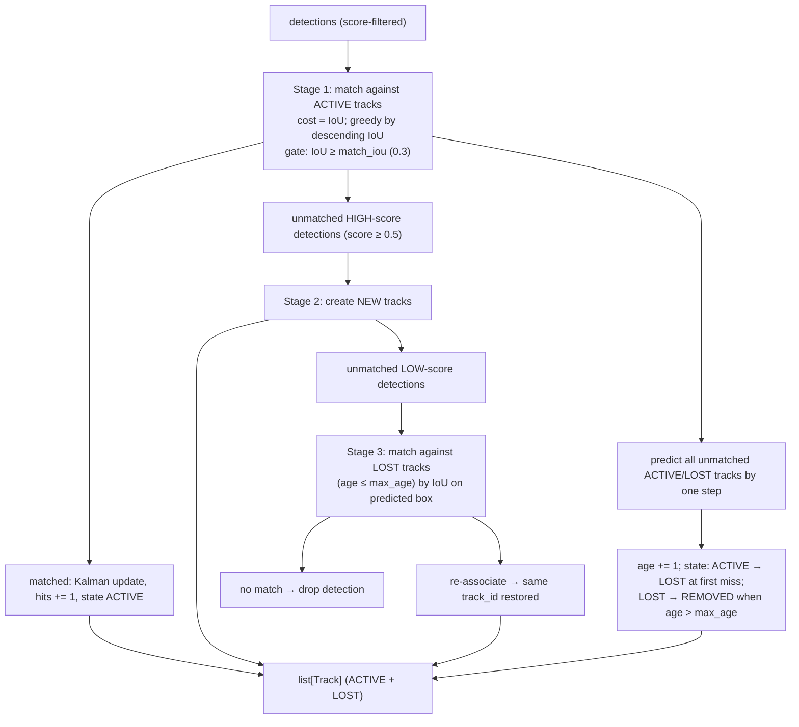
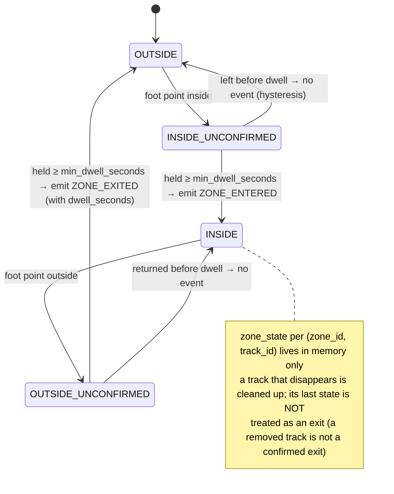
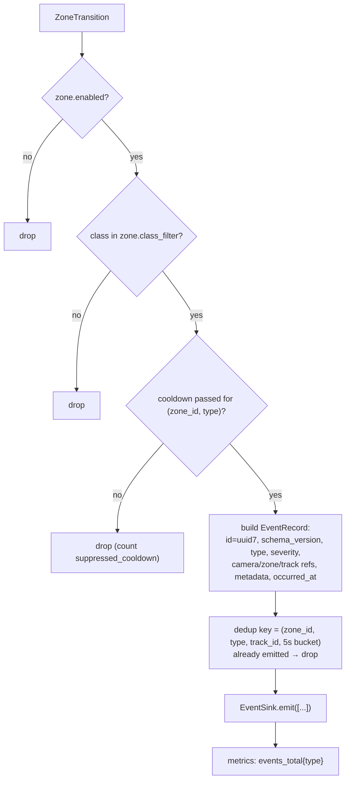
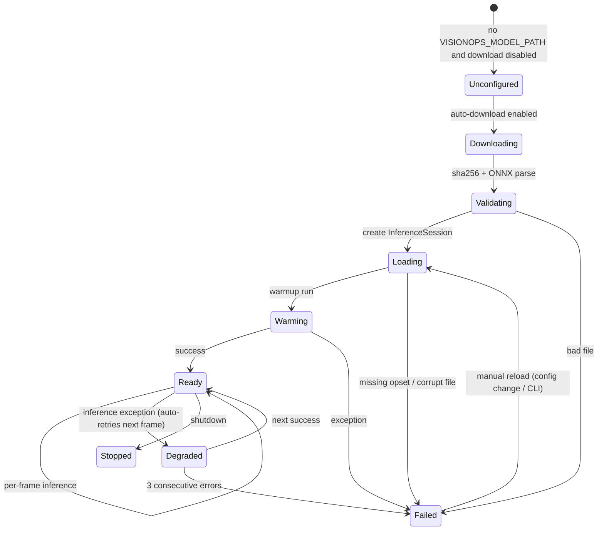

# VisionOps — Vision Engine

> **Scope:** how a frame becomes a `ZONE_ENTERED` event, and how every part of that path is swappable and testable.
> **Golden rule:** this package contains no web framework, no ORM and no network calls. It is a library.

---

## 1. The contract layer

`backend/visionops/vision/contracts.py` defines the entire vocabulary. Everything else in the pipeline is written against these types.

### 1.1 Value types

```python
@dataclass(frozen=True, slots=True)
class BBox:
    """Axis-aligned box in NORMALISED coordinates: (x1, y1, x2, y2), origin top-left."""
    x1: float; y1: float; x2: float; y2: float

    @property
    def width(self) -> float: ...
    @property
    def height(self) -> float: ...
    @property
    def area(self) -> float: ...
    @property
    def center(self) -> tuple[float, float]: ...
    @property
    def foot_point(self) -> tuple[float, float]:
        """(cx, y2) — the ground-contact estimate used for zone tests (§5)."""

@dataclass(frozen=True, slots=True)
class Detection:
    class_id: int
    label: str
    confidence: float
    box: BBox            # normalised
    frame_seq: int = 0
    clip: bool = False   # touches a frame edge → foot point unreliable

@dataclass(frozen=True, slots=True)
class Track:
    track_id: int
    label: str
    confidence: float
    box: BBox
    velocity: tuple[float, float]
    state: TrackState            # ACTIVE | LOST | REMOVED
    first_seen_seq: int
    last_seen_seq: int
    age_frames: int
    hits: int
    clip: bool

@dataclass(frozen=True, slots=True)
class Frame:
    image: np.ndarray            # BGR uint8, HxWx3, the ORIGINAL decoded resolution
    seq: int                     # monotonic per session
    timestamp: float             # unix seconds (source clock for browser sources)
    width: int
    height: int

@dataclass(frozen=True, slots=True)
class ZoneTransition:
    kind: TransitionKind        # ENTERED | EXITED
    zone_id: str
    zone_name: str
    track_id: int
    box: BBox
    foot_point: tuple[float, float]
    dwell_seconds: float | None
    severity: str

@dataclass(frozen=True, slots=True)
class SourceHealth:
    state: SourceState          # STOPPED|STARTING|RUNNING|DEGRADED|FAILED
    reason_code: str | None     # e.g. CAMERA_BUSY, RTSP_TIMEOUT, MODEL_ERROR
    detail: str | None          # human-readable, actionable, never a stack trace
    fps: float
    frames: int
    dropped: int
    retries: int
    uptime_seconds: float
    position: float | None      # for file sources
    duration: float | None
```

### 1.2 Interfaces

```python
class VisionModel(Protocol):
    """Anything that turns a frame into detections."""
    @property
    def info(self) -> ModelInfo: ...            # name, version, sha256, classes, input size, provider
    def warmup(self, iterations: int = 1) -> None: ...
    def infer(self, frame: Frame) -> list[Detection]: ...

class Tracker(Protocol):
    def update(self, detections: Sequence[Detection], ts: float) -> list[Track]: ...
    def reset(self) -> None: ...
    @property
    def active_count(self) -> int: ...

class ZoneStrategy(Protocol):
    kind: ClassVar[str]
    def evaluate(self, tracks: Sequence[Track], zone: ZoneSpec, ctx: EvalContext) -> list[ZoneTransition]: ...

class EventSink(Protocol):
    """Where events go. The pipeline never knows the concrete implementation."""
    def emit(self, events: Sequence[EventRecord]) -> None: ...
    def publish_state(self, state: PipelineState) -> None: ...
    def close(self) -> None: ...
```

`ModelInfo` records `sha256` of the loaded weights so a session's events can be attributed to an exact model file (reproducibility, and the foundation of the future model registry).

---

## 2. Frame processing

```mermaid
flowchart LR
  A["Frame (BGR uint8, original resolution)"] --> B{"Inference FPS budget"}
  B --|"not due"| X["drop (dropped++)"]
  B --|"due"| C["Letterbox to model input"]
  C --> D["/255, CHW, NCHW batch, float32"]
  D --> E["onnxruntime.infer"]
  E --> F["Decode raw output → candidates"]
  F --> G["Score threshold"]
  G --> H["Class allow-list"]
  H --> I["NMS (IoU, class-aware)"]
  I --> J["Rescale to normalised frame coords<br/>(undo letterbox)"]
  J --> K["list[Detection]"]
  K --> L["Tracker.update"] --> M["list[Track]"]
  M --> N["ZoneStrategy.evaluate"] --> O["list[ZoneTransition]"]
  O --> P["EventEngine.handle"] --> Q["list[EventRecord]"]
```

### 2.1 Preprocessing (`vision/preprocess.py`)

- **Letterbox** (scale + pad, aspect preserved) rather than a naive stretch. Stretching distorts people and measurably degrades small-object detection; letterboxing keeps the geometry honest and makes the inverse transform exact.
- Interpolation: `cv2.INTER_LINEAR` (fast, adequate). `INTER_AREA` when downscaling by > 2× is a cheap accuracy win for wide-angle cameras — implemented and configurable.
- Padding value `114` (the YOLO convention) so the model does not see an artificial hard edge.
- Normalisation: `/255.0`, then `CHW → NCHW`, `float32`, no mean/std subtraction (matches the YOLO export).
- **Amortisation:** the output buffer is allocated once per pipeline and reused. Zero-copy `np.ascontiguousarray` on a pre-allocated array.

Inverse transform (detection → normalised frame coordinates):

```python
scale = min(input_w / frame_w, input_h / frame_h)     # letterbox scale
pad_x = (input_w - frame_w * scale) / 2
pad_y = (input_h - frame_h * scale) / 2
x_norm = (x_px - pad_x) / (frame_w * scale)
y_norm = (y_px - pad_y) / (frame_h * scale)
```

Rounding to 4 decimals keeps JSON payloads small without visible drift.

### 2.2 Inference (`vision/onnx_model.py`)

- One `onnxruntime.InferenceSession` per process, created once, shared across sessions, guarded by a lock (ORT sessions are thread-safe for `Run`; the lock also prevents CPU oversubscription).
- **Provider selection** via config: `CPUExecutionProvider` (default), `CUDAExecutionProvider`, `CoreMLExecutionProvider`, and it is validated at load — if an unavailable provider is requested we fall back to CPU and *say so* in `ModelInfo` and the log, rather than crashing.
- **Warmup:** one synthetic frame run at startup so the first real frame is not 3× slower (lazy graph allocation, kernel selection). Measured in the startup log.
- **Class map:** read from the ONNX model's own metadata (`names` custom metadata key, standard in YOLO exports). No hard-coded COCO list, so fine-tuned models with classes like `forklift`, `hi_visor` or `helmet` work with zero code change.
- **Shape contract:** input `[1, 3, H, W]` float32; output `[1, 4+C, N]` (`xywh` + per-class scores) for YOLO v8/v11 exports. Other layouts (e.g. `[1, N, 4+C]`) are detected from the tensor shape and handled by a dedicated decoder — a deliberate small amount of flexibility rather than a general-purpose graph parser.
- **Failure:** an inference exception is caught by the pipeline, which sets the session to `DEGRADED` with `MODEL_ERROR`, increments `inference_errors_total`, and retries on the next frame. Three consecutive failures → `FAILED` (the operator sees the error; the loop keeps running so recovery is automatic).

### 2.3 Post-processing (`vision/postprocess.py`)

```
raw tensor → transpose to per-detection rows → for each row:
    score, class = max(class_scores)
    if score < confidence_threshold: skip
    if class_filter and class not in class_filter: skip
    convert xywh (cx, cy, w, h) in input pixels → xyxy
→ NMS per class (greedy, IoU threshold nms_iou_threshold)
→ inverse letterbox → normalised BBox, clamped to [0,1]
→ Detection(class_id, label, confidence, box, clip=edge-touching)
```

`clip` is computed here: a box whose `x1/y1/x2/y2` is within 1e-6 of 0 or 1, or that exceeded the frame bounds before clamping, is flagged. Clipped tracks are excluded from zone transitions (see §5.3) — this single check removes a whole class of phantom entry/exit events at doorways and image borders.

**NMS is our own** (ADR-007) and is unit-tested against a hand-computed IoU matrix, including the class-aware behaviour (two different classes at the same place both survive).

---

## 3. Confidence thresholds

There is no universal right number; there is a defensible process.

| Threshold | Default | Meaning | How to choose |
| --- | --- | --- | --- |
| `confidence_threshold` | `0.35` | Minimum detection score to become a track candidate | Raise for busy/noisy scenes; lower for small/far people. Documented per deployment. |
| `nms_iou_threshold` | `0.45` | NMS suppression IoU | Lower → keep more overlapping boxes (crowds); higher → suppress more (ghosts). |
| `zone.min_dwell_seconds` | `0.5` | Hysteresis before an entry/exit is emitted | Prevents a person standing on the boundary from flapping. Raise to 1–2 s in windy outdoor scenes. |
| `zone.cooldown_seconds` | `10` | Minimum gap between two identical events for the same zone | Anti-storm. Raise for high-traffic zones. |
| `tracker.max_age` | `30` frames | Frames a lost track is kept for re-association | Higher = fewer duplicate IDs, more ghost occupancy. |

**Calibration procedure** (documented in `docs/TESTING.md` and `README`): record 10 minutes of representative footage, note the alert rate with defaults, then adjust one threshold at a time and record both the alert rate and missed entries. Publish the result per site; `docs/PRD.md` §33 makes the resulting false-positive-per-hour rate the number we optimise for, because that is what operators actually feel.

---

## 4. Object classes

- The detector is **class-agnostic**. `class_filter` (`["person"]` by default) is configuration, not code.
- Class names come from model metadata (see §2.2). A missing/unparseable `names` metadata falls back to `class_<id>` with a warning — the system still runs.
- Zone `class_filter` restricts which classes can trigger a zone: a forklift-only yard zone filters to `["forklift", "truck"]` when a suitable model is installed.
- **No facial-attribute or biometric models** are supported or shipped (ADR-018). A model containing face classes is rejected by default class filtering.

---

## 5. Tracking

### 5.1 Algorithm (`vision/tracker.py` + `vision/kalman.py`)

Constant-velocity Kalman filter per track over the box state `(x1, y1, x2, y2, vx1, vy1, vx2, vy2)` in normalised coordinates, with **box-size-aware measurement noise** (larger boxes are measured more precisely — this single detail removes a lot of jitter on small distant objects).

Update cycle, per frame:



Two-stage association is the core of ByteTrack-style tracking and it is what keeps a person's ID alive while a detector momentarily drops them (a very common case: a person partially behind a pillar, or motion blur). Stage 3's use of the **predicted** box rather than the last observed box is what recovers IDs after a brief occlusion.

Initialisation is deliberately conservative: a new track needs `min_hits = 3` frames before it is reported as ACTIVE. Until then it exists but cannot cause a zone event, which prevents a single-frame false positive from creating a `ZONE_ENTERED`.

**Why normalised coordinates for the filter:** motion in normalised space is scale-invariant, so the same tuning works for a 320×240 fixture and a 4K camera, and Kalman covariances mean the same thing everywhere.

### 5.2 Track IDs

- IDs are **integers starting at 1 per session** (`SessionTracker`), never persisted, never reused across sessions.
- They are ephemeral by design (privacy, ADR-018/§39 PRD): track 12 in session A has no relationship to track 12 in session B, and nothing in the system can link them.
- The ID space resets when a session restarts. Events store the ID together with `session_id`, so the pair is interpretable and nothing more.

### 5.3 Occlusion, blur, low light — honest failure modes

| Condition | Effect | Mitigation implemented | Residual risk |
| --- | --- | --- | --- |
| **Partial occlusion** (pillar) | Detector loses the box for a few frames | Two-stage association + predicted box + `max_age` | Long or total occlusion → new ID → possible duplicate `ZONE_ENTERED` |
| **Total occlusion** | ID genuinely cannot be preserved | None possible without re-identification (which we refuse, ADR-018) | Event engine cooldown prevents alert storms; a `duplicate_entry` suppression key reduces repeats |
| **Crowd overlap** | NMS merges boxes; IDs swap | Lower NMS IoU, higher `max_age`, dwell hysteresis | Very dense crowds (≳ 6 overlapping people) remain unreliable — documented, not hidden |
| **Motion blur** | Confidence drops | Detections survive as low-score stage-2/3 matches | Genuine motion blur can drop people entirely |
| **Low light / night** | Misses and false negatives | Documented; `confidence_threshold` is per-camera; IR cameras are the real fix | Significant degradation; we measure and publish it rather than claiming otherwise |
| **Backlight / glare / rain** | False positives | NMS + cooldown + per-zone class filter | Some irreducible false positives |
| **Small / distant people** | Missed at 640 input width | Per-camera `input_width` setting (320/512/640/960) | Trade CPU for accuracy per camera — an explicit operator choice |
| **Person partly outside the frame** | Foot point is biased | `clip` flag suppresses transitions for clipped boxes | A person half-outside the frame is genuinely ambiguous |
| **Camera shake / rolling shutter** | Geometry jitter | Kalman smoothing | Extreme cases |
| **Inference slower than capture** | Staleness | Frame dropping (never queueing) + `frame_age_ms` surfaced in the UI | Events are late, never wrong — the correct trade for live monitoring |

**False positives** are controlled at four independent levels: score threshold, NMS, class filter, and per-zone cooldown. **False negatives** are controlled by `input_width`, `confidence_threshold` and `max_age`, and are measured per site (§3) rather than assumed away.

---

## 6. Zones

### 6.1 Representation

```python
@dataclass(frozen=True, slots=True)
class ZoneSpec:
    zone_id: str
    name: str
    kind: str                      # "polygon" (V0.1) | "line" (NEXT)
    points: tuple[tuple[float, float], ...]   # normalised, ≥3, CCW or CW (either is fine for even-odd)
    severity: str                  # info | warning | critical
    class_filter: frozenset[str]
    cooldown_seconds: float
    min_dwell_seconds: float
    enabled: bool
```

A rectangle is a 4-point polygon. The UI's drag tool emits four points; the data model has one concept. This is why "restricted zone" can become "L-shaped walkway" with no migration.

### 6.2 Point-in-polygon

Even-odd (ray casting) over normalised coordinates:

```python
def point_in_polygon(pt, polygon) -> bool:
    x, y = pt
    inside = False
    n = len(polygon)
    j = n - 1
    for i in range(n):
        xi, yi = polygon[i]; xj, yj = polygon[j]
        if (yi > y) != (yj > y):
            x_cross = xi + (y - yi) * (xj - xi) / (yj - yi)
            if x < x_cross:
                inside = not inside
        j = i
    return inside
```

Exact, deterministic, no dependency, unit-tested against unit-square/point/on-edge/outside cases and a self-intersecting bowtie (which behaves mathematically consistently, as documented).

### 6.3 Entry, exit, dwell — the state machine



Consequences, stated plainly:

- A person who walks into a zone and is instantly lost by the tracker produces **no** `ZONE_EXITED`. We do not invent events. Their last known state is simply dropped. This is deliberate: a phantom exit is worse than a missing one, because it corrupts occupancy and dwell analytics.
- Dwell is measured from the **confirmed entry** to the **confirmed exit**, in seconds, from the pipeline clock.

### 6.4 Line zones (`NEXT`, interface reserved)

`ZoneStrategy` is a registry (`ZONE_STRATEGIES = {"polygon": PolygonZoneStrategy}`). The line strategy detects the sign change of `cross(direction, foot_point − point_on_line)` between frames — which also yields a **direction** (`forward`/`backward`) and therefore supports one-way gates. The `kind` column and `CHECK` constraint already admit `line`; only the strategy class and the UI editor are missing.

### 6.5 Distance and mask strategies (`FUTURE`)

Registered the same way; a distance-belt strategy (point-to-line distance) is a trivial addition, and a segmentation-mask strategy (IoU between the person's mask and the zone) is available for customers who need true area semantics and have the compute budget.

---

## 7. Event generation

`vision/event_engine.py`:



- **Cooldown** is per `(zone_id, type)`: entering zone A never suppresses entering zone B, and an entry never suppresses an exit.
- **Dwell hysteresis** lives in the zone strategy (§6.3); cooldown is a second, independent gate in the event engine. Two gates with different failure modes: one handles boundary flapping per track, the other handles alert storms across tracks.
- **Idempotency:** `EventRecord.id` is a client-generated UUIDv7. Two sinks receiving the same record (e.g. DB and hub) agree on identity; edge replication later dedupes on the same key.

---

## 8. Model loading and lifecycle



- Loading is **lazy but eager at startup**: the API loads the model during lifespan so the first session does not pay a 5–10 s penalty; if loading fails the API still starts and reports `ai.state = FAILED` with an actionable reason (never a blank dashboard).
- The SHA-256 is computed once at load and surfaced in `ModelInfo`, System Status, and every event's metadata.
- **Model replacement without restart** (`NEXT`): a `reload()` on the `VisionModel` plus a session restart. The registry makes this a config change plus one API call.

---

## 9. Failure handling (the full list)

| Failure | Detection | Session state | Operator sees | Recovery |
| --- | --- | --- | --- | --- |
| Camera busy | `cv2` returns `CAP_NOT_OPEN` | `DEGRADED` `CAMERA_BUSY` | "Camera /dev/video0 is busy — close other apps using it" | Exponential backoff retry (1, 2, 4, 8… max 30 s, N attempts) |
| Camera unplugged mid-run | `read()` returns `None`/error | `DEGRADED` then `FAILED` `SOURCE_CLOSED` | Source failure banner + reason | Auto-reopen attempts; `FAILED` after the limit |
| RTSP timeout | `CAP_PROP_READ_TIMEOUT_MSEC` | `DEGRADED` `RTSP_TIMEOUT` | "RTSP read timed out after 5 s" | Retry with backoff |
| Bad RTSP credentials | Open returns false | `FAILED` `SOURCE_AUTH` | "RTSP rejected credentials (check the source credentials)" | Manual fix |
| No frames (frozen camera) | `last_frame_age > 10 s` | `DEGRADED` `SOURCE_STALLED` | "No new frames for 12 s" | Retry reopen |
| Model missing | Load raises | `FAILED` `MODEL_MISSING` | "No model at ./models/yolo11n.onnx — run `make model`" | Load on next session start |
| Model corrupt | ONNX parse fails | `FAILED` `MODEL_CORRUPT` | "Model file is not a valid ONNX graph" | Replace file, reload |
| Inference error | Exception in `Run` | `DEGRADED` `MODEL_ERROR` | "Inference failed 2× in a row: <short reason>" | Auto-retry; `FAILED` after 3 |
| OOM / RSS growth | Health check + metrics | `DEGRADED` `RESOURCE_PRESSURE` | "Memory above 1.5 GB — reduce target_fps" | Operator action (or auto-reduce FPS at Phase 2) |
| Disk full on snapshot | Write raises | stays `RUNNING`, snapshot skipped | "Snapshot failed: no space left" | Retention/prune job; event still recorded |
| Database locked | Session commit raises | stays `RUNNING`, event queued then dropped after 3 retries | "Event write retried 3× — events may be missing" | `busy_timeout`; Postgres in production |
| WS client slow | Queue full | n/a (client state) | "Live updates stale" badge | Drop-oldest, client re-syncs via REST |

**Principle:** the pipeline never dies for a data-plane problem. It reports, and it tries to recover. A process-level crash is a bug, not a design behaviour.

---

## 10. Performance

Budget on a 4 vCPU CPU-only host (yolo11n, 640×640 input, 5 target FPS, single session) — **measured numbers are published in `docs/benchmarks.md` with methodology; the table below is the budget, not a claim**:

| Stage | Budget | Notes |
| --- | --- | --- |
| Decode (browser JPEG / file) | ≤ 25 ms | 640×360 |
| Letterbox + pack | ≤ 5 ms | Reused buffers |
| ONNX inference | ≤ 90 ms | yolo11n @ 640 on 4 modern vCPU |
| NMS + filter | ≤ 2 ms | NumPy |
| Track update | ≤ 1 ms | ≤ 30 tracks |
| Zone evaluate | ≤ 1 ms | ≤ 10 zones |
| Event write + publish | ≤ 15 ms | Occasional |
| **Total per processed frame** | **≤ 140 ms** | → ≥ 7 FPS single-stream headroom at 5 FPS target |

Levers when the budget is exceeded, in the order the operator should reach for: lower `target_fps` → smaller `input_width` → higher `confidence_threshold` (fewer boxes) → GPU provider → move the camera to an edge node (Phase 7). Never: unbounded queues (they convert slowness into wrongness).

---

## 11. Testing the vision engine

- **Deterministic logic:** `FakeDetector` scripted per frame returns exact detections. Tests assert exact track IDs, exact transition sequences, exact event counts. No randomness, no tolerance, no flakiness.
- **Geometry:** hand-computed cases for IoU, letterbox round-trip (the inverse transform must be exact to 1e-6), point-in-polygon, dwell hysteresis, cooldown suppression.
- **Tracker:** scripted sequences for ID persistence through a 3-frame occlusion, ID switch on crossing, new-track creation, `max_age` expiry.
- **Event engine:** dedup, cooldown independence across zones, severity mapping, metadata completeness.
- **Pipeline:** fixture video for decode/rate-control/lifecycle; a `FailingModel` fake for `MODEL_ERROR`; a `SlowModel` fake for frame-drop accounting; a `FailingSource` for source failure.
- **Real model (marker-gated):** `@pytest.mark.model` — run a real ONNX model on a fixture and assert that a person-shaped figure is detected when the environment provides weights. **Skipped, never faked**, when weights are absent (`visionops/../models/*.onnx` or `VISIONOPS_TEST_MODEL`). The test also asserts the checksum of the model it used, so a result is never ambiguous.
- **Import-graph guard:** a test asserts `vision/` imports no FastAPI/SQLAlchemy/network module, keeping the CV core embeddable.

---

## 12. Extending the engine

1. Add your class implementing the relevant `Protocol` in `vision/`.
2. Register it in `vision/registry.py` (one line).
3. Write its tests under `tests/unit` or `tests/cv` — including a scripted deterministic case.
4. Document it in this file under the relevant section.
5. If it needs configuration, add it to `config.py` with a default, and to `.env.example`.
6. Never import it from `api/` directly — go through the registry.

Candidate extensions in priority order for the roadmap: real ByteTrack (`class ByteTracker`), distance-belt zone strategy, line zone strategy, segmentation-mask zone strategy, TensorRT/NPU model adapter, ROI-of-interest inference (skip inference outside configured regions — a large CPU saving for wide scenes).
